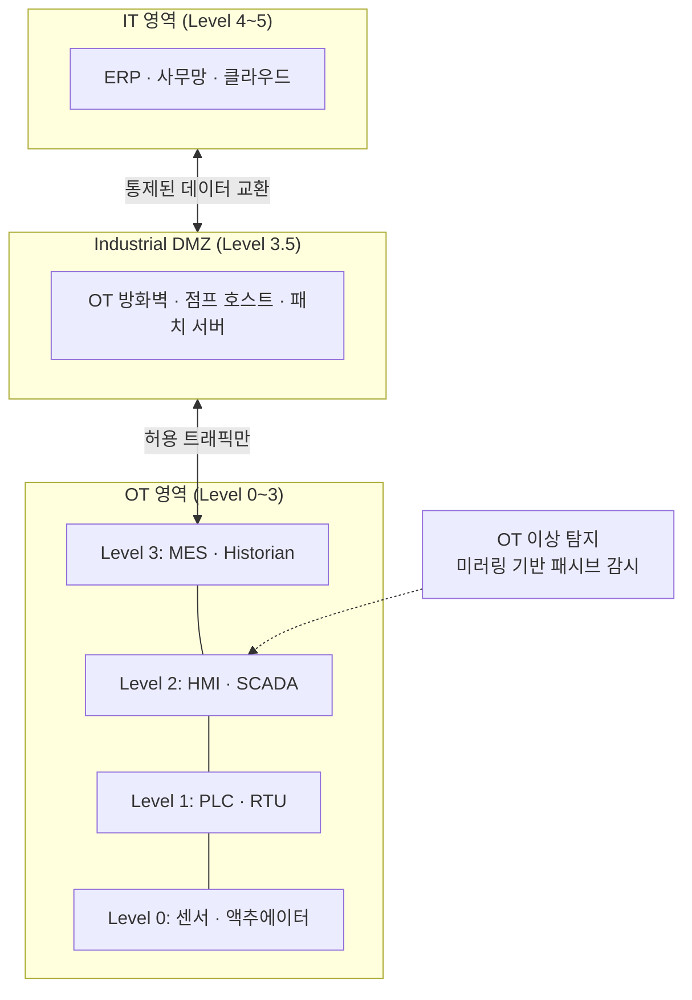

# 스마트팩토리 보안취약점 및 대응방안

---

## I. IT·OT 융합 제조망 보호, 스마트팩토리 보안의 개요

### 가. 정의

- 폐쇄망이던 **OT(운영기술) 제어망이 IT망·클라우드와 연결되면서 생기는 위협으로부터 생산 설비의 가용성과 안전을 지키는** IT·OT 융합 보안 체계

### 나. 취약점 및 필요성

| 구분 | 내용 |
| --- | --- |
| 가용성 우선 | 제어망 마비 시 생산 중단, 설비 손상, 인명·환경 피해 |
| 공격 표면 확대 | IIoT, [[5G 특화망]], 원격 유지보수 접점 증가 |
| 레거시 자산 | 패치가 어려운 구형 OS(Windows XP·7), 15~20년 운용 설비 |
| 평문 프로토콜 | Modbus, Profinet 등 인증·암호화 없는 산업용 [[프로토콜]] |
| 랜섬웨어 | IT망 감염이 OT망으로 확산되어 공장 가동 중단 |

---

## II. 보안 아키텍처 및 대응 기술

### 가. 퍼듀 모델 기반 계층 구조

- IT와 OT 사이에 iDMZ를 두어 직접 통신을 막고, OT 내부는 가용성에 영향이 없는 패시브 감시와 구역(Zone)·통로(Conduit) 분할 적용

### 나. 대응 기술

| 구분 | 요소 | 설명 |
| --- | --- | --- |
| 표준 | [[IEC 62443]] | 산업제어시스템 보안 표준, Zone·Conduit 및 보안 수준(SL) 정의 |
| 네트워크 | 망 분할 | 공정·설비 단위 구역 분할로 확산 차단 |
| | 일방향 게이트웨이 | 데이터 다이오드로 OT → IT 단방향 전송 |
| 접근 통제 | 원격 접근 통제 | 유지보수 업체 접속을 점프 호스트·ZTNA로 승인·기록 |
| 가시성 | 패시브 자산 식별 | SPAN 미러링으로 부하 없이 자산·통신 관계 파악 |
| | 산업 프로토콜 DPI | Modbus·DNP3·OPC UA 명령 수준 이상 탐지 |
| 단말 | 화이트리스트 | 허가된 프로세스만 실행 (패치 불가 레거시 보호) |
| | 이동식 매체 통제 | USB 검역 키오스크 |
| 검증 | [[디지털 트윈]] | 가상 공장에서 패치·침해 시나리오 사전 검증 |

---

## III. 비교 및 동향

### 가. IT 보안 vs OT 보안

| 비교 항목 | IT 보안 | OT 보안 |
| --- | --- | --- |
| 우선순위 | 기밀성 > 무결성 > 가용성 | 가용성 > 무결성 > 기밀성 |
| 침해 영향 | 데이터 유출, 금전 손실 | 생산 중단, 물리적 사고 |
| 자산 수명 | 3~5년 | 15~20년 |
| 패치 | 정기·즉시 적용 | 정비 기간에만 제한적 적용 |
| 프로토콜 | [[TCP]]/IP, HTTPS 등 표준 | Modbus, Profinet 등 벤더 특화·평문 |
| 실시간성 | 지연 허용 | 밀리초 단위 결정적 응답 |

### 나. 동향

- **IT·OT 통합 관제**: OT 전용 탐지와 [[XDR]]·[[SOAR (Security Orchestration, Automation and Response)|SOAR]]를 연계한 통합 SOC
- **공급망 보안**: 설비 도입 시 [[SBOM]] 요구, IEC 62443-4-1 기반 보안 개발 생명주기
- **규제 강화**: EU NIS2 지침·사이버 복원력법(CRA)으로 제조·제품 보안 의무 확대

---

### 🔗 연관 토픽

- **소속 도메인**: [[00_보안_MOC|🛡️ 보안]]
- **세부 분류**: `1. 정보보안 원칙 & 거버넌스 · 인증`
- **핵심 연관 토픽**:
  - [[IEC 62443]]
  - [[CPS]]
  - [[공급망 공격|공급망 공격(Supply Chain Attack)]]
  - [[디지털 트윈의 보안 취약점 및 대응방안]]
  - [[랜섬웨어]]
