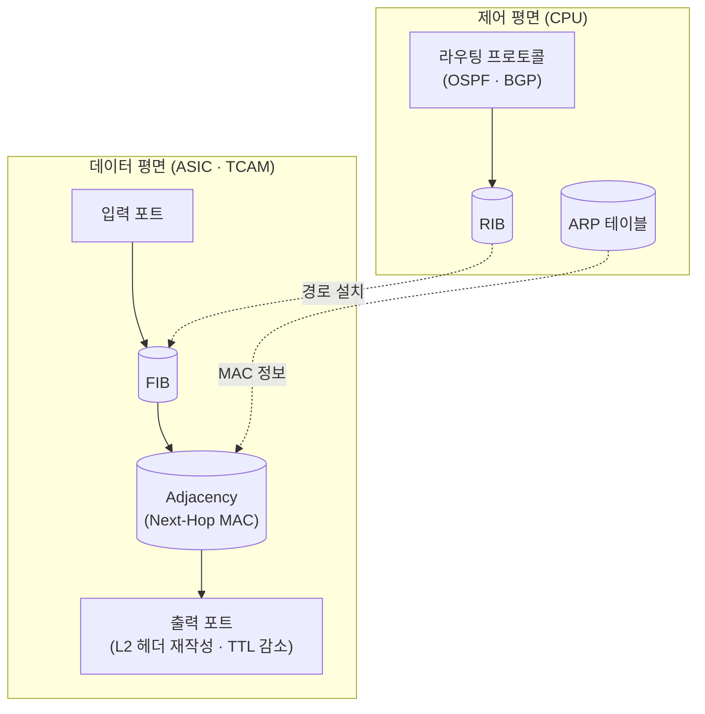

# L3 스위치 (Layer 3 Switch)

---

## I. 스위칭 속도로 라우팅하는, L3 스위치의 개요

### 가. 정의

- L2 스위칭과 **IP 주소 기반 L3 라우팅을 한 장비에 통합하고, 라우팅을 ASIC·TCAM 하드웨어로 Wire-Speed 처리**하는 스위치

### 나. 특징 및 필요성

| 구분 | 내용 |
| --- | --- |
| Inter-VLAN 라우팅 | VLAN 간 통신을 외부 [[라우터]] 없이 장비 내부에서 처리 |
| 브로드캐스트 분리 | 서브넷·VLAN 단위로 브로드캐스트 도메인 분할 |
| 하드웨어 포워딩 | 첫 패킷부터 FIB·Adjacency 테이블로 ASIC 처리 |
| 고밀도 포트 | 다수 이더넷 포트, 라우터보다 포트당 비용 낮음 |

---

## II. 구조 및 구성요소

### 가. 제어·데이터 평면 구조

- CPU가 만든 RIB·ARP 정보를 하드웨어 FIB·Adjacency 테이블로 내려, 패킷은 CPU를 거치지 않고 조회·헤더 재작성 후 전달

### 나. 구성요소

| 구분 | 요소 | 설명 |
| --- | --- | --- |
| 하드웨어 | ASIC | 파싱·조회·헤더 재작성 로직을 하드웨어로 구현 |
| | TCAM | 0·1·X 3상태로 최장 접두사 일치·ACL을 한 번에 검색 |
| 포워딩 | FIB | RIB에서 선택된 최적 경로만 담은 하드웨어 포워딩 테이블 |
| | Adjacency Table | Next-Hop의 MAC 주소 등 L2 재작성 정보 |
| | CEF | Cisco의 FIB·Adjacency 기반 토폴로지 중심 포워딩 방식 |
| 인터페이스 | SVI | VLAN에 IP를 부여한 가상 인터페이스, VLAN의 기본 [[게이트웨이]] 역할 |
| | Routed Port | 물리 포트를 L3 인터페이스로 사용 |
| [[가상화]] | VRF | 라우팅 테이블을 논리 분할해 테넌트 격리 |
| [[프로토콜]] | 동적 라우팅 | OSPF, IS-IS, [[BGP]] |

---

## III. 비교 및 동향

### 가. L3 스위치 vs 라우터

| 비교 항목 | L3 스위치 | 라우터 |
| --- | --- | --- |
| 주 용도 | LAN·데이터센터 내부, Inter-VLAN | WAN·인터넷 경계, 지사 연결 |
| 처리 | ASIC 고정 파이프라인, 포트당 고속 | NPU·CPU 기반, 기능 유연 |
| 테이블 규모 | TCAM 용량에 제한 | 인터넷 전체 경로 수용 가능 |
| 인터페이스 | 고밀도 이더넷 | 이더넷 외 WAN 인터페이스 |
| 부가 기능 | ACL, [[QoS]] | NAT, [[VPN]], 대규모 [[BGP]] 정책, 방화벽 |

### 나. 동향

- **Spine-Leaf L3 패브릭**: Leaf까지 L3 라우팅을 내리고 ECMP로 이중화
- **VXLAN·EVPN 오버레이**: L3 언더레이 위에서 L2 세그먼트를 확장해 멀티테넌트 지원
- **개방형 장비**: Whitebox + SONiC 등 오픈 NOS, P4 기반 INT 텔레메트리

---

### 🔗 연관 토픽

- **소속 도메인**: [[00_네트워크_MOC|🌐 네트워크]]
- **세부 분류**: `1. OSI 7계층 & 데이터링크 계층 (L1/L2)`
- **핵심 연관 토픽**:
  - [[스위치]]
  - [[라우터]]
  - [[네트워크 계층|네트워크 계층 (Network Layer)]]
  - [[스위치 이중화]]
  - [[BGP|BGP(Border Gateway Protocol)]]
