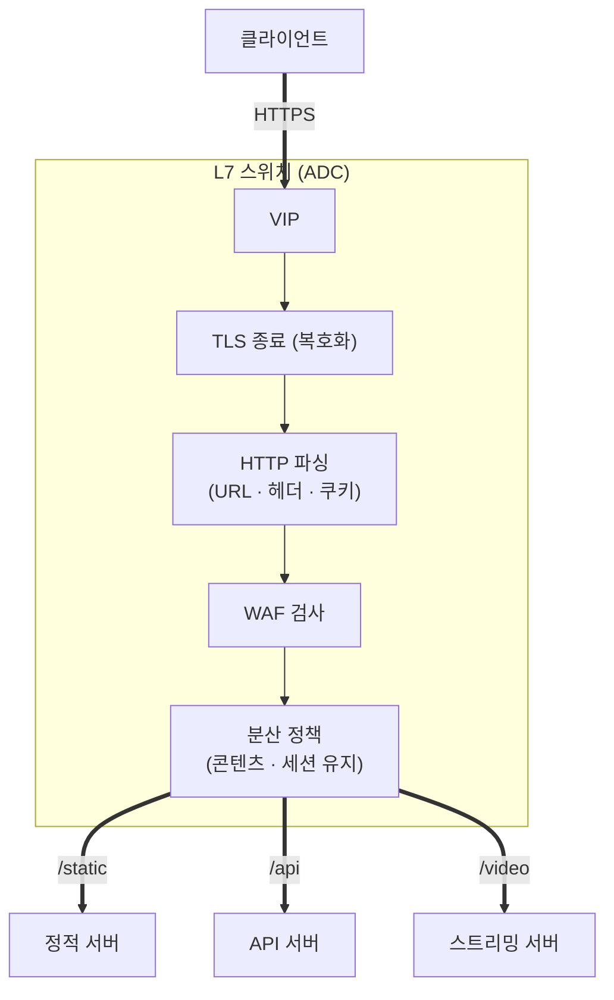

# L7 스위치 (Layer 7 Switch)

---

## I. 내용을 보고 나누는, L7 스위치의 개요

### 가. 정의

- HTTP 헤더·URL·[[쿠키]] 등 **응용 계층 정보를 해석해 요청을 적절한 서버로 분산**하고, SSL 오프로드·캐싱·보안 기능을 함께 제공하는 장비 (ADC, Application Delivery Controller)

### 나. 특징 및 필요성

| 구분 | 내용 |
| --- | --- |
| L4의 한계 | IP·포트만으로는 콘텐츠 종류별 서버 분리 불가 |
| 콘텐츠 기반 분산 | URL·헤더·쿠키 기준으로 서버 그룹 선택 |
| 프록시 동작 | 클라이언트와 TCP 연결을 종료하고 서버와 별도 연결 |
| 서버 부하 경감 | SSL/TLS 처리, 압축, 캐싱을 대신 수행 |
| 보안 통합 | WAF, Rate Limiting |

---

## II. 구조 및 구성요소

### 가. 처리 흐름

- VIP로 들어온 HTTPS를 복호화해 요청 내용을 검사한 뒤 정책에 맞는 백엔드로 새 연결을 맺어 전달

### 나. 구성요소

| 구분 | 요소 | 설명 |
| --- | --- | --- |
| 분석 | HTTP 파싱 · DPI | 헤더, URL, 쿠키, 페이로드 식별 |
| 분산 | 콘텐츠 기반 라우팅 | 경로·확장자·호스트명별 서버 그룹 선택 |
| | 세션 지속성 (Sticky Session) | 쿠키·Session ID로 같은 서버에 고정 ([[세션]]) |
| 성능 | SSL 오프로드 | TLS [[암호화]]·복호화를 대신 처리해 서버 [[CPU]] 절감 |
| | 캐싱 · 압축 | 정적 콘텐츠 캐싱, gzip 압축 |
| 보안 | WAF | [[SQL(Structured Query Language)\|SQL]] 인젝션, [[XSS]] 등 OWASP Top 10 공격 차단 |
| | Rate Limiting | 클라이언트별 요청 수 제한, L7 [[DDOS\|DDoS]] 완화 |
| [[HA(High Availability)\|가용성]] | L7 헬스 체크 | HTTP 요청에 대한 정상 응답(200 OK)으로 서비스 상태 확인 |

---

## III. 비교 및 동향

### 가. L4 스위치 vs L7 스위치

| 비교 항목 | L4 스위치 | L7 스위치 |
| --- | --- | --- |
| 기준 계층 | [[전송 계층]] | 응용 계층 |
| 판단 기준 | IP, [[TCP]]/UDP 포트 | URL, HTTP 헤더, 쿠키 |
| 동작 | 연결 단위 NAT 전달 | 리버스 프록시 (연결 종료 후 재연결) |
| 처리 부하 | 낮음 | 높음 (파싱·TLS 처리) |
| 주요 기능 | TCP/UDP 부하 분산 | 콘텐츠 분산, SSL 오프로드, WAF |
| 방어 대상 | SYN Flooding 등 L3/L4 공격 | SQL 인젝션, XSS 등 웹 공격 |

### 나. 동향

- **소프트웨어 ADC**: 어플라이언스에서 NGINX·HAProxy·Envoy 기반 소프트웨어로, [[쿠버네티스]] Ingress·Gateway API로 이동
- **서비스 메시**: [[MSA (Micro Service Architecture)|MSA]] 내부 East-West 트래픽을 사이드카·eBPF 기반 프록시로 L7 제어, mTLS 적용
- **API 보안 강화**: 정상 API 호출 패턴 학습 기반의 이상 탐지 WAF·API 보안 기능 결합

---

### 🔗 연관 토픽

- **소속 도메인**: [[00_네트워크_MOC|🌐 네트워크]]
- **세부 분류**: `1. OSI 7계층 & 데이터링크 계층 (L1/L2)`
- **핵심 연관 토픽**:
  - [[스위치]]
  - [[스위치 (Layer 3 Switch)]]
  - [[세션]]
  - [[쿠키]]
  - [[게이트웨이]]
