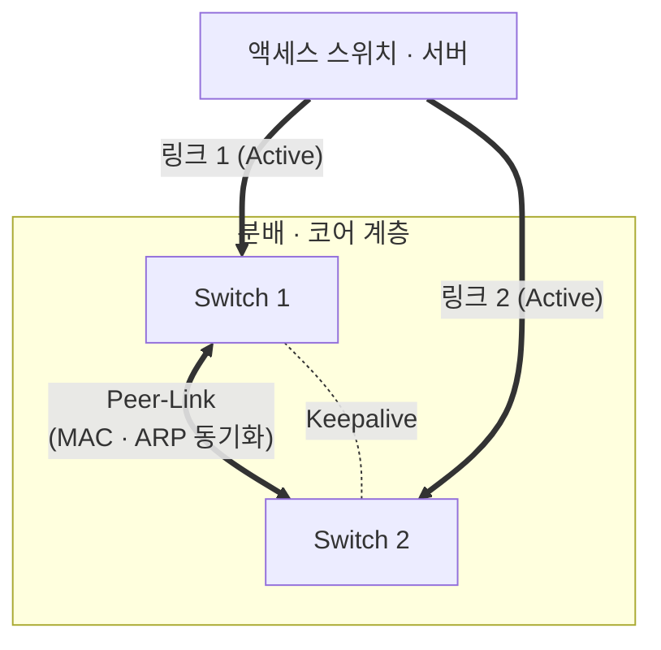

# 스위치 이중화 (Switch Redundancy)

---

## I. 한 대가 죽어도 망은 산다, 스위치 이중화의 개요

### 가. 정의

- 스위치와 링크를 **두 개 이상으로 구성해 단일 장애점(SPOF)을 제거하고, 장애 시 우회 경로로 서비스를 유지**하는 네트워크 [[HA(High Availability)|고가용성]] 구성

### 나. 필요성 및 특징

| 구분 | 내용 |
| --- | --- |
| 가용성 | 장비 고장·링크 단선 시 우회 경로로 서비스 유지 |
| 대역폭 | 다중 링크를 묶어 대역 확장·부하 분산 |
| 빠른 복구 | 장애 감지와 경로 전환 시간(수렴 시간) 최소화 |
| 루프 위험 | L2 중복 경로는 루프·브로드캐스트 스톰을 유발하므로 STP·MLAG 등 제어 필요 |

---

## II. 구조 및 핵심 기술

### 가. MLAG 기반 Active-Active 구성

- 하위 장비는 두 대의 상위 스위치를 하나로 보고 LACP로 묶어 연결하므로 STP 차단 포트 없이 두 링크를 모두 사용

### 나. 핵심 기술

| 구분 | 요소 | 설명 |
| --- | --- | --- |
| L2 루프 방지 | STP · RSTP · MSTP | 중복 경로 중 일부를 차단하고 장애 시 개방 (802.1D·802.1w·802.1s) |
| 링크 이중화 | LACP (802.3ad → 802.1AX) | 여러 물리 포트를 논리 링크 하나로 묶음 |
| 게이트웨이 이중화 | FHRP (VRRP · HSRP · GLBP) | 여러 L3 장비가 가상 IP·MAC을 공유해 기본 [[게이트웨이]] SPOF 제거 |
| 장비 통합 | 스태킹 · VSS | 여러 스위치를 제어 평면 하나로 통합해 단일 장비처럼 관리 |
| 멀티 섀시 | MLAG · vPC | 제어 평면은 각자 유지, 링크 묶음만 공유해 Active-Active |
| L3 경로 분산 | ECMP | 같은 비용의 여러 경로로 흐름 단위 분산 |
| 데이터센터 | Spine-Leaf · EVPN-VXLAN | 모든 Leaf가 모든 Spine과 연결, BGP EVPN으로 L2 확장과 멀티호밍 |

---

## III. 비교 및 동향

### 가. STP 기반 vs MLAG 기반 이중화

| 비교 항목 | STP 기반 | MLAG · vPC 기반 |
| --- | --- | --- |
| 동작 | Active-Standby (대기 포트 차단) | Active-Active |
| 대역폭 | 차단 링크는 평시 미사용 | 모든 링크 사용 |
| 복구 시간 | STP 30~50초, RSTP 수 초 이내 | 링크 장애 시 1초 미만 |
| 루프 방지 | 포트 차단 | LACP 묶음 + Peer-Link 규칙 |
| 제어 평면 | 장비별 독립 | 장비별 독립, MAC·[[ARP]] 테이블 동기화 |

### 나. 동향

- **L3 패브릭 전환**: 데이터센터는 STP를 배제하고 ECMP 기반 Spine-Leaf L3 구조로 이중화
- **EVPN 멀티호밍**: MLAG 대신 [[BGP]] EVPN의 ESI 멀티호밍으로 벤더 독립적 Active-Active 구현
- **빠른 장애 감지**: BFD와 텔레메트리로 밀리초 단위 장애 감지, 자동 우회

---

### 🔗 연관 토픽

- **소속 도메인**: [[00_네트워크_MOC|🌐 네트워크]]
- **세부 분류**: `1. OSI 7계층 & 데이터링크 계층 (L1/L2)`
- **핵심 연관 토픽**:
  - [[스위치]]
  - [[스위치 (Layer 3 Switch)]]
  - [[게이트웨이]]
  - [[HA(High Availability)]]
  - [[BGP|BGP(Border Gateway Protocol)]]
