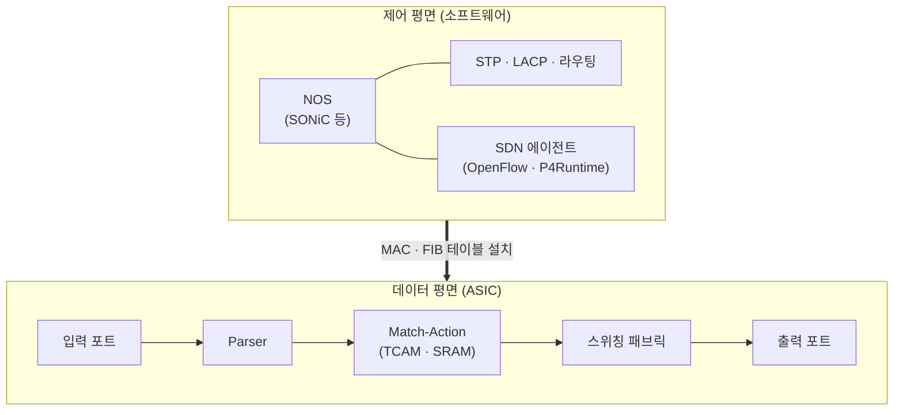

# 스위치 (Network Switch)

---

## I. 필요한 포트로만 보내는, 스위치의 개요

### 가. 정의

- 프레임의 **목적지 주소(L2는 MAC)를 학습한 주소 테이블과 대조해 해당 포트로만 전달**하는 중계 장비. 계층에 따라 L2·L3·L4·L7 스위치로 구분

### 나. 특징 및 필요성

| 구분 | 내용 |
| --- | --- |
| 충돌 도메인 분리 | 허브는 모든 포트로 중계해 충돌이 잦음, 스위치는 포트마다 충돌 도메인 분리 (전이중) |
| 자동 학습 | 출발지 MAC을 학습해 MAC 테이블 구성, 모르는 목적지는 Flooding |
| 하드웨어 처리 | ASIC·TCAM으로 Wire-Speed 전달 |
| 논리 분할 | VLAN으로 브로드캐스트 도메인 분리 |
| 전달 방식 | Store-and-Forward, Cut-Through, Fragment-Free |

---

## II. 구조 및 구성요소

### 가. 스위치 내부 구조

- 제어 평면이 테이블을 만들고, 데이터 평면 ASIC이 헤더 파싱 → 테이블 조회 → 출력 포트 전달을 하드웨어로 수행

### 나. 구성요소

| 구분 | 요소 | 설명 |
| --- | --- | --- |
| 하드웨어 | MAC 테이블 (CAM) | MAC 주소 ↔ 포트 매핑, 정확 일치 검색 |
| | TCAM | 0·1·X(Don't Care) 3상태 메모리로 ACL·최장 접두사 검색을 한 번에 수행 |
| | 스위칭 패브릭 | 포트 간 내부 교환 구조 (Crossbar 등) |
| 논리 분할 | VLAN (802.1Q) | 12비트 VID, 최대 4,094개 브로드캐스트 도메인 |
| | VXLAN | MAC-in-UDP 오버레이, 24비트 VNI로 약 1,600만 세그먼트 |
| 루프 방지 | STP · RSTP | 802.1D·802.1w, 중복 경로를 차단해 브로드캐스트 스톰 방지 |
| 구조 | Spine-Leaf | 데이터센터 East-West 트래픽용 2계층 Clos 토폴로지 |
| 개방형 | Whitebox · P4 | 범용 하드웨어 + 오픈 NOS, 데이터 평면 프로그래밍 |
| AI 네트워크 | RoCEv2 · PFC · ECN | GPU 클러스터 RDMA용 저손실 이더넷 |

---

## III. 비교 및 동향

### 가. 계층별 스위치 비교

| 비교 항목 | L2 | L3 | L4 | L7 |
| --- | --- | --- | --- | --- |
| 판단 기준 | MAC 주소 | IP 주소 | IP + [[TCP]]/UDP 포트 | URL, 헤더, [[쿠키]] |
| 주요 기능 | MAC 학습, 프레임 전달 | 라우팅, Inter-VLAN | 서버 부하 분산(SLB) | 콘텐츠 기반 분산, SSL 오프로드 |
| 동작 | 같은 네트워크 내 전달 | 서브넷 간 전달 | NAT 기반 연결 분산 | 프록시 기반 요청 분산 |
| 상세 노트 | [[스위치 이중화]] | [[스위치 (Layer 3 Switch)\|L3 스위치]] | - | [[스위치 (Layer 7 Switch)\|L7 스위치]] |

### 나. 동향

- **고속화**: AI·클라우드 트래픽 증가로 400G·800G 포트 보급, 51.2T급 스위치 ASIC, 전력 절감을 위한 CPO(광학 모듈을 ASIC 패키지에 통합) 도입
- **AI 전용 이더넷**: InfiniBand 대안으로 Ultra Ethernet Consortium(UEC) 사양 기반 저손실 이더넷 패브릭
- **DPU 오프로드**: 보안·텔레메트리 기능 일부를 서버의 DPU/SmartNIC로 이전해 마이크로 [[세그멘테이션]] 구현

---

### 🔗 연관 토픽

- **소속 도메인**: [[00_네트워크_MOC|🌐 네트워크]]
- **세부 분류**: `1. OSI 7계층 & 데이터링크 계층 (L1/L2)`
- **핵심 연관 토픽**:
  - [[데이터 링크 계층]]
  - [[스위치 (Layer 3 Switch)]]
  - [[스위치 (Layer 7 Switch)]]
  - [[스위치 이중화]]
  - [[SDN(Software Defined Network)]]
