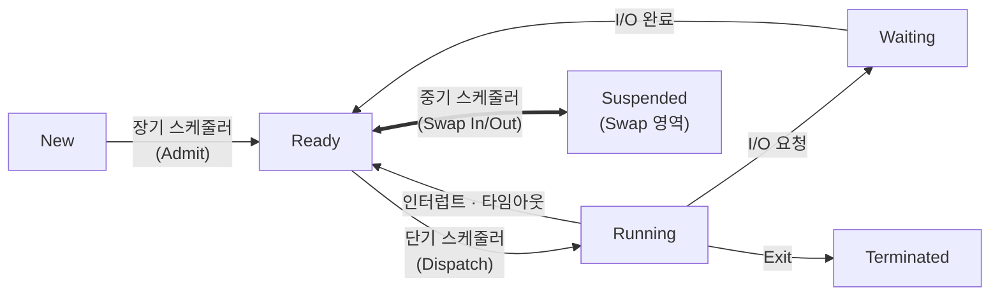

# 스케줄링 (CPU Scheduling) / 스케줄러

---

## I. 한정된 CPU의 효율적 배분, 스케줄링의 개요

### 가. 정의

- 다중 프로그래밍 환경에서 준비 큐(Ready [[Queue]])의 [[프로세스]]·스레드 중 **누구에게, 언제, 얼마나 [[CPU]]를 할당할지 결정**하는 [[OS(운영체제)|운영체제]]의 핵심 기능이며, 이를 수행하는 모듈을 **스케줄러**라 함

### 나. 목적 (평가 기준)

| 구분 | 기준 |
| --- | --- |
| 최대화 | CPU 이용률, [[처리량]](Throughput) |
| 최소화 | 반환 시간, 대기 시간, [[응답시간]] |
| 공정성 | [[기아\|기아(Starvation)]] 방지, 공평한 분배 |

---

## II. 스케줄러 구조 및 알고리즘

### 가. 계층별 스케줄러와 상태 전이

| 스케줄러 | 역할 | 호출 빈도 |
| --- | --- | --- |
| 장기 (Job Scheduler) | 메모리에 적재할 프로세스 결정, 다중 프로그래밍 정도 조절 | 낮음 |
| 중기 (Swapper) | 메모리 부족 시 프로세스를 Swap Out/In | 중간 |
| 단기 (CPU Scheduler) | Ready 큐에서 다음 실행 프로세스 선택 | 매우 높음 |
| 디스패처 (Dispatcher) | 선택된 프로세스에 CPU를 넘기고 [[문맥 교환]] 수행 ([[디스패치]]) | 매우 높음 |

### 나. 주요 스케줄링 알고리즘

| 구분 | 알고리즘 | 설명 |
| --- | --- | --- |
| 비선점 | FCFS | 도착 순서대로 할당, 호위 효과(Convoy Effect) |
| | SJF | 실행 시간이 가장 짧은 작업 우선, 평균 대기 시간 최소 / 긴 작업 기아 |
| | HRN | 우선순위 = (대기 시간 + 실행 시간) / 실행 시간, 에이징으로 SJF 기아 보완 |
| 선점 | RR (Round Robin) | 타임 퀀텀 단위로 교대 실행, 시분할 시스템 |
| | SRT (SRTF) | 남은 실행 시간이 가장 짧은 프로세스 우선 (SJF의 선점형) |
| | 우선순위 | 높은 우선순위 우선, 에이징으로 기아 방지 |
| | MLQ | 성격별(시스템·대화형·배치) 큐 분리, 큐 간 이동 불가 |
| | MLFQ | 큐 간 이동 허용, 하위 큐일수록 퀀텀 증가 → I/O·CPU 바운드 동시 최적화 |
| 리눅스 | CFS | 레드-블랙 트리로 가상 실행 시간(vruntime)이 가장 작은 태스크 우선 |
| | EEVDF | 가상 데드라인 기반, 리눅스 6.6부터 CFS 대체 |
| 하드웨어 | NUMA-Aware, EAS | 메모리 지역성 고려 배치, big.LITTLE 코어 간 전력 효율 배치 |

---

## III. 방식 비교 및 동향

### 가. 선점형 vs 비선점형

| 비교 항목 | 선점형 ([[선점 스케줄링]]) | 비선점형 ([[비선점방식 유형]]) |
| --- | --- | --- |
| CPU 회수 | OS가 강제 회수 가능 | 프로세스가 스스로 반납할 때까지 유지 |
| 문맥 교환 | 잦음 (오버헤드 큼) | 적음 |
| 응답성 | 좋음 (대화형·실시간) | 긴 작업이 독점하면 저하 (일괄 처리) |
| 대표 알고리즘 | RR, SRT, MLFQ, CFS | FCFS, SJF, HRN |

### 나. 동향

- **sched_ext**: 리눅스 6.12부터 eBPF로 커널 재컴파일 없이 워크로드 맞춤 스케줄링 정책을 주입
- **클러스터 스케줄링**: [[쿠버네티스]] kube-scheduler가 리소스·Affinity·Taint를 점수화해 Pod 배치
- **AI 워크로드 스케줄링**: GPU 토폴로지(NVLink·PCIe)와 VRAM을 고려한 작업 배치 (Slurm, Volcano)
- **실시간 시스템**: 데드라인 기반 스케줄링([[기한부 스케줄링]])과 [[우선순위 역전현상]] 대응

---

### 🔗 연관 토픽

- **소속 도메인**: [[00_운영체제_MOC|⚙️ 운영체제]]
- **세부 분류**: `1. 프로세스 & 스레드 관리`
- **핵심 연관 토픽**:
  - [[프로세스 상태 전이도]]
  - [[문맥 교환|문맥 교환 (Context Switching)]]
  - [[선점 스케줄링]]
  - [[기아]]
  - [[OS(운영체제)]]
