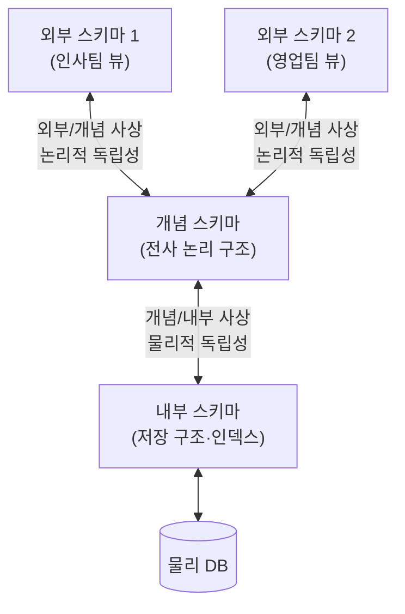

# 스키마 (Schema)

---

## I. 데이터베이스의 설계도, 스키마의 개요

### 가. 정의

- 데이터베이스의 **구조(개체·속성·관계)와 제약조건을 기술한 명세**로, [[DBMS]]가 메타데이터로 관리

### 나. 특징

| 구분 | 내용 |
| --- | --- |
| 데이터 독립성 | 응용 프로그램과 저장 구조 간 결합도 감소 |
| 무결성·보안 | 제약조건·도메인·권한으로 잘못된 데이터와 접근 차단 |
| 시간 불변성 | 자주 바뀌지 않는 구조 정보 (인스턴스는 수시로 변경) |
| 저장 위치 | [[시스템 카탈로그]](데이터 사전)에 저장 |

---

## II. 3단계 스키마 구조

### 가. ANSI/SPARC 3단계 구조

- 사용자·조직·저장 관점을 분리하고 계층 간 사상(Mapping)으로 한 계층의 변경이 다른 계층에 미치는 영향을 줄임

### 나. 구성요소

| 구분 | 요소 | 설명 |
| --- | --- | --- |
| 3단계 | 외부 스키마 | 사용자·응용별로 필요한 부분 구조 (서브스키마, 뷰) |
| | 개념 스키마 | 조직 전체의 개체·관계·제약조건·권한을 통합한 논리 구조, DBA가 관리 |
| | 내부 스키마 | 레코드 형식, 인덱스, 저장 방식 등 물리 구조 |
| 사상 | 외부/개념 사상 | 개념 스키마가 바뀌어도 외부 스키마 유지 → 논리적 독립성 |
| | 개념/내부 사상 | 내부 스키마가 바뀌어도 개념 스키마 유지 → 물리적 독립성 |
| 정의 수단 | [[DDL]] | CREATE·ALTER·DROP으로 스키마 정의·변경 |

---

## III. 비교 및 동향

### 가. Schema-on-Write vs Schema-on-Read

| 비교 항목 | Schema-on-Write | Schema-on-Read |
| --- | --- | --- |
| 적용 환경 | RDBMS, DW | [[NoSQL (CAP 이론 BASE 속성)\|NoSQL]], 데이터 레이크 |
| 스키마 적용 시점 | 저장 시 검증 | 조회 시 해석 |
| 데이터 형태 | 정형 | 정형·반정형·비정형 |
| 장점 | 품질·조회 성능·정합성 | 적재 속도, 유연성 |
| 단점 | 스키마 변경 비용 | 조회 시 해석 부담, 품질 관리 어려움 |

### 나. 동향

- **스키마 진화 관리**: Avro·Protobuf 스키마 레지스트리로 하위 호환성 검증 ([[아파치 카프카]])
- **오픈 테이블 포맷**: Iceberg·Delta Lake가 레이크에서 스키마 진화와 ACID 지원 ([[데이터 레이크하우스]])
- **계약 기반 검증**: [[JSON]] Schema·GraphQL 스키마로 API 간 데이터 계약 명시

---

### 🔗 연관 토픽

- **소속 도메인**: [[00_데이터베이스_MOC|🗄️ 데이터베이스]]
- **세부 분류**: `1. 데이터 모델링 & 관계형 DB 설계`
- **핵심 연관 토픽**:
  - [[ANSI SPARC 모델(3-단계 데이터베이스 구조) 데이터 독립성]]
  - [[시스템 카탈로그]]
  - [[DDL]]
  - [[DBMS]]
  - [[NoSQL (CAP 이론 BASE 속성)]]
