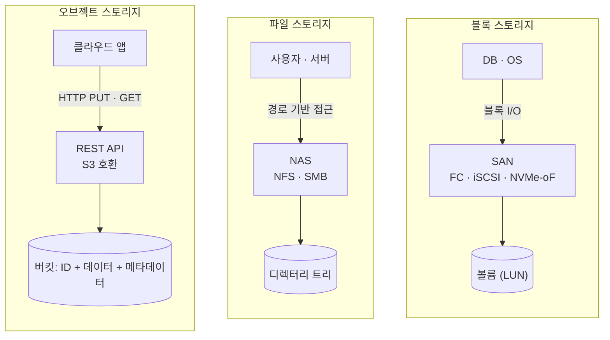

# 스토리지 유형 (블록, 파일, 오브젝트 스토리지)

---

## I. 데이터를 다루는 단위에 따른, 스토리지 유형의 개요

### 가. 정의

- 데이터를 **블록(고정 크기 조각)·파일(계층 경로)·오브젝트(ID + 데이터 + 메타데이터)** 중 어떤 단위로 저장·접근하느냐에 따라 나눈 스토리지 분류

### 나. 필요성 및 특징

| 구분 | 내용 |
| --- | --- |
| 워크로드 적합 | DB는 저지연 블록, 문서 공유는 파일, 대용량 비정형 데이터는 오브젝트 |
| 비정형 데이터 증가 | 이미지·영상·로그 증가로 대규모 확장이 쉬운 오브젝트 스토리지 확대 |
| [[클라우드 네이티브]] | [[컨테이너]] 환경에서 CSI로 볼륨을 동적 할당 |

---

## II. 구조 및 구성요소

### 가. 유형별 구조

- 블록은 호스트가 파일시스템을 직접 올리는 볼륨, 파일은 서버가 파일시스템을 공유, 오브젝트는 평면 주소 공간에 API로 접근

### 나. 구성요소

| 구분 | 요소 | 설명 |
| --- | --- | --- |
| 블록 | SAN | FC 또는 IP(iSCSI) 기반 전용 스토리지 네트워크 |
| | NVMe-oF | 네트워크 너머에서도 NVMe 명령을 써서 지연 최소화 |
| | LUN / 볼륨 | 호스트에 디스크처럼 보이는 논리 단위 |
| 파일 | [[NAS]] | LAN에 연결된 파일 서버, 여러 클라이언트가 공유 |
| | NFS / SMB | 유닉스·리눅스 / 윈도우 계열 파일 공유 [[프로토콜]] |
| | 계층 메타데이터 | 디렉터리 경로·파일 속성으로 탐색 |
| 오브젝트 | 평면 주소 공간 | 버킷 안에 고유 키로 저장, 계층 탐색 병목 없음 |
| | 확장 메타데이터 | 사용자 정의 속성·보존 정책 저장 |
| | REST API (S3) | HTTP 기반 PUT·GET·DELETE |

---

## III. 비교 및 동향

### 가. 블록 vs 파일 vs 오브젝트

| 비교 항목 | 블록 | 파일 | 오브젝트 |
| --- | --- | --- | --- |
| 데이터 구조 | 고정 크기 블록 | 디렉터리·파일 | ID + 데이터 + 메타데이터 |
| 프로토콜 | FC, iSCSI, NVMe-oF | NFS, SMB | HTTP(S) REST, S3 |
| 장점 | 높은 IOPS, 낮은 지연 | 공유·관리 쉬움 | 거의 무제한 확장, 저비용 |
| 한계 | 여러 호스트 공유 시 클러스터 파일시스템 필요 | 대규모에서 메타데이터 병목 | 부분 수정 어려움(객체 단위 덮어쓰기), 지연 큼 |
| 적합 워크로드 | RDBMS, VM 디스크, 부팅 볼륨 | 사내 파일 공유, 홈 디렉터리 | 백업·아카이브, 미디어, 데이터 레이크 |
| 클라우드 예 | AWS EBS | AWS EFS | AWS S3 |

### 나. 동향

- **통합 SDS**: Ceph처럼 하나의 소프트웨어 정의 스토리지가 블록(RBD)·파일(CephFS)·오브젝트(RGW)를 함께 제공
- **AI 학습 스토리지**: 병렬 파일시스템(Lustre, GPFS)과 올플래시 S3 호환 오브젝트 스토리지, GPUDirect Storage 확산
- **[[쿠버네티스]] CSI**: 벤더 중립 인터페이스로 PV·PVC를 동적 프로비저닝

---

### 🔗 연관 토픽

- **소속 도메인**: [[00_컴퓨터구조_MOC|💻 컴퓨터구조]]
- **세부 분류**: `2. 캐시 & 메모리 계층 구조 · 스토리지`
- **핵심 연관 토픽**:
  - [[NAS]]
  - [[RAID]]
  - [[이레이저 코딩|이레이저 코딩(erasure coding)]]
  - [[쿠버네티스|쿠버네티스(Kubernates)]]
  - [[클라우드 네이티브]]
