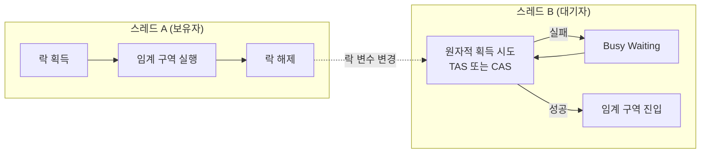

# 스핀락 (Spin Lock)

---

## I. 잠들지 않고 기다리는 락, 스핀락의 개요

### 가. 정의

- 임계 구역에 들어갈 수 없을 때 스레드가 **CPU를 내놓지 않고 반복문을 돌며(Busy Waiting) 락이 풀릴 때까지 계속 확인**하는 동기화 기법

### 나. 특징

| 구분 | 내용 |
| --- | --- |
| 장점 | 잠들고 깨어나는 [[문맥 교환]] 비용이 없음 → 대기가 문맥 교환 비용보다 짧을 때 유리 |
| 단점 | 기다리는 동안 CPU를 낭비, 오래 기다리면 성능 저하 |
| 적용 환경 | 멀티프로세서(SMP), 잠들 수 없는 [[커널]] 문맥(인터럽트 핸들러 등) |
| 단일 코어 | 락 보유자가 실행돼야 풀리므로 스핀은 무의미, 선점 금지 상태에서 스핀하면 교착 |

---

## II. 동작 구조 및 구성요소

### 가. 스핀락 동작 개념도

- 스레드 B는 잠들지 않고 원자적 연산으로 락 변수를 반복 확인하다가 A가 해제하는 즉시 획득

### 나. 구성요소

| 구분 | 요소 | 설명 |
| --- | --- | --- |
| 원자적 연산 | TAS (Test-And-Set) | 값을 읽고 1로 쓰는 동작을 하나의 원자적 명령으로 수행 |
| | CAS (Compare-And-Swap) | 현재 값이 기대값과 같을 때만 새 값으로 교체, 락프리 자료구조에도 사용 |
| 대기 최적화 | TTAS (Test-and-Test-And-Set) | 먼저 일반 읽기로 확인 후 비어 있을 때만 TAS → 캐시 라인 무효화 트래픽 감소 |
| | PAUSE 명령 (x86) | 스핀 루프 전력 소모와 루프 탈출 시 파이프라인 비용 감소 |
| 공정성 | 티켓 스핀락 | 번호표 순서대로 획득, [[기아\|기아(Starvation)]] 방지 |
| 확장성 | MCS 락 | 대기자를 큐로 연결해 각자 자기 노드만 스핀, 캐시 라인 경합(Cache Bouncing) 감소 |
| | qspinlock | MCS를 4바이트 락 변수에 압축한 Linux 기본 스핀락 (4.2부터) |

---

## III. 비교 및 동향

### 가. 스핀락 vs 뮤텍스

| 비교 항목 | 스핀락 | 뮤텍스 |
| --- | --- | --- |
| 대기 방식 | Busy Waiting | 대기 큐에서 Sleep |
| 문맥 교환 | 없음 | 있음 |
| 대기 중 CPU | 계속 사용 | 사용 안 함 |
| 유리한 임계 구역 | 매우 짧음 (마이크로초 이하) | 김 |
| 사용 문맥 | 커널 인터럽트 핸들러, 드라이버 | 사용자 모드 애플리케이션, 잠들 수 있는 커널 코드 |

### 나. 동향

- **적응형 락**: Linux mutex의 낙관적 스핀, Solaris adaptive mutex, Java 락처럼 보유자가 실행 중이면 잠시 스핀하고 아니면 Sleep
- **가상화 환경**: vCPU가 락을 쥔 채 선점되면 다른 vCPU의 스핀이 낭비(Lock Holder Preemption) → paravirtual spinlock, PAUSE-Loop Exiting으로 완화
- **PREEMPT_RT**: 실시간 커널에서는 대부분의 spinlock_t를 잠들 수 있는 rt_mutex 기반으로 바꿔 지연 시간 축소

---

### 🔗 연관 토픽

- **소속 도메인**: [[00_운영체제_MOC|⚙️ 운영체제]]
- **세부 분류**: `1. 프로세스 & 스레드 관리`
- **핵심 연관 토픽**:
  - [[경쟁조건 해결 방안]]
  - [[세마포어]]
  - [[모니터 동기화|모니터/Monitor 동기화]]
  - [[캐시 일관성]]
  - [[인터럽트|인터럽트 (Interrupt)]]
