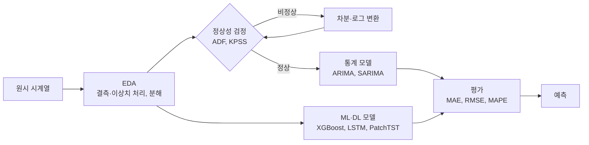

# 시계열분석 (Time Series Analysis)

---

## I. 시간 순서 데이터로 미래를 예측하는, 시계열분석의 개요

### 가. 정의

- 시간 순서로 관측된 데이터의 **추세·계절성 등 패턴과 시점 간 의존성을 분석해 미래 값을 예측**하는 기법

### 나. 특징

| 구분 | 내용 |
| --- | --- |
| 구성 요소 | 추세(Trend), 계절성(Seasonality), 순환(Cycle), 불규칙(Noise)으로 분해 |
| 자기상관 | 현재 값이 과거 값과 상관, 표본 독립 가정 불성립 |
| 정상성 | 평균·분산이 일정하고 자기공분산이 시차에만 의존 (ARIMA 계열의 전제) |
| 발전 | 통계 모델(ARIMA) → [[딥러닝]]([[LSTM (Long Short-Term Memory)\|LSTM]]) → [[트랜스포머]]·시계열 [[파운데이션 모델]] |

---

## II. 분석 절차 및 핵심 기술

### 가. 분석 절차

- 통계 모델은 정상성 확보 후 차수 결정, ML·DL 모델은 시차·달력 특성 등을 입력으로 학습하며 시간 순서를 지킨 검증(Time-series CV) 필요

### 나. 핵심 기술

| 구분 | 요소 | 설명 |
| --- | --- | --- |
| 정상성 | ADF·KPSS 검정 | ADF는 단위근 존재(비정상)가 귀무가설, KPSS는 정상성이 귀무가설 |
| | 차분 | $y_t - y_{t-1}$로 추세 제거, 계절 차분으로 계절성 제거 |
| 차수 결정 | ACF·PACF | MA 차수 q는 ACF 절단점, AR 차수 p는 PACF 절단점으로 판단 |
| 통계 모델 | ARIMA(p,d,q) | 자기회귀(AR) + 차분(I) + 이동평균(MA), SARIMA는 계절 항 추가 |
| | 지수평활 (ETS) | 최근 관측에 큰 가중치, Holt-Winters로 추세·계절 반영 |
| 라이브러리 | Prophet | Meta 개발, 추세·계절성·휴일 효과의 가법 모델 |
| 딥러닝 | LSTM·GRU | 게이트로 장기 의존성 학습 ([[RNN (Recurrent Neural Network)\|RNN]] 개선) |
| | PatchTST | 시계열을 패치 단위 토큰으로 나눠 Transformer에 입력, 채널 독립 처리 |
| 유사도 | DTW | 시간 축이 어긋난 두 시계열의 [[유사도]] 측정 |

---

## III. 비교 및 동향

### 가. 모델 세대 비교

| 비교 항목 | 통계 모델 | ML·딥러닝 모델 | 시계열 파운데이션 모델 |
| --- | --- | --- | --- |
| 대표 | ARIMA, SARIMA, ETS, VAR | XGBoost, LSTM, PatchTST | Chronos(Amazon), TimesFM(Google), Moirai(Salesforce), TimeGPT(Nixtla) |
| 특징 | 선형, 정상성 가정 | 비선형·다변량 관계 학습 | 대규모 시계열 사전학습, 제로샷 예측 |
| 장점 | 해석 용이, 소량 데이터 | 복잡한 패턴·외생 변수 활용 | 개별 학습 없이 즉시 예측 |
| 한계 | 비선형·장기 패턴 표현 한계 | 데이터·튜닝 비용 | 도메인 특화 데이터에서 성능 편차, 미세조정 필요 |

### 나. 동향

- **시계열 파운데이션 모델**: 다양한 도메인 시계열로 사전학습한 모델이 제로샷 예측을 제공, 미세조정으로 도메인 적응
- **시공간 모델**: 교통·전력 수요 예측에서 그래프 신경망으로 공간 관계와 시간 의존성을 함께 모델링
- **LLM 활용**: 시계열을 토큰화하거나 LLM 임베딩에 맞게 재프로그래밍해 예측·[[이상 감지]]에 활용하는 연구 (Time-LLM 등)

---

### 🔗 연관 토픽

- **소속 도메인**: [[00_인공지능_MOC|🤖 인공지능]]
- **세부 분류**: `1. 수학 · 통계학 & 데이터 전처리`
- **핵심 연관 토픽**:
  - [[LSTM (Long Short-Term Memory)]]
  - [[RNN (Recurrent Neural Network)]]
  - [[파운데이션 모델|파운데이션 모델(Foundation Model)]]
  - [[이상 감지]]
  - [[회귀분석|회귀분석(Regression Analysis)]]
