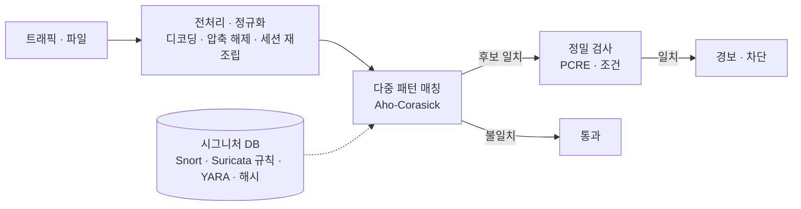

# 시그니처 탐지기법 (Signature-based Detection)

---

## I. 알려진 위협을 빠르고 정확하게, 시그니처 탐지의 개요

### 가. 정의

- 알려진 악성코드·공격의 **고유 패턴(문자열, 바이트 열, 해시, 규칙)을 DB로 만들어 입력 트래픽·파일과 대조**하여 위협을 탐지하는 기법 (오용 탐지, Misuse Detection)

### 나. 특징

| 구분 | 내용 |
| --- | --- |
| 낮은 오탐 | 명확한 패턴 일치 시에만 탐지 |
| 고속 처리 | 다중 패턴 매칭 알고리즘으로 실시간 처리 |
| 설명 용이 | 어떤 규칙에 걸렸는지 명확 |
| 미탐 한계 | 신종·변종·제로데이는 탐지 불가 |
| 유지 부담 | 시그니처 DB를 지속 갱신해야 함 |

---

## II. 동작 구조 및 구성요소

### 가. 탐지 엔진 구조

- 정규화로 우회 인코딩을 풀고, 다중 패턴 매칭으로 후보를 고른 뒤 정규식·조건으로 최종 판정

### 나. 구성요소

| 구분 | 요소 | 설명 |
| --- | --- | --- |
| 매칭 알고리즘 | Aho-Corasick | 트라이 기반으로 여러 패턴을 한 번에 검색 |
| | Boyer-Moore | 단일 패턴을 건너뛰며 빠르게 검색 |
| 패턴 표현 | 정규표현식 (PCRE) | 가변 패턴 정의 |
| | 해시 매칭 | 파일 해시(SHA-256)·퍼지 해시(ssdeep)로 식별 |
| 규칙 언어 | Snort·Suricata 규칙 | 네트워크 IDS/IPS 탐지 규칙 |
| | YARA | 파일·메모리 악성코드 분류 규칙 |
| 전처리 | 정규화 | URL 인코딩·Base64·[[난독화]] 해제 |
| | DPI | L7 페이로드까지 검사 |
| 갱신 | [[CTI]] 연계 | STIX/TAXII로 위협 지표(IoC) 수집 |

---

## III. 비교 및 동향

### 가. 시그니처 탐지 vs 이상 탐지

| 비교 항목 | 시그니처 탐지 | 이상·행위 탐지 |
| --- | --- | --- |
| 기준 | 알려진 악성 패턴 | 정상 기준선에서의 이탈 |
| 대상 | 알려진 공격 | 미지·제로데이 공격 |
| 오탐 | 낮음 | 높음 |
| 미탐 | 신종에 높음 | 상대적으로 낮음 |
| 자원 | 상대적으로 적음 | 학습·프로파일링 부담 |

### 나. 동향

- **하이브리드 탐지**: [[EDR(Endpoint Detection and Response)|EDR]]·[[XDR]]에서 시그니처·[[휴리스틱 탐지기법|휴리스틱]]·[[행위기반 탐지기법|행위 기반]]을 계층 결합
- **샌드박스 연계 자동 시그니처**: [[샌드박스]] 분석으로 악성 판정된 파일의 해시·YARA 규칙을 즉시 배포
- **LLM 기반 규칙 작성**: [[CVE]] 공지·패킷 샘플로 탐지 규칙 초안을 생성하고 분석가가 검증

---

### 🔗 연관 토픽

- **소속 도메인**: [[00_보안_MOC|🛡️ 보안]]
- **세부 분류**: `2. 현대 암호학 & 키 관리 · 전자서명`
- **핵심 연관 토픽**:
  - [[휴리스틱 탐지기법|휴리스틱 탐지기법 (Heuristic Detection)]]
  - [[행위기반 탐지기법|행위기반 탐지기법 (Behavior-based Detection)]]
  - [[샌드박스|샌드박스 (Sandbox)]]
  - [[CTI]]
  - [[EDR(Endpoint Detection and Response)]]
