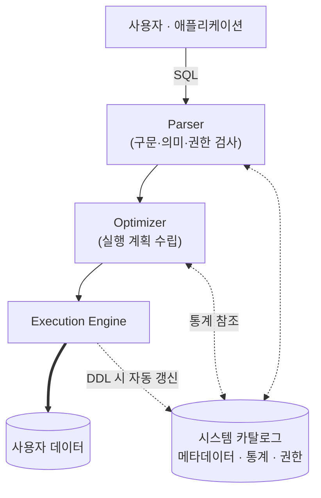

# 시스템 카탈로그 (System Catalog)

---

## I. DB 메타데이터 저장소, 시스템 카탈로그의 개요

### 가. 정의

- [[DBMS]]가 관리하는 테이블·뷰·인덱스·제약조건·사용자 권한 등 **모든 객체의 메타데이터(Data about Data)를 저장하는 시스템 데이터베이스** (데이터 사전, Data Dictionary)

### 나. 특징

| 구분 | 내용 |
| --- | --- |
| 자동 갱신 | [[DDL]](CREATE, ALTER, DROP) 실행 시 DBMS가 스스로 갱신 |
| 읽기 전용 | 사용자는 SELECT로 조회만 가능, 직접 INSERT·UPDATE·DELETE 불가 |
| 자기 기술성 | DB가 자신의 구조를 스스로 설명 (Self-Describing) |
| 최적화 기반 | 비용 기반 [[OPTIMIZER\|옵티마이저]]가 참조하는 통계 정보 제공 |

---

## II. 동작 구조 및 구성요소

### 가. 카탈로그 참조 구조

### 나. 저장 정보

| 구분 | 요소 | 설명 |
| --- | --- | --- |
| 객체 정보 | 테이블·컬럼·인덱스·뷰 | 이름, 데이터 타입, 길이, 뷰 정의, 인덱스 대상 속성 ([[스키마]]) |
| 무결성 | 제약조건 | PK, FK, UNIQUE, CHECK ([[데이터베이스 무결성]]) |
| 보안 | 사용자·권한 | 계정, 롤, GRANT/REVOKE 권한 ([[DCL]]) |
| 통계 | Statistics | 행 수, 블록 수, 값 분포, 선택도 |
| 표준 인터페이스 | Information Schema | ANSI SQL 표준 카탈로그 뷰 |
| 사용자 뷰 | 시스템 뷰 | Oracle 기준 DBA_xxx(전체), ALL_xxx(접근 가능), USER_xxx(본인 소유) |
| 물리 정보 | 데이터 디렉터리 | 카탈로그의 실제 저장 위치 (시스템만 접근) |

---

## III. 비교 및 동향

### 가. 시스템 카탈로그 vs 사용자 데이터베이스

| 비교 항목 | 시스템 카탈로그 | 사용자 데이터베이스 |
| --- | --- | --- |
| 저장 내용 | 메타데이터 (구조·통계·권한) | 실제 업무 데이터 |
| 갱신 주체 | DBMS (DDL 시 자동) | 사용자·애플리케이션 ([[DML]]) |
| 사용자 접근 | 조회만 가능 | CRUD 가능 |
| 장애 영향 | DBMS 전체 질의 불가 | 해당 데이터에 한정 |

### 나. 동향

- **분산 카탈로그**: Snowflake, [[CockroachDB]] 등은 [[합의 알고리즘]](Raft) 기반 독립 메타데이터 계층으로 확장성 확보
- **엔터프라이즈 데이터 카탈로그**: 단일 DB를 넘어 전사 데이터 자산의 메타데이터를 통합 관리하는 [[데이터 거버넌스]] 플랫폼으로 확장
- **액티브 메타데이터**: 사용 이력에 ML을 적용해 민감정보 자동 태깅, 데이터 계보(Lineage) 추적, 품질 이상 탐지

---

### 🔗 연관 토픽

- **소속 도메인**: [[00_데이터베이스_MOC|🗄️ 데이터베이스]]
- **세부 분류**: `1. 데이터 모델링 & 관계형 DB 설계`
- **핵심 연관 토픽**:
  - [[DBMS]]
  - [[자료 사전]]
  - [[스키마]]
  - [[OPTIMIZER]]
  - [[데이터 거버넌스]]
