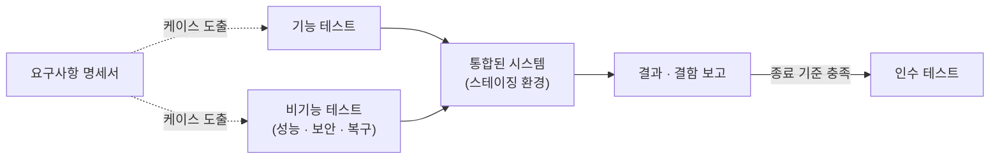

# 시스템 테스트 (System Testing)

---

## I. 통합된 전체 시스템의 요구 충족 검증, 시스템 테스트의 개요

### 가. 정의

- 통합이 끝난 **전체 시스템이 요구사항 명세(기능·비기능)를 충족하는지 운영과 유사한 환경에서 검증**하는 테스트 레벨

### 나. 특징

| 구분 | 내용 |
| --- | --- |
| 종단 간 검증 | 모듈 단위를 넘어 업무 흐름 전체를 검증 |
| 환경 유사성 | 운영과 유사한 스테이징 환경에서 수행 |
| 독립 수행 | 개발팀과 분리된 테스트 조직이 주로 수행 |
| 관문 역할 | [[인수 테스트]] 진입 전 최종 품질 확인 |

---

## II. 수행 구조 및 구성요소

### 가. 수행 구조

- 요구사항 명세에서 기능·비기능 케이스를 도출해 스테이징 환경의 통합 시스템에 수행하고, 종료 기준 충족 시 인수 테스트로 이관

### 나. 구성요소

| 구분 | 요소 | 설명 |
| --- | --- | --- |
| 접근 | [[블랙박스 테스트]] | 내부 구조 대신 명세 기준 입출력 검증 |
| 기능 | 기능 테스트 | 업무 규칙·데이터 처리·종단 간 업무 흐름 |
| 비기능 | [[성능 테스트]] | [[응답시간]]·[[처리량]]·동시 사용자 목표 확인 |
| | 스트레스 테스트 | 한계 초과 부하에서 동작·저하 양상 확인 |
| | 보안 테스트 | 접근 통제, 취약점 점검, 침투 테스트 |
| | 복구 테스트 | 장애 주입 후 목표 시간(RTO) 내 복구 확인 |
| | [[사용성 평가\|사용성]] · 호환성 | 사용 편의, 브라우저·단말 호환 |
| 품질 유지 | [[리그레션 테스트\|회귀 테스트]] | 결함 수정 후 기존 기능 재검증 |
| 환경 | 스테이징 환경 | 운영과 같은 구성·데이터 특성의 시험 환경 |

---

## III. 비교 및 동향

### 가. 테스트 레벨 비교 (V-모델)

| 비교 항목 | [[단위 테스트\|단위]] | [[통합 테스트\|통합]] | 시스템 | 인수 |
| --- | --- | --- | --- | --- |
| 기준 문서 | 상세 설계 | 아키텍처 설계 | 요구사항 명세 | 사용자 요구·계약 |
| 주체 | 개발자 | 개발자·통합 담당 | 독립 테스트 조직 | 사용자·고객 |
| 주 기법 | [[화이트박스 테스트\|화이트박스]] | 화이트·블랙박스 | 블랙박스 | 블랙박스 (알파·베타) |
| 목적 | 모듈 논리 결함 | 인터페이스 결함 | 전체 요구 충족 | 업무 적용 가능성 판단 |

### 나. 동향

- 요구사항에서 LLM으로 시나리오·스크립트 생성, 결함 원인 분석 보조
- [[카오스 엔지니어링]]으로 운영·스테이징 환경의 회복력 검증 (Shift-Right)
- 성능·보안 테스트를 CI/CD에 내장한 지속적 테스트

---

### 🔗 연관 토픽

- **소속 도메인**: [[00_소프트웨어공학_MOC|🏗️ 소프트웨어공학]]
- **세부 분류**: `3. 요구사항 공학 & UML 객체지향 분석/설계`
- **핵심 연관 토픽**:
  - [[통합 테스트]]
  - [[인수 테스트]]
  - [[블랙박스 테스트]]
  - [[성능 테스트]]
  - [[소프트웨어 테스트|소프트웨어 테스트 (Software Test)]]
