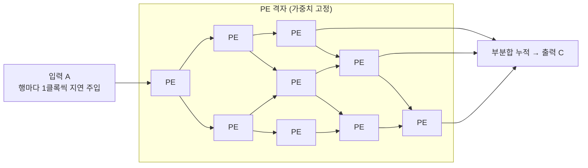

# 시스톨릭 어레이 (Systolic Array)

---

## I. 심장 박동처럼 데이터를 흘리는 행렬 연산 구조, 시스톨릭 어레이의 개요

### 가. 정의

- 격자로 배열된 [[PE]]들이 **클록마다 이웃 PE로 데이터를 넘기며 곱셈·누산을 반복**해, 한 번 읽은 데이터를 여러 번 재사용하는 병렬 연산 구조 (H. T. Kung, 1978)

### 나. 특징

| 구분 | 내용 |
| --- | --- |
| 데이터 재사용 | 메모리에서 한 번 읽은 값이 여러 PE를 거치며 사용, 메모리 대역폭 요구 감소 |
| 규칙적 흐름 | 인접 PE 간 짧은 배선만 사용, 클록 동기 파이프라인 |
| 단순 제어 | PE마다 같은 연산 반복, 명령 해독·스케줄링 부담 작음 |
| 특화 | 행렬 곱(GEMM)·합성곱에 최적, 범용성은 낮음 |

---

## II. 구조 및 구성요소

### 가. 데이터 흐름 (3×3, Weight Stationary 예)

- 가중치는 PE에 미리 적재, 입력은 왼쪽에서 오른쪽으로, 부분합은 위에서 아래로 흐르며 C ← C + A × W 누적

### 나. 구성요소

| 구분 | 요소 | 설명 |
| --- | --- | --- |
| 연산 | PE | 곱셈기·누산기·로컬 레지스터로 구성된 단위 셀 |
| | [[MAC 배열\|MAC]] 연산 | a × b + c를 한 클록에 수행 |
| 데이터 흐름 | WS (Weight Stationary) | 가중치를 PE에 고정, 입력·부분합 이동 (Google TPU v1) |
| | OS (Output Stationary) | 출력 부분합을 PE에 고정, 입력·가중치 이동 |
| | IS (Input Stationary) | 입력을 PE에 고정 |
| | RS (Row Stationary) | 필터·입력의 행 단위로 매핑해 전체 재사용 극대화 (MIT Eyeriss) |
| 버퍼 | Skew 버퍼 ([[FIFO]]) | 행·열마다 입력을 한 클록씩 늦게 넣어 파면(Wavefront) 정렬 |
| | 온칩 SRAM | 입력·가중치·출력을 담는 통합 버퍼 (TPU Unified Buffer) |

---

## III. 비교 및 동향

### 가. 시스톨릭 어레이 vs SIMD/GPU

| 비교 항목 | 시스톨릭 어레이 | SIMD / [[GPU]] |
| --- | --- | --- |
| 데이터 이동 | PE 간 직접 전달 | 레지스터 파일·공유 메모리 경유 |
| 메모리 대역폭 요구 | 낮음 | 높음 |
| 제어 | 단순 (고정 흐름) | 복잡 (명령 해독, 워프 [[스케줄링\|스케줄러]]) |
| 전력 효율 | 행렬 연산에서 높음 | 중간 |
| 범용성 | 행렬·합성곱 특화 | 다양한 병렬 [[알고리즘]] |
| 사례 | Google [[TPU (Tensor Processing Unit)\|TPU]] (v1: 256×256 MAC) | NVIDIA CUDA 코어, AMD CDNA |

### 나. 동향

- **GPU 내부 채택**: NVIDIA Tensor Core 등 GPU도 행렬 전용 유닛을 내장해 시스톨릭 계열 연산을 수행
- **저정밀·희소 지원**: FP8·INT8·INT4 혼합 정밀도와 구조적 희소성(2:4 Sparsity)으로 [[NPU]] 효율 향상

---

### 🔗 연관 토픽

- **소속 도메인**: [[00_컴퓨터구조_MOC|💻 컴퓨터구조]]
- **세부 분류**: `1. CPU 프로세서 & 마이크로아키텍처`
- **핵심 연관 토픽**:
  - [[PE|PE(Processing Element)]]
  - [[MAC 배열]]
  - [[TPU (Tensor Processing Unit)]]
  - [[NPU|NPU(Neural Processing Unit)]]
  - [[GPU]]
