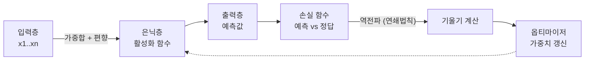

# 신경망분석 (Neural Network Analysis)

---

## I. 가중치 학습으로 비선형 관계를 찾는, 신경망분석의 개요

### 가. 정의

- 뉴런을 모방한 **노드와 가중치 연결로 구성된 다층 모델을 데이터로 학습**시켜 분류·회귀·예측을 수행하는 데이터 분석 기법 (인공신경망, ANN)

### 나. 특징

| 구분 | 내용 |
| --- | --- |
| 비선형 학습 | 활성화 함수로 변수 간 복잡한 비선형 관계 표현 |
| 범용 근사 | 은닉층 1개 이상의 충분히 넓은 신경망은 연속 함수를 임의 정밀도로 근사 가능 (Universal Approximation) |
| 특징 자동 학습 | 심층 구조에서는 수작업 변수 설계 없이 계층적 특징 학습 |
| 한계 | 대량 데이터 필요, 과적합 위험, 결과 해석 어려움(블랙박스) |

---

## II. 학습 구조 및 구성요소

### 가. 순전파·역전파 학습

- 순전파로 예측값과 손실을 구하고, [[역전파]]로 각 가중치의 기울기를 계산해 옵티마이저가 가중치를 갱신하는 과정을 반복

### 나. 구성요소

| 구분 | 요소 | 설명 |
| --- | --- | --- |
| 구조 | MLP (다층 퍼셉트론) | 입력·은닉·출력층, 단층 퍼셉트론의 XOR 문제 해결 |
| | 활성화 함수 | 비선형성 부여 (Sigmoid, ReLU, GELU) |
| 학습 | 손실 함수 | 회귀는 MSE, 분류는 교차 엔트로피 |
| | 역전파 | 연쇄법칙으로 출력 오차를 각 층 가중치 기울기로 전파 |
| | [[최적화 알고리즘\|옵티마이저]] | 경사하강 기반 가중치 갱신 (SGD, Momentum, Adam, AdamW) |
| 일반화 | [[Dropout]] | 학습 중 뉴런 일부를 무작위 비활성화 |
| | 정규화 | [[배치 정규화]]·레이어 정규화로 학습 안정화 |
| | 가중치 감쇠·조기 종료 | 과적합 억제 |
| 해석 | [[XAI]] | SHAP, [[LIME]], Grad-CAM으로 예측 근거 설명 |

---

## III. 통계 분석 비교 및 동향

### 가. 회귀분석 vs 신경망분석

| 구분 | [[회귀분석]] | 신경망분석 |
| --- | --- | --- |
| 가정 | 선형성, 정규성, [[등분산성]], 독립성 | 분포 가정 거의 없음 |
| 변수 설계 | 분석가가 변수 선택 | 모델이 잠재 특징 학습 |
| 데이터 요구량 | 소표본도 유의성 검정 가능 | 대량 데이터 필요 |
| 해석력 | 계수로 영향 방향·크기 해석 | 블랙박스, XAI로 보완 |
| 적합 데이터 | 정형 데이터 | 이미지·음성·텍스트 등 비정형, 고차원 데이터 |

### 나. 동향

- **트랜스포머 중심 구조**: [[CNN]]·[[RNN (Recurrent Neural Network)|RNN]] 이후 [[트랜스포머]] 기반 [[파운데이션 모델]]이 다양한 분석의 기본 모델로 확산, 상태공간모델(Mamba) 등 대안 구조 연구
- **물리 정보 신경망 (PINN)**: 미분방정식 등 물리 법칙을 손실 함수에 포함해 적은 데이터로 과학·공학 문제 해결
- **정형 데이터 한계**: 표 형식 데이터에서는 여전히 그래디언트 부스팅 트리가 신경망과 대등하거나 우세한 경우가 많아 병행 비교 필요

---

### 🔗 연관 토픽

- **소속 도메인**: [[00_경영전략_MOC|📈 경영전략]]
- **세부 분류**: `3. 비즈니스 프로세스 혁신 & 디지털 전환 (DX)`
- **핵심 연관 토픽**:
  - [[역전파]]
  - [[데이터 마이닝|Data Mining (데이터 마이닝)]]
  - [[XAI]]
  - [[트랜스포머|트랜스포머(Transformer)]]
  - [[회귀분석]]
