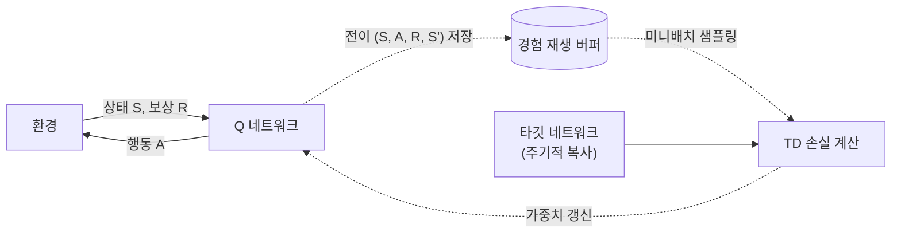

# 심화강화학습 (Deep Reinforcement Learning)

---

## I. 신경망으로 확장한 강화학습, 심화강화학습의 개요

### 가. 정의

- 누적 보상을 최대화하는 정책을 찾는 [[강화학습]]에 **심층 신경망을 가치·정책 함수 근사기로 결합**해 고차원 상태·행동 공간을 다루는 기법

### 나. 필요성 및 특징

| 구분 | 내용 |
| --- | --- |
| 고차원 상태 | 화면 픽셀·센서처럼 표로 나타낼 수 없는 상태를 함수 근사로 처리 |
| End-to-End | 원시 관측에서 행동까지 직접 학습 |
| 대표 성과 | DQN(Atari, 2015), AlphaGo(2016), 로봇 제어, LLM 정렬(RLHF) |
| 난점 | 학습 불안정, 낮은 샘플 효율, 보상 설계 어려움 |

---

## II. 구조 및 핵심 기술

### 가. 개념도 (DQN 기준)

- 경험 재생으로 표본 간 상관을 끊고, 타깃 네트워크로 학습 목표를 고정해 안정성 확보

### 나. 핵심 기술

| 구분 | 요소 | 설명 |
| --- | --- | --- |
| 기반 이론 | [[마르코프 결정 프로세스\|MDP]] | 상태, 행동, 전이 확률, 보상, 할인율 $\gamma$ |
| 함수 근사 | 가치·정책 네트워크 | $Q(s,a)$·$V(s)$, 정책 $\pi(a \mid s)$를 신경망으로 근사 |
| 탐색 | 탐험·활용 | ε-greedy, 엔트로피 보너스 등으로 균형 |
| 안정화 | 경험 재생 | 전이를 버퍼에 저장 후 무작위 샘플링 |
| | 타깃 네트워크 | 일정 주기로만 갱신하는 별도 네트워크로 TD 목표 계산 |
| 가치 기반 | DQN 계열 | Double DQN(과대추정 완화), Dueling DQN, Rainbow |
| 액터-크리틱 | A2C·A3C | Actor는 정책, Critic은 가치 추정으로 분산 축소 |
| | PPO | 정책 비율 클리핑으로 갱신 폭 제한, 구현이 단순하고 안정적 (On-policy) |
| | DDPG·TD3·SAC | 연속 행동용 Off-policy, SAC는 엔트로피 최대화로 탐험 강화 |

---

## III. 비교 및 동향

### 가. 알고리즘 분류

| 비교 항목 | 가치 기반 | 정책 기반 | 액터-크리틱 |
| --- | --- | --- | --- |
| 학습 대상 | Q 값 | 정책 $\pi$ | 정책 + 가치 |
| 행동 공간 | 이산 | 이산·연속 | 이산·연속 |
| 특징 | Off-policy, 샘플 재사용 | 분산 큼 | 분산 축소, 안정적 |
| 대표 | DQN, Double DQN, Dueling DQN | REINFORCE | A3C, PPO, DDPG, SAC |

### 나. 동향

- **LLM 정렬·추론 강화**: RLHF에서 PPO, 이후 GRPO 등 정책 경사 기법으로 검증 가능한 보상(수학·코드 정답)을 이용해 추론 능력 강화
- **오프라인 강화학습**: 수집된 데이터만으로 정책 학습 (CQL, IQL), 로봇·헬스케어 등 시행착오 비용이 큰 분야
- **Sim-to-Real**: 물리 시뮬레이터·[[디지털 트윈]]에서 학습 후 도메인 랜덤화로 실제 로봇에 전이 ([[Physical AI]])

---

### 🔗 연관 토픽

- **소속 도메인**: [[00_인공지능_MOC|🤖 인공지능]]
- **세부 분류**: `1. 수학 · 통계학 & 데이터 전처리`
- **핵심 연관 토픽**:
  - [[강화학습]]
  - [[Q러닝]]
  - [[모델 프리]]
  - [[마르코프 결정 프로세스]]
  - [[멀티에이전트 강화학습]]
