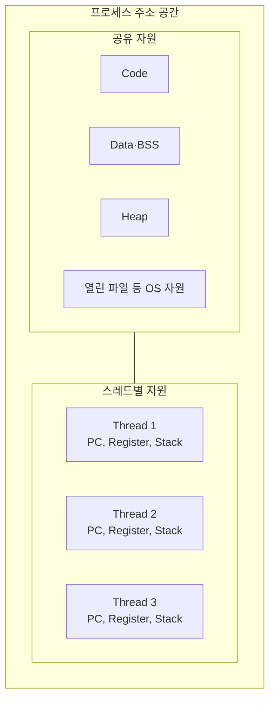

# 스레드 (Thread)

---

## I. CPU 스케줄링의 단위, 스레드의 개요

### 가. 정의

- [[프로세스]] 안에서 프로세스의 자원을 공유하며 **독립적으로 실행되는 흐름의 단위**, 대부분의 현대 OS에서 CPU 스케줄링의 기본 단위

### 나. 특징

| 구분 | 내용 |
| --- | --- |
| 경량성 | 주소 공간을 공유해 생성·전환 비용이 프로세스보다 작음 (경량 프로세스, LWP) |
| 병렬성 | 멀티코어에서 한 애플리케이션의 여러 스레드를 동시에 실행 |
| 응답성 | 한 스레드가 I/O로 블로킹돼도 다른 스레드가 계속 실행 |
| 자원 공유 | 공유 메모리로 바로 통신, 대신 동기화 필요 |

---

## II. 구조 및 구성요소

### 가. 스레드 메모리 구조

- 코드·데이터·힙·파일은 공유하고, PC·레지스터·스택만 스레드별로 보유

### 나. 구성요소

| 구분 | 요소 | 설명 |
| --- | --- | --- |
| 스레드별 자원 | PC (Program Counter) | 다음에 실행할 명령어 주소 |
| | 레지스터 집합 | 실행 중인 연산 상태 |
| | [[Stack\|스택]] | 함수 호출 정보, 반환 주소, 지역 변수 |
| | TLS (Thread Local Storage) | 전역 변수처럼 쓰지만 스레드마다 별도 사본을 갖는 영역 |
| 제어 블록 | TCB (Thread Control Block) | 스레드 ID, 상태, 레지스터, 스케줄링 정보 |
| 스레드 모델 | 사용자 수준 (N:1) | 라이브러리가 관리, 전환이 빠르나 한 스레드 블로킹 시 전체 블로킹·멀티코어 활용 불가 |
| | [[커널]] 수준 (1:1) | 커널이 직접 관리, 멀티코어 활용 (Linux NPTL, Windows) |
| | 혼합형 (M:N) | 사용자 스레드 M개를 커널 스레드 N개에 매핑 (Go 고루틴, Java 가상 스레드) |

---

## III. 비교 및 동향

### 가. 프로세스 vs 스레드

| 비교 항목 | 프로세스 | 스레드 |
| --- | --- | --- |
| 개념 | 자원 할당의 단위 | 실행(스케줄링)의 단위 |
| 메모리 | 독립 주소 공간 | Code·Data·Heap 공유 |
| 통신 | [[프로세스간 통신\|IPC]] (파이프, 소켓, 공유 메모리) | 공유 메모리 직접 접근 |
| 문맥 교환 | 비용 큼 (페이지 테이블 교체, TLB 무효화) | 비용 작음 (레지스터·스택만 교체) |
| 장애 격리 | 다른 프로세스에 영향 적음 | 한 스레드 오류가 프로세스 전체 종료 |
| 생성 (Linux) | `fork()`, 페이지는 COW로 공유 후 쓰기 시 복사 | `clone()`에 주소 공간 공유 플래그 지정 |

### 나. 동향

- **경량 스레드**: Java 21 가상 스레드, Go 고루틴이 수 KB 스택으로 수십만 개 동시 작업 처리, 1:1 커널 스레드의 스택 메모리(예: 스레드당 1MB~8MB) 부담 해소
- **SMT 인지 스케줄링**: Intel Hyper-Threading·AMD SMT의 하드웨어 스레드, 하이브리드 코어(P/E 코어) 토폴로지를 고려한 OS 스케줄링
- **컴파일 시점 안전성**: Rust 소유권·`Send`/`Sync` 규칙으로 데이터 레이스를 컴파일 단계에서 차단

---

### 🔗 연관 토픽

- **소속 도메인**: [[00_운영체제_MOC|⚙️ 운영체제]]
- **세부 분류**: `1. 프로세스 & 스레드 관리`
- **핵심 연관 토픽**:
  - [[프로세스]]
  - [[프로세스와 스레드 비교|프로세스(Process)와 스레드(Thread) 비교]]
  - [[멀티 쓰레드|멀티 쓰레드(Multi-Thread)]]
  - [[문맥 교환|문맥 교환 (Context Switching)]]
  - [[스케줄링]]
