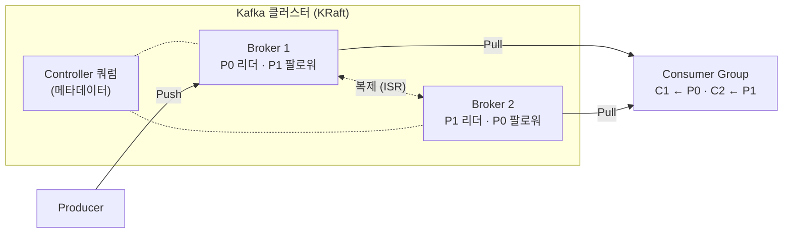

# 아파치 카프카 (Apache Kafka)

---

## I. 이벤트를 저장하는 분산 로그, 아파치 카프카의 개요

### 가. 정의

- 이벤트를 **토픽별 파티션에 순서대로 추가 저장(분산 커밋 로그)하고, 여러 소비자가 각자 위치(오프셋)에서 읽어 가는 발행–구독 기반 이벤트 스트리밍 플랫폼** (LinkedIn 개발, 2011 오픈소스)

### 나. 특징

| 구분 | 내용 |
| --- | --- |
| 허브 구조 | N:N 시스템 연동을 중앙 이벤트 허브로 단순화 |
| 영속·재처리 | 디스크에 보존 기간 동안 저장, 오프셋 되돌려 재처리(Replay) |
| 고처리량 | 순차 디스크 쓰기, 배치 전송, 제로 카피 |
| 확장성 | 파티션 단위 병렬 처리, 브로커 추가로 수평 확장 |

---

## II. 아키텍처 및 구성요소

### 가. 클러스터 구조

- 프로듀서는 파티션 리더에 쓰고 팔로워가 복제하며, 그룹 내에서 한 파티션은 한 컨슈머만 읽어 순서와 병렬성을 함께 확보

### 나. 구성요소

| 구분 | 요소 | 설명 |
| --- | --- | --- |
| 논리 | 토픽 | 이벤트 분류 단위 |
| | 파티션 | 토픽의 분할 단위, 파티션 내에서만 순서 보장 ([[파티셔닝\|파티션]]) |
| | 오프셋 | 파티션 내 메시지 순번, 소비 위치 |
| 물리 | 브로커 | 파티션을 저장·서비스하는 서버 |
| | 컨트롤러 (KRaft) | Raft 기반 메타데이터 관리 ([[합의 알고리즘]]) |
| 클라이언트 | 프로듀서 | 키 해시로 파티션 선택, acks 설정으로 내구성 조절 |
| | 컨슈머 그룹 | 그룹 내 파티션당 컨슈머 1개, 리밸런싱으로 재할당 |
| 신뢰성 | 복제·ISR | 리더와 동기화된 복제본 집합, min.insync.replicas |
| | 정확히 한 번 | 멱등 프로듀서 + 트랜잭션 (EOS) |
| 성능 | 제로 카피 | 페이지 캐시에서 소켓으로 직접 전송 (sendfile) |
| 생태계 | Kafka Connect·Streams | 외부 시스템 연동, 스트림 처리 라이브러리 |

---

## III. 비교 및 동향

### 가. Kafka vs RabbitMQ

| 비교 항목 | Kafka | RabbitMQ |
| --- | --- | --- |
| 모델 | 분산 로그, 이벤트 스트리밍 | 메시지 브로커 (AMQP 등) |
| 소비 방식 | Pull | Push 중심 |
| 보존 | 보존 기간 동안 유지, 재처리 가능 | 확인(Ack) 후 큐에서 제거 (Streams 기능은 재처리 지원) |
| 순서 | 파티션 단위 보장 | 큐 단위 |
| 라우팅 | 토픽·파티션 | Exchange 기반 유연한 라우팅 |
| 활용 | 로그·CDC·스트림 파이프라인 | 작업 큐, 서비스 간 비동기 요청 |

### 나. 동향

- **ZooKeeper 제거**: KRaft가 3.3에서 운영 수준(GA), Kafka 4.0(2025)에서 ZooKeeper 모드 완전 제거
- **계층형 스토리지**: 오래된 세그먼트를 객체 스토리지로 이전해 보존 비용 절감 (KIP-405)
- **스트림 처리 연계**: Flink·Kafka Streams·ksqlDB로 실시간 집계·조인, CDC(Debezium)로 DB 변경 스트리밍

---

### 🔗 연관 토픽

- **소속 도메인**: [[00_데이터베이스_MOC|🗄️ 데이터베이스]]
- **세부 분류**: `5. 분산 데이터베이스 & NoSQL & 대용량`
- **핵심 연관 토픽**:
  - [[파티셔닝|파티션]]
  - [[합의 알고리즘]]
  - [[분산 데이터베이스]]
  - [[EDW]]
  - [[HA(High Availability)]]
