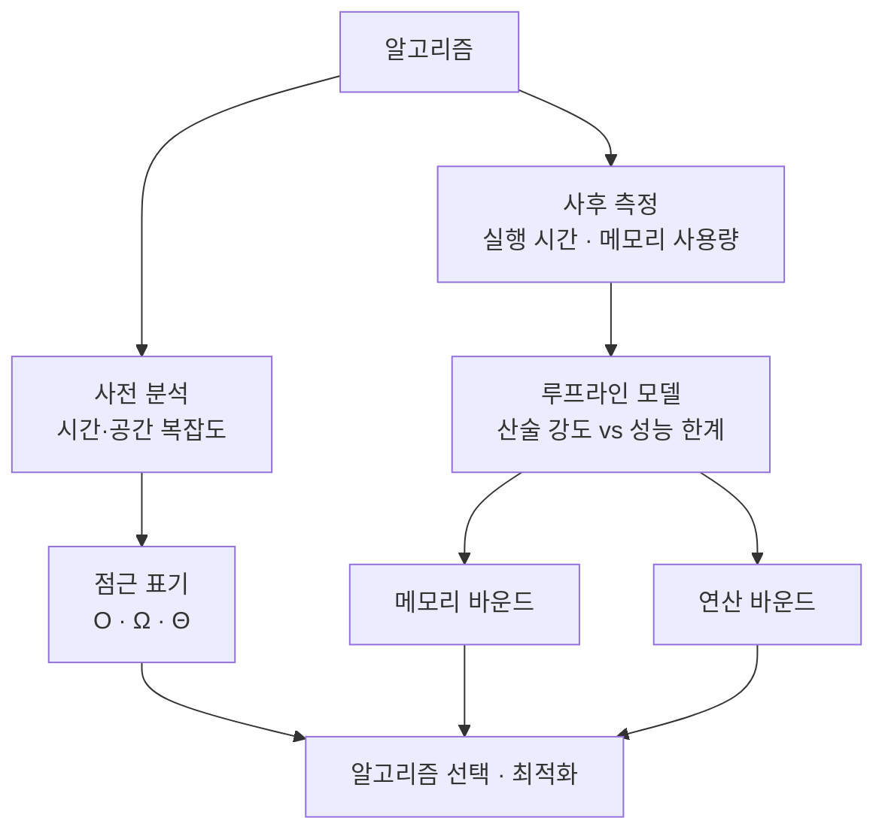

# 알고리즘 성능평가

---

## I. 시간과 공간으로 재는 효율, 알고리즘 성능평가의 개요

### 가. 정의

- [[알고리즘]]이 사용하는 **시간·메모리 자원을 입력 크기에 대한 증가율(복잡도)과 실측으로 분석**해 효율을 비교하는 활동

### 나. 필요성 및 특징

| 구분 | 내용 |
| --- | --- |
| 필요성 | 같은 문제의 여러 알고리즘 중 대규모 입력·제한된 자원([[EDGE\|Edge]])에 맞는 것 선택 |
| 사전 분석 | 실행 전 수학적 분석, 하드웨어와 무관한 점근 복잡도 |
| 사후 측정 | 실제 환경에서 실행 시간·메모리 측정 (프로파일링, 벤치마크) |
| 하드웨어 모델 | 루프라인 모델로 연산·메모리 중 어느 쪽이 병목인지 판단 |

---

## II. 평가 방법 및 구성요소

### 가. 평가 체계

- 복잡도로 증가 추세를 비교하고, 실제 하드웨어([[CPU]]·[[GPU]]·[[NPU]])에서는 루프라인 모델로 병목을 확인

### 나. 구성요소

| 구분 | 요소 | 설명 |
| --- | --- | --- |
| 복잡도 | 시간 복잡도 | 입력 크기 n에 대한 기본 연산 횟수 |
| | 공간 복잡도 | 고정 공간 + 가변 공간(재귀 스택, 동적 할당) |
| 점근 표기 | [[O-Notation (O-표기법)\|O (Big-O)]] | 점근적 상한, f(n) ≤ c·g(n) (n ≥ n₀) |
| | Ω (Big-Omega) | 점근적 하한 |
| | Θ (Big-Theta) | 상한과 하한이 같은 정확한 증가율 |
| 분석 경우 | 최선·평균·최악 | 입력 분포에 따른 경우별 분석, 각 경우에 O·Ω·Θ 모두 사용 가능 |
| | 상각 분석 | 연산 시퀀스 전체 비용의 평균 (예: 동적 배열 확장) |
| 하드웨어 분석 | 루프라인 모델 | 최대 연산 성능(FLOPS)과 메모리 대역폭을 한계선으로 성능 상한 표시 |
| | 산술 강도 | 메모리 바이트당 연산 수(FLOPs/Byte), 낮으면 메모리 바운드 |
| 최적화 | 캐시 블로킹 (Loop Tiling) | 데이터를 캐시 크기 블록으로 나눠 재사용 증가, 산술 강도 향상 |

---

## III. 비교 및 동향

### 가. 사전 분석 vs 사후 측정

| 비교 항목 | 사전 분석 (이론) | 사후 측정 (실측) |
| --- | --- | --- |
| 기준 | 연산 횟수, 메모리 크기 | 실행 시간, 처리량, 메모리 사용량 |
| 환경 의존 | 하드웨어 독립 | 하드웨어·컴파일러·데이터 의존 |
| 지표 | O(log n), O(n log n) 등 | 초, FLOPS, GB/s, 캐시 미스율 |
| 장점 | 대규모 입력의 추세 예측 | 상수 계수·캐시 효과까지 반영 |
| 용도 | 설계 단계 알고리즘 선택 | 구현 튜닝, 병목 제거 |

### 나. 동향

- **메모리 바운드 최적화**: Transformer 연산에서 FlashAttention(타일링으로 HBM 접근 감소), 양자화 등 복잡도는 같아도 데이터 이동을 줄이는 기법이 성능을 좌우
- **하드웨어·알고리즘 공동 설계**: 알고리즘 선택 시 점근 복잡도와 함께 캐시·메모리 대역폭·병렬성 고려

---

### 🔗 연관 토픽

- **소속 도메인**: [[00_컴퓨터구조_MOC|💻 컴퓨터구조]]
- **세부 분류**: `2. 캐시 & 메모리 계층 구조 · 스토리지`
- **핵심 연관 토픽**:
  - [[O-Notation (O-표기법)]]
  - [[알고리즘]]
  - [[퀵 정렬|퀵 정렬 (Quick Sort)]]
  - [[처리량]]
  - [[GPU]]
