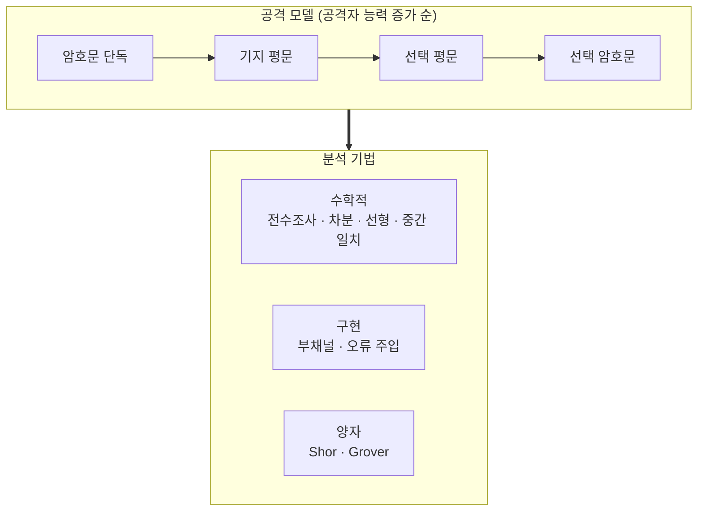

# 암호 분석 공격 (Cryptanalysis Attacks)

---

## I. 키 없이 평문에 다가가는, 암호 분석의 개요

### 가. 정의

- 암호 알고리즘의 **수학적 구조나 구현 특성을 분석하여 키 없이 평문을 얻거나 비밀키를 찾아내는** 기법의 총칭

### 나. 특징

| 구분 | 내용 |
| --- | --- |
| 케르크호프스 원칙 | 알고리즘은 공개되어 있고 키만 비밀이라는 전제에서 분석 |
| 공격 모델 | 공격자가 가진 정보·오라클 접근 수준에 따라 COA~CCA로 구분 |
| 분석 축 | 수학적 분석, 구현(부채널·오류 주입) 분석, 양자 알고리즘 |
| 안전성 기준 | 전수조사보다 빠른 공격이 없으면 안전한 것으로 평가 |

---

## II. 공격 모델 및 기법

### 가. 공격 모델과 분석 기법

- 공격자가 얻을 수 있는 정보가 많을수록 강한 모델이며, 그 환경에서 수학적·구현·양자 기법을 적용

### 나. 세부 기법

| 구분 | 요소 | 설명 |
| --- | --- | --- |
| 공격 모델 | COA | 암호문만으로 통계·빈도 분석 |
| | KPA | 평문-암호문 쌍을 알고 키 추론 |
| | CPA | 원하는 평문의 암호문을 얻을 수 있음 (암호화 오라클) |
| | CCA | 원하는 암호문의 평문을 얻을 수 있음 (복호화 오라클) |
| 수학적 | 전수조사 | 모든 키 시도, 키 길이로 대응 |
| | 차분 분석 | 평문 차이가 암호문 차이로 전파되는 확률 이용 (주로 CPA) |
| | 선형 분석 | 평문·암호문·키 비트의 선형 근사식 이용 (KPA) |
| | 중간 일치 공격 | 다중 암호화를 양쪽에서 계산해 만나는 값 탐색 (2DES 무력화) |
| 구현 | [[부채널 공격]] | 전력·시간·전자파 누출 분석 |
| | 오류 주입 | 연산 오류를 유발해 키 유도 (RSA-CRT 공격) |
| 양자 | Shor·Grover | 공개키 해독, 대칭키 탐색 가속 ([[쇼어 & 그루버 알고리즘]]) |

---

## III. 비교 및 동향

### 가. 공격 유형별 대응

| 비교 항목 | 위협 | 대응 |
| --- | --- | --- |
| 수학적 분석 | 차분·선형 분석 | S-Box 설계, 충분한 라운드 수 |
| 공개키 양자 공격 | RSA·ECC 붕괴 | [[양자내성암호]] 전환 (NIST FIPS 203·204·205) |
| 대칭키 양자 공격 | 탐색 강도 절반 | AES-256 등 키 길이 확대 |
| 딥러닝 부채널 분석 | 마스킹 우회 | 고차 마스킹, 하이딩 |
| 화이트박스 환경 | 메모리 접근으로 키 추출 | 화이트박스 암호, 하드웨어 키 보관 |

### 나. 동향

- **PQC 후보 분석 성과**: SIKE(2022)·Rainbow 등 NIST 후보가 고전 컴퓨터 분석으로 깨져 다양한 수학 기반 병행 필요
- **암호 민첩성**: 알고리즘이 깨졌을 때 신속히 교체할 수 있는 구조와 암호 자산 목록(CBOM)
- **자동화 분석**: SAT/MILP 솔버로 차분·선형 특성 탐색 자동화

---

### 🔗 연관 토픽

- **소속 도메인**: [[00_보안_MOC|🛡️ 보안]]
- **세부 분류**: `2. 현대 암호학 & 키 관리 · 전자서명`
- **핵심 연관 토픽**:
  - [[암호문 공격 기법|암호문 공격 기법 (Ciphertext Attack)]]
  - [[부채널 공격|부채널 공격(Side Channel Attack)]]
  - [[쇼어 & 그루버 알고리즘]]
  - [[양자내성암호]]
  - [[DES]]
