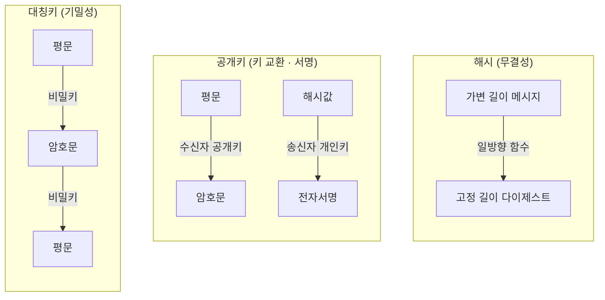

# 암호 알고리즘 (Cryptographic Algorithms)

---

## I. 보안 서비스의 수학적 토대, 암호 알고리즘의 개요

### 가. 정의

- **수학적 연산으로 데이터를 변환하여 [[기밀성]]·[[무결성]]·인증·부인방지를 제공**하는 알고리즘의 총칭으로, 대칭키·공개키·해시 알고리즘으로 구분

### 나. 특징

| 구분 | 내용 |
| --- | --- |
| 기밀성 | 대칭키·공개키 암호화로 비인가자의 열람 방지 |
| 무결성 | 해시·MAC으로 변조 탐지 |
| 인증·부인방지 | 전자서명으로 송신자 증명 |
| 케르크호프스 원칙 | 알고리즘은 공개, 안전성은 키의 비밀성에만 의존 |
| 양자 위협 | Shor·Grover 알고리즘으로 기존 체계 재설계 필요 |

---

## II. 분류 및 구성요소

### 가. 3대 암호 알고리즘 구조

- 대칭키는 데이터 암호화, 공개키는 키 교환·서명, 해시는 무결성 검증을 맡아 하이브리드로 함께 사용

### 나. 분류별 알고리즘

| 구분 | 요소 | 설명 |
| --- | --- | --- |
| 대칭키 | 블록 암호 | [[AES]], ARIA, SEED, LEA (SPN·Feistel·ARX 구조) |
| | 스트림 암호 | ChaCha20 (ARX), RC4(폐기) |
| 공개키 | 소인수분해 기반 | [[RSA (Rivest Shamir Adleman)\|RSA]] |
| | 이산대수 기반 | DH, [[DSA]], [[Elgamel\|ElGamal]], KCDSA |
| | 타원곡선 기반 | [[ECC]] (ECDH, ECDSA, EdDSA) |
| 해시 | SHA-2, SHA-3, LSH | 고정 길이 다이제스트, 역상·충돌 저항성 |
| 메시지 인증 | [[HMAC]], GMAC | 비밀키 기반 무결성·출처 인증 |
| 운용 모드 | CBC, CTR, GCM | 블록 암호의 다중 블록 처리, GCM은 AEAD |
| 양자내성 | ML-KEM, ML-DSA, SLH-DSA | 격자·해시 기반 (NIST FIPS 203·204·205) |
| 경량 | Ascon, LEA | IoT 등 제한 환경용 (NIST 경량 암호 표준 Ascon) |
| 특수 목적 | [[동형 암호]] | 암호문 상태에서 연산 가능 |

---

## III. 비교 및 동향

### 가. 대칭키 vs 공개키 vs 해시

| 비교 항목 | 대칭키 | 공개키 | 해시 |
| --- | --- | --- | --- |
| 키 | 비밀키 1개 | 공개키·개인키 쌍 | 없음 (HMAC은 비밀키) |
| 안전성 근거 | 혼돈·확산 설계 | 수학적 난제 | 일방향성·충돌 저항성 |
| 속도 | 빠름 | 느림 | 빠름 |
| 키 수 (n명) | $\frac{n(n-1)}{2}$ | $2n$ | - |
| 용도 | 데이터 암호화 | 키 교환, 서명 | 무결성, 패스워드 저장 |
| 양자 영향 | 강도 절반 (키 2배로 대응) | 붕괴 (PQC 교체) | 역상 강도 절반 |

### 나. 동향

- **[[양자내성암호]] 전환**: NIST PQC 표준 확정(2024) 후 공공·금융의 하이브리드 전환과 암호 자산 인벤토리 구축
- **암호 민첩성**: 알고리즘을 설정 변경만으로 교체할 수 있도록 암호 모듈을 추상화한 설계
- **프라이버시 강화 연산**: [[동형 암호]]·[[영지식증명]]의 가속 하드웨어·라이브러리 실용화

---

### 🔗 연관 토픽

- **소속 도메인**: [[00_보안_MOC|🛡️ 보안]]
- **세부 분류**: `1. 정보보안 원칙 & 거버넌스 · 인증`
- **핵심 연관 토픽**:
  - [[대칭키 암호화]]
  - [[비대칭키 암호화]]
  - [[해시함수|해시함수(알고리즘 측면)]]
  - [[양자내성암호]]
  - [[FIPS (Federal Information Processing Standards)]]
