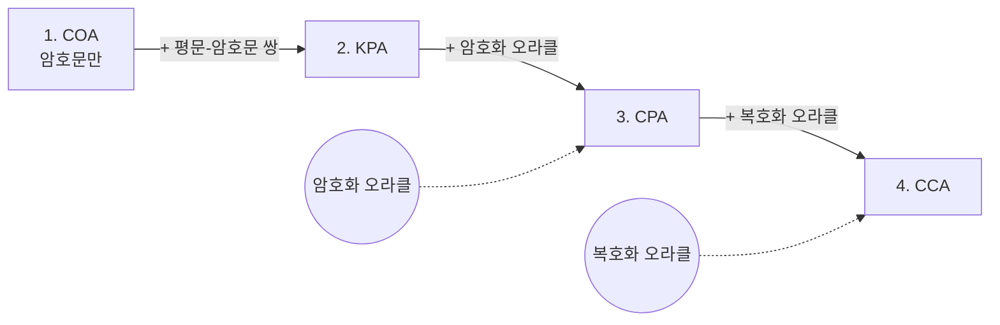

# 암호문 공격 기법 (Ciphertext Attack)

---

## I. 공격자 능력의 계층, 암호문 공격 모델의 개요

### 가. 정의

- 공격자가 **확보한 정보(암호문, 평문-암호문 쌍)와 오라클 접근 능력에 따라 암호 공격을 COA·KPA·CPA·CCA 네 단계로 분류**한 공격 모델

### 나. 특징

| 구분 | 내용 |
| --- | --- |
| 케르크호프스 원칙 | 알고리즘 공개 전제 |
| 능력의 계층화 | COA < KPA < CPA < CCA 순으로 공격자 능력 증가 |
| 안전성 정의 | 강한 모델에서 안전할수록 강한 암호 (IND-CPA, IND-CCA) |
| 현실 반영 | 웹 서버 오류 응답 등 실제 시스템이 오라클 역할을 하기도 함 |

---

## II. 모델 구조 및 구성요소

### 가. 공격 모델 계층

- 수동적 관찰(COA, KPA)에서 오라클에 질의하는 능동적 공격(CPA, CCA)으로 갈수록 강력

### 나. 구성요소

| 구분 | 요소 | 설명 |
| --- | --- | --- |
| 공격 모델 | COA (Ciphertext-Only) | 암호문만으로 빈도·통계 분석 |
| | KPA (Known-Plaintext) | 알려진 평문-암호문 쌍 활용 (에니그마의 크립 이용) |
| | CPA (Chosen-Plaintext) | 원하는 평문을 암호화한 결과 획득 |
| | CCA (Chosen-Ciphertext) | 원하는 암호문을 복호화한 결과 획득 (CCA2는 적응적 질의) |
| 분석 기법 | 선형 분석 | 주로 KPA 환경 |
| | 차분 분석 | 주로 CPA 환경 |
| 안전성 개념 | IND-CPA | 선택 평문 공격하에서 두 평문 중 어느 것의 암호문인지 구별 불가 |
| | IND-CCA2 | 복호화 오라클이 있어도 구별 불가, 공개키 암호의 표준 요구 |
| 오라클 | 암·복호화 오라클 | 키는 모르지만 입력에 대한 결과를 주는 블랙박스 |

---

## III. 비교 및 동향

### 가. 4대 모델 비교

| 비교 항목 | COA | KPA | CPA | CCA |
| --- | --- | --- | --- | --- |
| 확보 정보 | 암호문 | 평문-암호문 쌍 | 선택 평문의 암호문 | 선택 암호문의 평문 |
| 오라클 | 없음 | 없음 | 암호화 | 암호화 + 복호화 |
| 공격자 능력 | 가장 약함 | 약함 | 강함 | 가장 강함 |
| 공격 성공 난이도 | 가장 어려움 | 어려움 | 쉬움 | 가장 쉬움 |
| 이 모델에서 안전하면 | 최소 요건 | 고전 암호 이상 | IND-CPA (결정적 암호 불가) | IND-CCA2 (현대 표준) |

### 나. 동향

- **패딩 오라클 대응**: CBC 패딩 오류 응답을 오라클로 쓰는 CCA 공격(POODLE, Lucky13)을 AEAD(AES-GCM)로 차단
- **CCA 안전 공개키 암호**: RSA-OAEP, Fujisaki-Okamoto 변환을 적용한 ML-KEM 등 IND-CCA2 설계 표준화
- **화이트박스 공격 모델**: 오라클을 넘어 실행 메모리까지 보이는 환경에서 [[난독화]]·화이트박스 암호로 키 은닉

---

### 🔗 연관 토픽

- **소속 도메인**: [[00_보안_MOC|🛡️ 보안]]
- **세부 분류**: `2. 현대 암호학 & 키 관리 · 전자서명`
- **핵심 연관 토픽**:
  - [[암호 분석 공격 기법|암호 분석 공격(Cryptanalysis Attacks) 기법]]
  - [[블록 암호화|블록 암호화 (Block Cipher)]]
  - [[RSA (Rivest Shamir Adleman)]]
  - [[AES]]
  - [[암호학적 보안 강도|암호학적 보안 강도(Security Strength)]]
