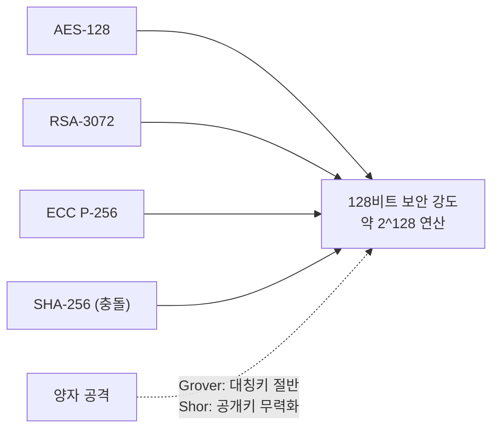

# 암호학적 보안 강도 (Security Strength)

---

## I. 서로 다른 암호를 같은 저울에, 보안 강도의 개요

### 가. 정의

- 알려진 최선의 공격으로 암호를 깨는 데 필요한 **작업량(Work Factor)을 비트 수로 표현한 척도**로, n비트 보안 강도는 약 $2^n$번 연산이 필요함을 의미 (NIST SP 800-57)

### 나. 특징

| 구분 | 내용 |
| --- | --- |
| 공통 척도 | 대칭키·공개키·해시의 안전성을 같은 단위로 비교 |
| 키 길이 선정 | 데이터 보호 기간과 컴퓨팅 발전을 고려한 알고리즘·키 길이 결정 |
| 시한성 | 112비트는 2030년까지, 이후 128비트 이상 요구 (NIST SP 800-131A) |
| 양자 영향 | Grover는 대칭키 강도 절반, Shor는 RSA·ECC 무력화 |

---

## II. 산정 원리 및 구성요소

### 가. 동등 강도 매핑 (128비트)

- 키 길이는 달라도 최선의 공격 비용이 같으면 같은 보안 강도로 취급

### 나. 알고리즘별 산정

| 구분 | 요소 | 설명 |
| --- | --- | --- |
| 기준 | 작업량 | 최선 공격의 연산 횟수, n비트 강도 = $2^n$ |
| 대칭키 | 키 길이 = 강도 | 전수조사가 최선일 때 AES-128은 128비트 |
| 공개키 (인수분해) | 준지수 공격 (GNFS) | 키가 길어야 함: RSA-3072 ≈ 128비트 |
| 공개키 (타원곡선) | 키 길이의 약 1/2 | P-256 ≈ 128비트 |
| 해시 | 충돌 강도 | 생일 공격으로 출력 길이의 1/2 (SHA-256 = 128비트) |
| | 역상 강도 | 출력 길이와 같음 (SHA-256 = 256비트) |
| 양자 | Grover | 대칭키·역상 강도 절반 |
| | Shor | RSA·ECC 강도 사실상 0 |
| 지침 | NIST SP 800-57 | 보안 강도별 알고리즘·키 길이와 사용 기간 |

---

## III. 비교 및 동향

### 가. NIST 동등 보안 강도 표

| 보안 강도 | 대칭키 | RSA·DH | ECC | 해시 (충돌 기준) |
| --- | --- | --- | --- | --- |
| 112비트 (2030년까지) | 3TDEA (2023 이후 금지) | 2048 | 224 | SHA-224, SHA-512/224 |
| 128비트 | AES-128 | 3072 | 256 | SHA-256, SHA3-256 |
| 192비트 | AES-192 | 7680 | 384 | SHA-384, SHA3-384 |
| 256비트 | AES-256 | 15360 | 512 이상 (P-521) | SHA-512, SHA3-512 |

### 나. 동향

- **대칭키 상향**: 양자 시대에도 128비트 이상을 유지하도록 CNSA 2.0 등에서 AES-256 권고
- **PQC 보안 범주**: NIST는 PQC를 AES-128/192/256 수준의 보안 범주 1·3·5로 분류 (ML-KEM-512/768/1024)
- **RSA·ECC 퇴출 일정**: NIST IR 8547 초안은 112비트 공개키를 2030년 비권고, 2035년 금지로 제시 ([[양자내성암호]])

---

### 🔗 연관 토픽

- **소속 도메인**: [[00_보안_MOC|🛡️ 보안]]
- **세부 분류**: `2. 현대 암호학 & 키 관리 · 전자서명`
- **핵심 연관 토픽**:
  - [[쇼어 & 그루버 알고리즘]]
  - [[양자내성암호]]
  - [[RSA (Rivest Shamir Adleman)]]
  - [[ECC|ECC(Elliptic Curve Cryptography)]]
  - [[해시 함수의 안전성]]
