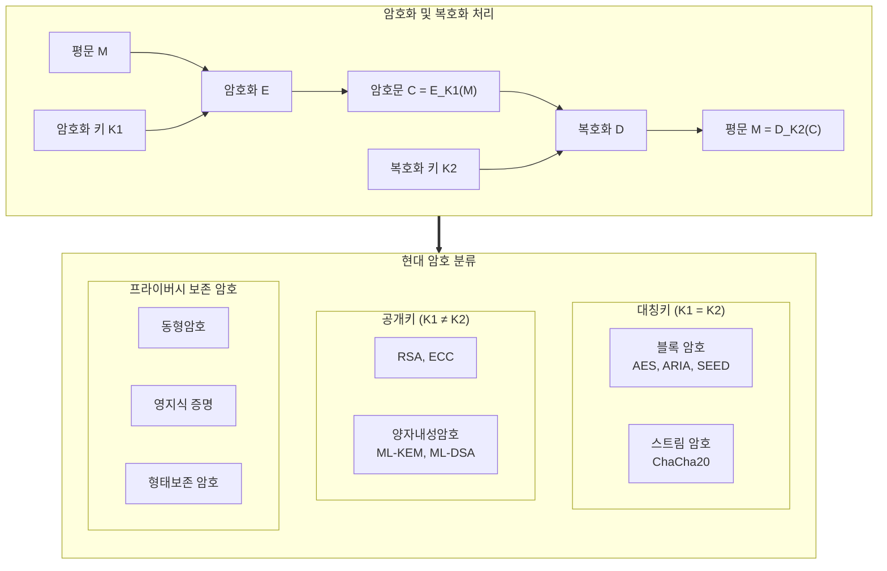

# 암호화 (Encryption)

---

## I. 기밀성·무결성 보장의 핵심 기반, 암호화의 개요

암호화(Encryption)는 인가되지 않은 제3자의 도청, 변조, 위조를 방지하기 위해 수학적 알고리즘과 암호키(Key)를 활용하여 평문(Plaintext)을 해독 불가능한 암호문(Ciphertext)으로 변환하는 정보보안의 근원적 보호 기술이다.

| 구분 | 내용 |
| :--- | :--- |
| **정의** | 수학적 알고리즘과 키를 사용해 평문을 무의미한 암호문으로 변환하는 보안 기술 |
| **보안 목표** | 기밀성(Confidentiality), 무결성(Integrity), 인증(Authentication), 부인방지(Non-repudiation) |
| **설계 원리** | 커크호프의 원리(키만 비밀), 혼돈(Confusion, S-Box), 확산(Diffusion, P-Box) ([[Shannon의 암호 설계 원칙]]) |

---

## II. 암호화의 구조 및 핵심 기술

### 가. 암호화 처리 구조 및 분류 체계

- 현대 암호 통신은 **공개키로 세션키를 교환하고 대칭키로 데이터를 암호화하는 하이브리드 구조**가 기본 ([[전자봉투]])
- 보호 범위가 저장·전송 중 데이터에서 **사용 중 데이터(Data-in-Use)** 와 **양자 위협 대응(PQC)** 으로 확장

### 나. 핵심 기술 요소

| 구분 | 기술 | 설명 |
| --- | --- | --- |
| 대칭키 (블록) | [[AES]], ARIA, SEED | SPN(AES·ARIA)·Feistel(SEED) 구조의 128bit 블록 암호, 저장 데이터 암호화 표준 ([[블록 암호화]]) |
| 대칭키 (스트림) | ChaCha20-Poly1305 | 키스트림과 평문 XOR, 모바일·TLS 1.3 고속 암호화 |
| 운용 모드 | GCM | CTR 모드 병렬 암호화 + 인증 태그를 동시 제공하는 AEAD |
| 공개키 (인수분해) | [[RSA (Rivest Shamir Adleman)\|RSA]] | 큰 수의 소인수분해 난제 기반, 2048bit 이상, 키 교환·서명 |
| 공개키 (이산대수) | [[ECC]] (ECDH, ECDSA) | 타원곡선 이산대수 난제, RSA보다 짧은 키(256bit)로 동등 보안 ([[타원곡선 암호]]) |
| 일방향 | [[해시함수]] (SHA-256, SHA-3), [[HMAC]] | 무결성 검증, 비밀번호 저장, 서명용 요약 |
| 형태보존 | FPE (FF1, FF3-1) | 길이·형식을 유지해 DB [[스키마]] 변경 없이 개인정보 암호화 |
| 연산보존 | [[동형 암호]] (CKKS, BFV) | 복호화 없이 암호문 상태로 연산, 민감 데이터 분석·AI 추론 보호 |
| 증명 | [[영지식증명\|영지식 증명]] (zk-SNARKs) | 비밀을 노출하지 않고 진위만 증명, DID 등에 활용 |
| 양자내성 | [[양자내성암호\|PQC]] (FIPS 203/204) | 격자 기반 ML-KEM(키 캡슐화)·ML-DSA(서명), 2024년 NIST 표준 확정 |

---

## III. 기술 비교 및 데이터 전주기 보호 전략

### 가. 대칭키 vs 공개키 vs 차세대 암호

| 비교 항목 | [[대칭키 암호화\|대칭키]] | [[비대칭키 암호화\|공개키]] | 동형암호 | PQC |
| :--- | :--- | :--- | :--- | :--- |
| **키 관계** | 암호키 = 복호키 | 공개키 ≠ 개인키 | 연산키(Evaluation Key) 별도 | 공개키 ≠ 비밀키 |
| **필요 키 수 (N명)** | $N(N-1)/2$ | $2N$ | - | $2N$ |
| **보안 기반** | 치환·전치 라운드(혼돈·확산) | 소인수분해·이산대수 | LWE/RLWE 격자 난제 | 격자·해시·코드 난제 |
| **속도 및 부하** | 매우 빠름 (HW 가속) | 느림 (연산 부하 큼) | 매우 느림 (가속기 필요) | 중간 수준 |
| **주요 용도** | 대용량 저장·전송 암호화 | 세션키 교환, 전자서명, PKI | 사용 중 데이터 연산 보호 | 양자 컴퓨팅 대응 키 교환/인증 |
| **대표 알고리즘** | [[DES]], [[AES]], SEED, ARIA | [[RSA (Rivest Shamir Adleman)\|RSA]], [[ECC]], ElGamal | CKKS, BFV | ML-KEM, ML-DSA |

### 나. 데이터 상태별 전주기 보호

| 데이터 상태 | 주요 위협 | 핵심 암호화 보호 기술 |
| :--- | :--- | :--- |
| **Data-at-Rest (저장 중)** | 저장매체 도난, 파일 덤프 | AES-256-GCM, TDE(투명한 DB 암호화), FDE(전체 디스크), FPE(형태보존) |
| **Data-in-Transit (전송 중)** | 도청, 중간자(MITM) 공격 | TLS 1.3([[ECDHE]] + AES-GCM/ChaCha20), [[IP Sec\|IPsec]] [[VPN]], SSH |
| **Data-in-Use (연산 중)** | 메모리 덤프, 관리자 권한 탈취 | [[동형 암호]](CKKS/BFV), [[기밀컴퓨팅]](TEE Enclave, AMD SEV, Intel TDX) |

### 다. 암호 관리 체계 및 향후 발전 방향
- **암호 민첩성(Crypto-Agility) 및 CBOM 도입**: 양자 컴퓨터 위협에 신속히 대응하기 위해 소프트웨어 내 암호 알고리즘 목록(CBOM)을 관리하고, 소스 재작성 없이 PQC 알고리즘으로 동적 교체 가능한 유연한 아키텍처 구축.
- **PQC 하이브리드 전환 및 Harvest-Now 대응**: 기존 고전 공개키(ECDH/RSA)와 NIST 표준 양자내성암호(ML-KEM, ML-DSA)를 동시 적용하는 하이브리드 키 교환을 조기 상용화하여 사후 복호화 공격 차단.
- **경량 암호(Lightweight Cryptography)의 확산**: 자원이 극도로 제약된 IoT 센서, 차량 ECU, 스마트 팩토리 디바이스를 위해 NIST 공식 표준으로 선정된 Ascon 등 초경량 암호 제품군 적용 확대.

---

### 🔗 연관 토픽

- **소속 도메인**: [[00_보안_MOC|🛡️ 보안]]
- **세부 분류**: `1. 정보보안 원칙 & 거버넌스 · 인증`
- **핵심 연관 토픽**:
  - [[암호 알고리즘]]
  - [[대칭키 암호화]]
  - [[비대칭키 암호화]]
  - [[양자내성암호]]
  - [[KMS]]
