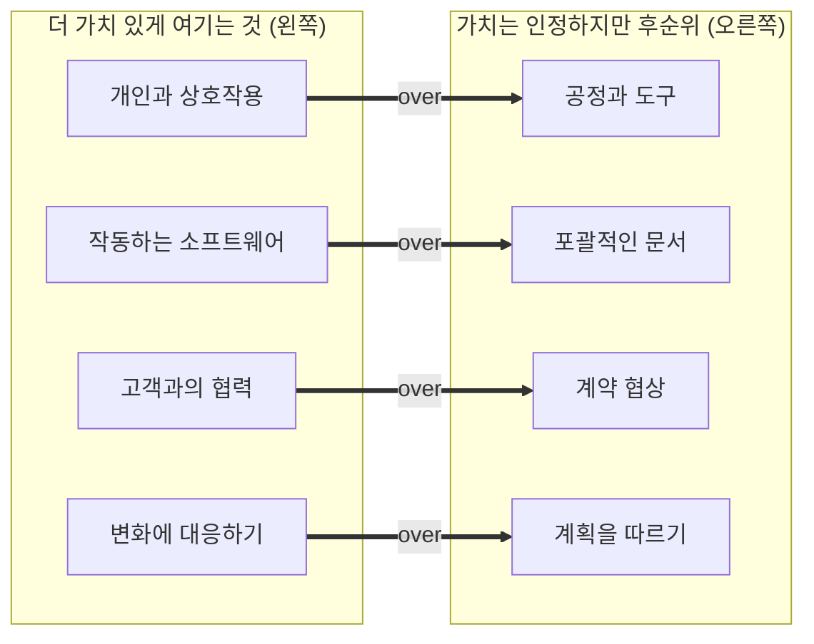

# 애자일 선언문 (Agile Manifesto)과 12개 원칙

---

## I. 변화 대응과 고객 가치 중심의 개발 철학, 애자일 선언문의 개요

### 가. 정의

- 2001년 Scrum·XP 등 경량 방법론 주창자 17명이 발표한 소프트웨어 개발 철학으로, **4대 가치(Values)** 와 이를 실천하기 위한 **12개 원칙(Principles)** 으로 구성

### 나. 등장 배경 및 특징

| 구분 | 내용 |
| --- | --- |
| 등장 배경 | [[워터폴]]의 경직성·문서 과다, 요구사항이 급변하는 시장, 경량 방법론의 공통 철학 정립 필요 |
| 가치 표현 방식 | "왼쪽 항목을 오른쪽 항목보다 더 가치 있게 여긴다", 오른쪽 항목도 가치는 인정 |
| 반복·점진 | 짧은 주기로 동작하는 SW를 전달하고 피드백으로 개선 |
| 적응형 | 계획 준수보다 변화 대응, 자기 조직화 팀 |

---

## II. 4대 가치와 12개 원칙

### 가. 4대 가치

### 나. 12개 원칙

| 번호 | 원칙 | 관점 |
| --- | --- | --- |
| 1 | 가치 있는 소프트웨어를 일찍, 지속적으로 전달해 고객을 만족시킨다 | 고객 가치 |
| 2 | 개발 후반이라도 요구사항 변경을 환영한다, 변화를 고객 경쟁력에 활용 | 변화 수용 |
| 3 | 작동하는 소프트웨어를 수 주~수 개월의 짧은 주기로 자주 전달한다 | 고객 가치 |
| 4 | 비즈니스 담당자와 개발자는 프로젝트 기간 내내 매일 함께 일한다 | 협업 |
| 5 | 동기부여된 개인들로 팀을 구성하고, 환경과 지원을 주고 신뢰한다 | 팀 |
| 6 | 가장 효율적·효과적인 정보 전달 방법은 대면 대화다 | 소통 |
| 7 | 작동하는 소프트웨어가 진척의 주된 척도다 | 측정 |
| 8 | 스폰서·개발자·사용자가 일정한 속도를 무기한 유지할 수 있는 지속 가능한 개발 | 지속 가능성 |
| 9 | 기술적 탁월성과 좋은 설계에 대한 지속적 관심이 민첩성을 높인다 | 품질 |
| 10 | 하지 않아도 되는 일을 최대화하는 단순성이 필수다 | 품질 |
| 11 | 최고의 아키텍처·요구사항·설계는 자기 조직화된 팀에서 나온다 | 팀 |
| 12 | 팀은 정기적으로 더 효과적인 방법을 성찰하고 행동을 조율한다 (회고) | 개선 |

- 원칙은 고객 가치(1·3·7), 변화 수용(2), 사람과 협업(4·5·6·11), 지속 가능성과 품질(8·9·10), 지속적 개선(12)으로 묶을 수 있음

---

## III. 비교 및 동향

### 가. 워터폴 vs 애자일

| 비교 항목 | 워터폴 | 애자일 |
| --- | --- | --- |
| 가치 중심 | 프로세스, 도구, 문서 | 사람, 상호작용, 작동하는 SW |
| 진척 척도 | 단계별 산출물, 마일스톤 | 작동하는 소프트웨어 |
| 변화에 대한 태도 | 통제 대상 (형상통제위원회) | 수용 대상 (비즈니스 기회) |
| 인도 주기 | 종료 시점 일괄 인도 (빅뱅) | 1~4주 반복 인도 |
| 조직 | 명령·통제, 하향식 | 자기 조직화, 수평적 |

### 나. 동향

- **대규모 애자일**: 여러 팀·포트폴리오 수준으로 확장하는 SAFe, LeSS 도입
- **DevOps 결합**: '자주 전달' 원칙을 CI/CD 자동화로 실현 ([[DevOps]], [[DevSecOps]], BizDevOps)
- **원격 애자일**: 대면 대화 원칙을 협업 도구·화상 회의·AI 회의 요약으로 보완
- **AI 보조 애자일**: 생성형 AI로 백로그 초안 작성, 스토리 포인트 추정 보조, 회고 요약

---

### 🔗 연관 토픽

- **소속 도메인**: [[00_프로젝트관리_MOC|📋 프로젝트관리]]
- **세부 분류**: `1. PMBOK 표준 & 프로젝트 거버넌스`
- **핵심 연관 토픽**:
  - [[Agile]]
  - [[SCRUM]]
  - [[워터폴]]
  - [[DevOps]]
  - [[연동계획|연동계획 (Rolling Wave Planning)]]
