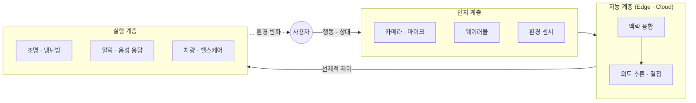

# 앰비언트 컴퓨팅 (Ambient Computing)

---

## I. 보이지 않게 스며든 컴퓨팅, 앰비언트 컴퓨팅의 개요

### 가. 정의

- 기기와 센서가 생활 환경에 자연스럽게 녹아들어, **사용자의 명시적 조작 없이 상황을 인지하고 필요한 서비스를 먼저 제공**하는 컴퓨팅 환경 (Mark Weiser의 유비쿼터스 컴퓨팅·Ambient Intelligence 개념의 발전형)

### 나. 특징

| 구분 | 내용 |
| --- | --- |
| 등장 배경 | 기기·앱 파편화에 따른 조작 부담, AI·IoT·엣지 컴퓨팅 성숙 |
| Zero UI | 화면 대신 음성·제스처·존재 감지로 상호작용 |
| 맥락 인지 | 위치·시간·활동·이력으로 사용자 상황 추론 |
| 선제적 서비스 | 요청 전에 환경을 조정하거나 정보 제공 |
| 기기 간 연속성 | 특정 기기가 아니라 공간·사용자를 따라 서비스 이어짐 |

---

## II. 구조 및 기술요소

### 가. 서비스 구조

- 센서가 상황을 감지하고, 지능 계층이 의도를 추론해 실행 장치를 제어하는 폐루프 구조

### 나. 기술요소

| 구분 | 요소 | 설명 |
| --- | --- | --- |
| 인터페이스 | Zero UI / NUI | 음성(VUI)·제스처·시선 등 자연스러운 입력 |
| 상황 인지 | Context-Awareness | 다중 센서 데이터를 결합해 상황·의도 추론 |
| 연결 | AIoT | AI가 결합된 IoT 기기 네트워크 |
| | Matter · Thread | CSA의 IP 기반 스마트홈 상호운용 표준(2022), 저전력 메시 네트워크 |
| 연산 | [[EDGE\|엣지 컴퓨팅]] · [[NPU]] | 기기·허브에서 즉시 처리해 지연·프라이버시 개선 |
| 지능 | [[온디바이스 AI]] · [[sLLM (Smaller Large Language Model)\|sLLM]] | 경량 모델을 기기에서 실행 |
| 프라이버시 | 연합학습 · 로컬 처리 | 원시 데이터를 기기 밖으로 보내지 않고 학습·추론 |
| 실행 | 액추에이터 | 조명·온도·잠금장치 등 물리 환경 제어 |

---

## III. 비교 및 동향

### 가. 유비쿼터스 컴퓨팅 vs 앰비언트 컴퓨팅

| 비교 항목 | 유비쿼터스 컴퓨팅 | 앰비언트 컴퓨팅 |
| --- | --- | --- |
| 강조점 | 언제 어디서나 접속 가능한 컴퓨팅 | 의식하지 않아도 동작하는 컴퓨팅 |
| 상호작용 | 주로 사용자 요청에 반응 | 상황 인지 후 선제적 동작 |
| 인터페이스 | 스마트폰·디스플레이 중심 | 음성·센서 중심 Zero UI |
| 기반 기술 | 무선망, 소형 단말, RFID | AI, NPU, 엣지 컴퓨팅, 상호운용 표준 |

### 나. 동향

- **생성형 AI 비서**: LLM 기반 음성 비서가 복합 명령을 이해하고 여러 기기를 조합해 실행 (Gemini for Home, Alexa+ 등)
- **공간 확장**: 집에서 차량(SDV)·사무실·도시로 앰비언트 서비스 영역 확대
- **프라이버시 보호**: 상시 카메라·마이크에 따른 감시 우려로 온디바이스 처리, 동형암호 등 프라이버시 강화 기술(PET) 적용

---

### 🔗 연관 토픽

- **소속 도메인**: [[00_디지털서비스_MOC|🚀 디지털서비스]]
- **세부 분류**: `5. 기능안전 (Functional Safety) & 신뢰성 표준`
- **핵심 연관 토픽**:
  - [[온디바이스 AI]]
  - [[sLLM (Smaller Large Language Model)]]
  - [[NPU|NPU(Neural Processing Unit)]]
  - [[인터미턴트 컴퓨팅|인터미턴트 컴퓨팅 (intermittent computing)]]
  - [[AI Agent]]
