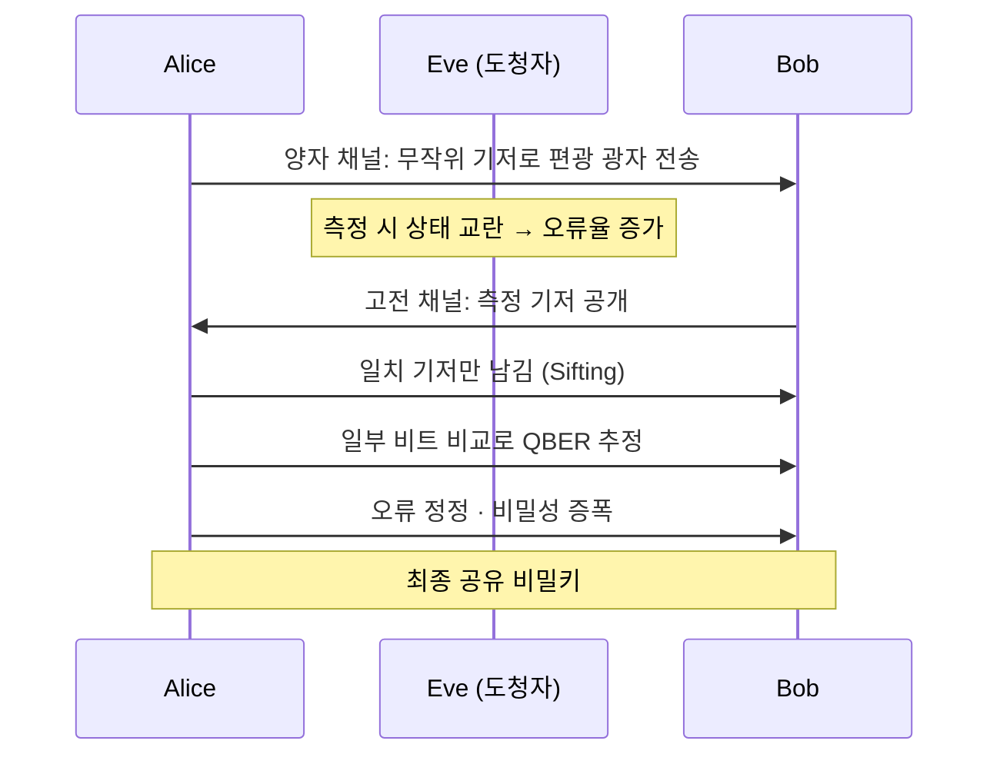

# 양자 암호 (Quantum Cryptography)

---

## I. 물리 법칙으로 도청을 드러내는, 양자 암호의 개요

### 가. 정의

- 양자의 **복제 불가능성과 측정에 의한 상태 교란을 이용해 도청을 탐지하면서 비밀키를 분배**하는 기술로, 대표 형태가 양자키분배(QKD)

### 나. 특징

| 구분 | 내용 |
| --- | --- |
| 정보이론적 안전성 | 이론상 계산 능력과 무관한 안전성 (이상적 장치 가정) |
| 도청 탐지 | 도청 시 양자 오류율(QBER)이 높아져 키 폐기 |
| 키 분배 전용 | 데이터 암호화는 분배된 키로 대칭키 암호(또는 OTP) 수행 |
| 인증 필요 | 고전 채널 인증을 위해 사전 공유키나 PQC 서명 필요 |
| 구현 한계 | 거리 제한, 전용 장비, 장치 취약점(검출기 공격) 존재 |

---

## II. 동작 구조 및 구성요소

### 가. BB84 기반 QKD 절차

- 양자 채널로 광자를 보내고 인증된 고전 채널로 기저를 대조해 키를 추린 뒤, 오류율이 임계값을 넘으면 폐기

### 나. 구성요소

| 구분 | 요소 | 설명 |
| --- | --- | --- |
| 물리 원리 | 복제 불가 정리·측정 교란 | 미지의 양자 상태는 복제할 수 없고 측정하면 바뀜 |
| 프로토콜 | BB84 | 2개 기저·4개 편광 상태 사용 (1984) |
| | Decoy-State | 미끼 펄스로 광자수 분할(PNS) 공격 탐지 |
| | E91·MDI-QKD | 얽힘 기반, 측정 장치 독립형으로 검출기 공격 대응 |
| 후처리 | 오류 정정·비밀성 증폭 | 오류 제거와 도청자 정보 제거 |
| 장치 | 단일 광자원·검출기 | 감쇠 레이저, SPAD·SNSPD 검출기 |
| | QRNG | 양자 현상 기반 난수 생성 |
| 네트워크 | 신뢰 노드 | 중계 지점에서 키를 재암호화해 거리 연장 (노드 신뢰 필요) |
| | 양자 중계기 | 얽힘 교환으로 장거리 전송 (연구 단계) |
| | 위성 QKD | 자유공간 링크로 대륙 간 분배 (Micius 위성 실증) |
| 연동 | QKD-KMS | 생성 키를 IPsec·MACsec 장비에 공급 |

---

## III. 비교 및 동향

### 가. QKD vs PQC

| 비교 항목 | QKD | [[양자내성암호]] (PQC) |
| --- | --- | --- |
| 안전성 근거 | 양자역학 원리 | 수학적 난제 (격자·해시 등) |
| 구현 | 전용 장비·광 채널 | 소프트웨어 교체 |
| 거리 | 광섬유 수십~100km대, 신뢰 노드 필요 | 제한 없음 |
| 인증 | 별도 인증 수단 필요 | 서명 알고리즘 포함 |
| 표준 | ITU-T Y.3800 시리즈, ETSI QKD | NIST FIPS 203·204·205 |
| 적용 | 백본·국방·금융 전용 구간 | 웹·모바일·IoT 전반 |

### 나. 동향

- **하이브리드 운용**: QKD 구간과 PQC 인증·키 교환을 결합하는 국가 양자 암호 통신망 구축 (국내 이동통신사 상용 구간 운영)
- **각국 입장 차이**: 미국 NSA·영국 NCSC 등은 비용·인증 문제로 PQC 우선 권고, 중국·EU는 QKD 인프라(EuroQCI) 투자
- **보안성 검증**: 검출기 맹목화 등 장치 공격 대응을 위한 QKD 장비 보안 평가 기준 마련

---

### 🔗 연관 토픽

- **소속 도메인**: [[00_보안_MOC|🛡️ 보안]]
- **세부 분류**: `2. 현대 암호학 & 키 관리 · 전자서명`
- **핵심 연관 토픽**:
  - [[양자내성암호]]
  - [[하이브리드 양자암호통신]]
  - [[쇼어 & 그루버 알고리즘]]
  - [[RSA (Rivest Shamir Adleman)]]
  - [[암호학적 보안 강도|암호학적 보안 강도(Security Strength)]]
