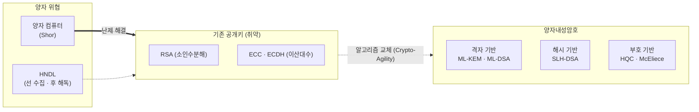

# 양자내성암호 (PQC: Post-Quantum Cryptography)

---

## I. 양자 컴퓨터 위협에 대응하는 공개키 암호, 양자내성암호의 개요

### 가. 정의

- 쇼어 [[알고리즘]] 등 **양자 컴퓨터로도 다항 시간에 풀기 어려운 수학적 난제(격자·해시·부호 등)** 에 기반해 [[RSA (Rivest Shamir Adleman)\|RSA]]·[[ECC]]·Diffie-Hellman을 대체하는 차세대 공개키 [[암호 알고리즘]]

### 나. 등장 배경 및 특징

| 구분 | 내용 |
| --- | --- |
| 기존 암호 붕괴 | 쇼어 알고리즘이 소인수분해·이산대수 문제를 다항 시간에 해결 → RSA·ECC 무력화 |
| HNDL 위협 | 지금 암호문을 수집해 두고 양자 컴퓨터 등장 시점(Q-Day)에 해독(Harvest Now, Decrypt Later) |
| 소프트웨어 전환 | [[양자 암호\|QKD]]와 달리 전용 장비 없이 기존 인터넷 인프라에서 알고리즘 교체로 적용 |
| 비용 | 키·서명 크기가 커서 대역폭·메모리 최적화 필요 |

---

## II. 수학적 기반 및 표준 알고리즘

### 가. 위협과 전환 개념도

### 나. 계열별 특징 및 표준

| 계열 | 수학적 난제 | 대표 알고리즘 | 특징 |
| --- | --- | --- | --- |
| 격자 기반 | 고차원 격자의 최단 벡터(SVP), LWE | **ML-KEM**(Kyber, FIPS 203), **ML-DSA**(Dilithium, FIPS 204), FN-DSA(Falcon) | 성능 균형이 좋아 표준의 주축, 키 교환·서명 모두 지원 |
| 해시 기반 | 해시 함수의 충돌 저항성 | **SLH-DSA**(SPHINCS+, FIPS 205) | 안전성 근거가 단순, 서명 크기 큼 |
| 부호 기반 | 오류 정정 부호의 복호 난제 | HQC(2025 추가 선정), Classic McEliece | 오랜 검증, 키 크기 큼 |
| 다변수 기반 | 다변수 이차 연립방정식 | Rainbow(2022 공격으로 탈락) | 서명 속도 빠름, 안전성 이슈 |

- NIST는 2024년 8월 FIPS 203·204·205를 최종 표준으로 승인
- 국내는 KpqC 공모전으로 HAETAE, AIMer(서명), SMAUG-T, NTRU+(KEM)를 선정

---

## III. 비교 및 전환 동향

### 가. 기존 공개키 암호 vs PQC

| 비교 항목 | RSA · ECC | PQC |
| --- | --- | --- |
| 수학적 근간 | 소인수분해, 이산대수 | 격자, 해시, 부호 등 |
| 양자 공격 | 치명적 취약 | 내성 보유 |
| 키·서명 크기 | 작음 (ECC 256bit) | 큼 |
| 성숙도 | 수십 년 검증 | 표준화 직후 도입 단계 |

### 나. PQC vs QKD

| 비교 항목 | PQC | QKD ([[양자 암호]]) |
| --- | --- | --- |
| 보안 원리 | 수학적 계산 복잡도 | 양자역학 법칙 (복제 불가) |
| 구현 | 소프트웨어, 기존망 재사용 (저비용) | 전용 장비·광채널 (고비용) |
| 거리 | 제한 없음 | 수백 km 한계, 중계 필요 |
| 표준 | NIST FIPS 203~205 | ITU-T Y.3800 시리즈 |

### 다. 전환 동향

- **하이브리드 키 교환**: X25519 + ML-KEM처럼 기존 암호와 PQC를 함께 사용해 어느 한쪽이 뚫려도 안전 (TLS 1.3 적용 확산)
- **Crypto-Agility**: 코드 수정 없이 알고리즘을 교체할 수 있는 구조와 암호 자산 목록(CBOM) 관리
- **우선 전환 대상**: 장기 기밀성이 필요한 금융·국방·공공부터 단계적 전환, 국내는 2030년대 초까지 공공 분야 전환 로드맵 추진 ([[국가 망 보안체계]])

---

### 🔗 연관 토픽

- **소속 도메인**: [[00_보안_MOC|🛡️ 보안]]
- **세부 분류**: `2. 현대 암호학 & 키 관리 · 전자서명`
- **핵심 연관 토픽**:
  - [[양자 암호|양자 암호(Quantum Cryptography)]]
  - [[쇼어 & 그루버 알고리즘]]
  - [[RSA (Rivest Shamir Adleman)]]
  - [[ECC|ECC(Elliptic Curve Cryptography)]]
  - [[FIPS (Federal Information Processing Standards)]]
