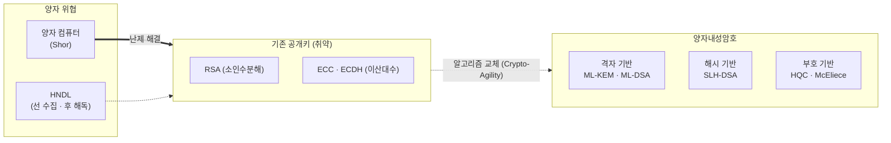

# 양자내성암호 (PQC: Post-Quantum Cryptography)

---

## I. 양자 컴퓨터 위협에 대응하는 공개키 암호, 양자내성암호의 개요

양자내성암호(PQC, Post-Quantum Cryptography)는 쇼어(Shor) 알고리즘을 구동하는 고성능 양자 컴퓨터로도 다항 시간 내에 풀 수 없는 수학적 난제(격자, 해시, 부호, 다변수 등)를 기반으로 하여, 기존의 RSA, ECC, Diffie-Hellman을 대체하는 차세대 비대칭 암호 알고리즘 체계이다.

| 구분 | 내용 |
| :--- | :--- |
| **정의** | 양자 컴퓨터로도 해독 불가능한 수학적 복잡도 난제 기반의 차세대 공개키 암호 알고리즘 |
| **등장 배경** | 쇼어 알고리즘에 의한 소인수분해·이산대수 붕괴 위협, 선제 수집 사후 해독(HNDL) 공격 대응 |
| **핵심 장점** | 양자암호키분배(QKD)와 달리 전용 하드웨어 없이 기존 통신망/소프트웨어에서 즉시 전환 가능 |

---

## II. 수학적 기반 및 표준 알고리즘

### 가. 위협과 전환 개념도

### 나. 계열별 특징 및 표준

| 계열 | 수학적 난제 | 세부 특징 및 대표 알고리즘 |
| :--- | :--- | :--- |
| **격자 기반 (Lattice)** | 고차원 격자 최단벡터(SVP), LWE | 성능 균형이 가장 우수하여 표준 주축. **ML-KEM**(Kyber, FIPS 203), **ML-DSA**(Dilithium, FIPS 204), FN-DSA(Falcon) |
| **해시 기반 (Hash)** | 해시 함수의 일방향성 및 충돌 저항성 | 안전성 근거가 명확하나 서명 크기가 큼. **SLH-DSA**(SPHINCS+, FIPS 205) 전자서명 표준 |
| **부호 기반 (Code)** | 오류 정정 부호(Goppa 등)의 복호 난제 | 오랜 기간 수학적 검증 완료, 공개키 크기가 큼. HQC, Classic McEliece |
| **다변수 기반 (Multivariate)** | 유한체 상의 다변수 이차 연립방정식(MQ) | 서명 검증 속도가 매우 빠르나 안전성 이슈 존재. GeMSS, Rainbow |

- NIST는 2024년 8월 FIPS 203(ML-KEM), 204(ML-DSA), 205(SLH-DSA)를 최종 표준으로 공식 발효
- 국내는 KpqC 공모전을 통해 HAETAE, AIMer(서명), SMAUG-T, NTRU+(KEM) 국가 표준 알고리즘 선정 추진

---

## III. 비교 및 전환 동향

### 가. 기존 공개키 암호 vs PQC

| 비교 항목 | 고전 공개키 (RSA · ECC) | 양자내성암호 (PQC) |
| :--- | :--- | :--- |
| **수학적 근간** | 소인수분해, 타원곡선 이산대수(ECDLP) | 고차원 격자(LWE), 해시 트리, 오류정정 부호 |
| **양자 컴퓨터 내성** | 쇼어 알고리즘에 의해 다항 시간 내 해독 (취약) | 양자 알고리즘으로도 지수 시간 복잡도 유지 (안전) |
| **키 및 서명 크기** | 수십~수백 바이트로 작음 (ECC 256bit) | 수백 바이트~수 킬로바이트(KB)로 상대적 큼 |
| **인프라 호환성** | 현행 모든 표준 프로토콜 탑재 | 패킷 단편화 고려 대역폭·메모리 최적화 필요 |

### 나. PQC vs QKD

| 비교 항목 | 양자내성암호 (PQC) | 양자키분배 (QKD, [[양자 암호]]) |
| :--- | :--- | :--- |
| **보안 원리** | 수학적 계산 복잡도 난제 | 양자역학 물리적 법칙 (불확정성, 복제불가) |
| **구현 방식** | 순수 소프트웨어/펌웨어 교체 (저비용) | 단일 광자 검출기 등 전용 물리 장비 (고비용) |
| **전송 거리** | 거리 제약 없음 (기존 인터넷망 활용) | 광섬유 감쇠로 수백 km 한계 (신뢰 노드 필요) |
| **글로벌 표준** | NIST FIPS 203, 204, 205 | ITU-T Y.3800 시리즈, ETSI |

### 다. PQC 전환 동향 및 향후 과제
- **하이브리드 키 교환(Hybrid KEM) 우선 상용화**: TLS 1.3 구간에서 고전 X25519와 PQC ML-KEM을 결합하여 두 공유키를 혼합 사용함으로써 전환기 과도기적 안정성 완벽 보장.
- **암호 민첩성(Crypto-Agility) 및 CBOM 관리**: 특정 알고리즘에 대한 새로운 수학적 취약점이 발견될 경우 소스코드 재작성 없이 신규 PQC로 즉시 교체 가능한 아키텍처 수립.
- **국가·공공 인프라 단계적 마이그레이션**: HNDL 공격에 노출된 국방·금융망을 시작으로 [[국가 망 보안체계]]와 연계하여 2030년대 초까지 전 국가 정보통신망의 PQC 전면 전환 로드맵 이행.

---

### 🔗 연관 토픽

- **소속 도메인**: [[00_보안_MOC|🛡️ 보안]]
- **세부 분류**: `2. 현대 암호학 & 키 관리 · 전자서명`
- **핵심 연관 토픽**:
  - [[양자 암호|양자 암호(Quantum Cryptography)]]
  - [[쇼어 & 그루버 알고리즘]]
  - [[RSA (Rivest Shamir Adleman)]]
  - [[ECC|ECC(Elliptic Curve Cryptography)]]
  - [[FIPS (Federal Information Processing Standards)]]
