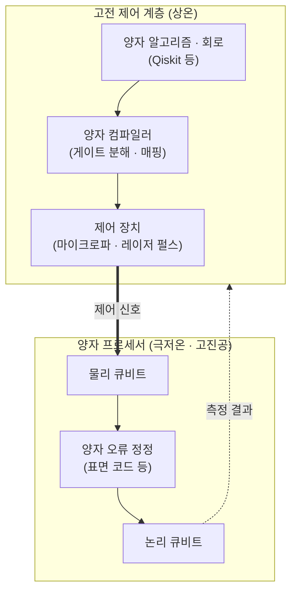

# 양자컴퓨터 (Quantum Computer)

---

## I. 중첩·얽힘·간섭을 이용한 연산, 양자컴퓨터의 개요

### 가. 정의

- 큐비트(Qubit)의 **중첩·얽힘과 확률 진폭의 간섭**을 이용해, 특정 문제를 고전 컴퓨터보다 훨씬 적은 연산 단계로 푸는 컴퓨터

### 나. 특징

| 구분 | 내용 |
| --- | --- |
| 등장 배경 | 고전 컴퓨터로 다루기 어려운 분자 시뮬레이션·최적화·소인수분해 문제 |
| 큐비트 | 0과 1의 중첩 상태, n큐비트는 2ⁿ개 상태의 진폭을 표현 |
| 제한된 우위 | 모든 문제가 빨라지는 것이 아니라 Shor(지수적), Grover(제곱근) 등 특정 알고리즘에서 이점 |
| 오류 취약 | 결맞음(Coherence) 시간이 짧고 노이즈가 커 오류 정정 필수 |
| 발전 단계 | NISQ(노이즈 있는 중간 규모) → FTQC(오류 허용 양자컴퓨팅) |

---

## II. 구조 및 기술요소

### 가. 구조

- 고전 계층이 회로를 펄스 신호로 바꿔 큐비트를 조작하고, 여러 물리 큐비트를 오류 정정 코드로 묶어 오류율이 낮은 논리 큐비트를 구성

### 나. 기술요소

| 구분 | 요소 | 설명 |
| --- | --- | --- |
| 양자 원리 | 중첩 (Superposition) | 큐비트가 0과 1의 선형 결합 상태로 존재 |
| | 얽힘 (Entanglement) | 여러 큐비트의 측정 결과가 독립적으로 설명되지 않는 상관관계 (정보의 즉시 전달은 아님) |
| | 간섭 (Interference) | 정답 상태의 진폭은 키우고 오답 진폭은 상쇄 |
| 하드웨어 | 초전도 | 조셉슨 접합 회로, 수십 mK 희석 냉동기 필요 (IBM, Google) |
| | 이온트랩 | 전자기장으로 이온 포획, 레이저로 제어, 높은 게이트 정확도 (Quantinuum, IonQ) |
| | 중성원자 | 광학 집게로 원자 배열, 대규모 배열·재배치 용이 (QuEra, Atom Computing) |
| | 광자 | 빛 입자 기반, 상온 동작·통신 연계 (PsiQuantum, Xanadu) |
| 오류 제어 | QEC | 표면 코드 등으로 오류를 감지·정정, 물리 오류율이 임계값 이하일 때 효과 |
| 소프트웨어 | 양자 SDK · OpenQASM | Qiskit, Cirq 등으로 회로 작성, 하드웨어별 컴파일 |

---

## III. 비교 및 동향

### 가. 하드웨어 방식 비교

| 비교 항목 | 초전도 | 이온트랩 | 중성원자 |
| --- | --- | --- | --- |
| 동작 환경 | 극저온 (수십 mK) | 초고진공, 레이저 냉각 | 초고진공, 레이저 냉각 |
| 제어 | 마이크로파 펄스 | 레이저 · 전자기장 | 레이저 · 광학 집게 |
| 장점 | 빠른 게이트, 반도체 공정 활용 | 긴 결맞음, 높은 정확도, 전 연결성 | 대규모 배열, 큐비트 재배치 |
| 단점 | 짧은 결맞음, 냉각 설비 | 느린 게이트, 확장성 | 느린 게이트, 원자 손실 |
| 사례 | IBM, Google Willow | Quantinuum, IonQ | QuEra, Atom Computing |

### 나. 동향

- **오류 정정 실증**: Google Willow(2024)가 표면 코드 크기를 키울수록 논리 오류율이 감소하는 임계값 이하 동작을 시연, 각 진영이 논리 큐비트 확대 로드맵 경쟁
- **하이브리드 연산**: HPC·[[GPU]]와 QPU를 연동해 일부 계산만 양자 프로세서로 넘기는 구조 (NVIDIA CUDA-Q 등)
- **PQC 전환**: 대규모 양자컴퓨터가 [[RSA (Rivest Shamir Adleman)|RSA]]·[[ECC]]를 깰 가능성(Q-Day)과 '지금 수집, 나중에 해독' 위협에 대비해 [[양자내성암호]]로 이행 (NIST FIPS 203~205, 2024)

---

### 🔗 연관 토픽

- **소속 도메인**: [[00_디지털서비스_MOC|🚀 디지털서비스]]
- **세부 분류**: `5. 기능안전 (Functional Safety) & 신뢰성 표준`
- **핵심 연관 토픽**:
  - [[양자내성암호]]
  - [[RSA (Rivest Shamir Adleman)]]
  - [[ECC|ECC(Elliptic Curve Cryptography)]]
  - [[GPU]]
  - [[암호화|암호화 (Encryption)]]
