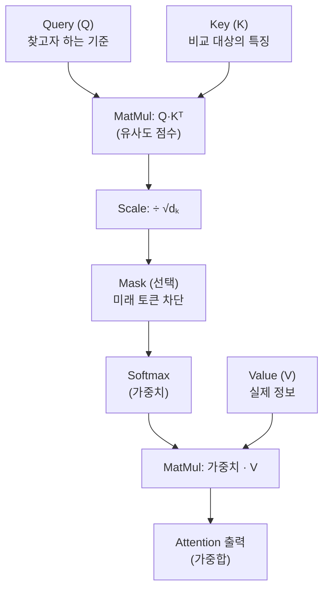

# 어텐션 메커니즘 (Attention Mechanism)

---

## I. 중요한 정보에 집중하는 연산, 어텐션 메커니즘의 개요

### 가. 어텐션 메커니즘(Attention Mechanism)의 정의
- 딥러닝 시퀀스 모델에서 출력을 생성할 때 입력 전체를 일률적으로 처리하지 않고, 현재 처리 시점과 연관성이 높은 특정 토큰에 동적으로 집중(Attention) 가중치를 부여하여 문맥 벡터를 생성하는 신경망 메커니즘이다.

### 나. 등장 배경 및 특징

| 구분 | 내용 |
| --- | --- |
| 정보 병목 해소 | [[seq2seq\|Seq2Seq]]의 고정 길이 컨텍스트 벡터에 모든 정보를 압축하던 한계 극복 |
| 장기 의존성 | [[RNN (Recurrent Neural Network)\|RNN]]·[[LSTM (Long Short-Term Memory)\|LSTM]]에서 문장이 길수록 앞 정보가 소실되는 문제 해결 |
| 병렬 처리 | 행렬 연산 기반으로 순차 처리 없이 병렬 계산 ([[트랜스포머]]의 핵심) |
| 해석 가능성 | 어텐션 가중치로 모델이 어디에 집중했는지 시각화 가능 |

---

## II. 동작 원리 및 핵심 요소

### 가. Scaled Dot-Product Attention

$$\text{Attention}(Q, K, V) = \text{softmax}\left(\frac{QK^\top}{\sqrt{d_k}}\right)V$$

- Q와 K의 내적으로 [[유사도]]를 구하고, $\sqrt{d_k}$로 나눠 Softmax 포화(기울기 소실)를 막은 뒤 V를 가중합

### 나. 핵심 구성요소

| 구분 | 요소 | 설명 |
| --- | --- | --- |
| 입력 | Query · Key · Value | 기준(Q), 검색 대상의 특징(K), 실제 정보(V) |
| 연산 | Attention Score / Softmax | 유사도 점수를 합이 1인 가중치로 정규화 ([[소프트맥스 정규화]]) |
| 변형 | Self-Attention | Q·K·V가 같은 시퀀스에서 나와 문장 내부 관계 파악 ([[자기 집중]]) |
| | Cross-Attention | 디코더의 Q가 인코더의 K·V를 참조 |
| | Multi-Head Attention | 여러 헤드로 병렬 수행해 다양한 관점의 관계 학습 |
| | Masked Attention | 디코더 학습 시 미래 토큰을 −∞로 마스킹 |
| 추론 최적화 | KV Cache | 이전 토큰의 K·V를 저장해 생성 시 중복 연산 제거 |
| 범위 조절 | Local / Global Attention | 윈도우 내 토큰만 보거나 전체를 참조 |

---

## III. 어텐션 구조 비교 및 최신 기술 동향

### 가. 어텐션 아키텍처 비교

#### 1) 기본 Seq2Seq vs 어텐션 기반 모델

| 비교 항목 | 기본 Seq2Seq | 어텐션 기반 (Transformer 등) |
| --- | --- | --- |
| **정보 압축** | 고정 크기 단일 벡터 압축 | 시점마다 동적 문맥 벡터 산출 |
| **장기 의존성** | 시퀀스 길이 증가 시 앞부분 정보 소실 | 토큰 간 거리에 무관하게 직접 참조 ($O(1)$) |
| **연산 방식** | 시간축 순차 처리 (Sequential) | 행렬 연산 기반 대규모 병렬 처리 (Parallel) |
| **긴 문장 처리 품질** | 병목 현상으로 급격한 성능 저하 | 고품질 문맥 정보 안정적 유지 |

#### 2) 어텐션 헤드 구조 비교 (MHA vs MQA vs GQA)

| 비교 항목 | MHA (Multi-Head) | MQA (Multi-Query) | GQA (Grouped-Query) |
| --- | --- | --- | --- |
| **구조적 특성** | 헤드마다 독립된 Key·Value 할당 | 모든 Query 헤드가 단일 Key·Value 공유 | Query 헤드를 그룹화하여 Key·Value 공유 |
| **KV Cache 메모리** | 가장 큼 (메모리 병목 심화) | 가장 작음 (극단적 경량화) | 작음 (메모리-성능 최적 절충) |
| **추론 서빙 속도** | 상대적 느림 | 매우 빠름 | 빠름 |
| **정확도/표현력** | 가장 우수함 | 다소 하락 | MHA 수준에 근접 |
| **적용 사례** | Transformer 원본, GPT-3 | PaLM, Falcon | Llama 2/3, Mistral 7B |

### 나. 최신 동향 및 향후 전망
- **FlashAttention 기반 하드웨어 최적화**: GPU의 SRAM과 HBM 간의 메모리 읽기/쓰기 대역폭 병목을 IO-Aware 타일링(Tiling) 기법으로 해소하여 어텐션 연산 속도와 메모리 효율 극대화.
- **초장문 컨텍스트($O(N^2)$ 한계 극복)**: 시퀀스 길이 제곱에 비례하는 연산 복잡도를 완화하기 위해 Ring Attention, Sparse Attention, LongLoRA 등 분산·희소 어텐션 기술을 통한 수백만 토큰 컨텍스트 지원.
- **비-어텐션 선형 복잡도 아키텍처의 도전**: 메모리 집약적인 KV Cache 부담을 원천 배제하기 위해 Mamba(SSM), RWKV 등 선형 복잡도 $O(N)$을 갖는 대안 모델 연구 활성화.

---

### 🔗 연관 토픽

- **소속 도메인**: [[00_인공지능_MOC|🤖 인공지능]]
- **세부 분류**: `3. 딥러닝 핵심 아키텍처 & 신경망`
- **핵심 연관 토픽**:
  - [[트랜스포머]]
  - [[자기 집중]]
  - [[seq2seq]]
  - [[초거대 언어 모델|초거대 언어 모델(Large Language Model)]]
  - [[RNN (Recurrent Neural Network)]]
