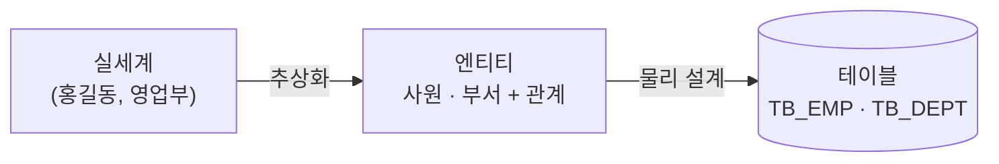

# 엔티티 (Entity)

---

## I. 업무 관심 대상의 집합, 엔티티의 개요

### 가. 정의

- 업무에 필요하고 **독립적으로 식별 가능한 사물·개념의 집합**으로, 속성과 관계를 가지며 물리 모델에서 테이블로 구현

### 나. 엔티티의 조건

| 구분 | 내용 |
| --- | --- |
| 업무 필요성 | 업무에서 관리가 필요한 정보 |
| 식별성 | 유일한 식별자로 인스턴스 구별 |
| 인스턴스 | 2개 이상의 인스턴스 집합 |
| 속성 | 반드시 속성을 가짐 |
| 관계 | 다른 엔티티와 최소 1개 이상 관계 |
| 업무 활용 | 업무 프로세스에서 사용(CRUD)됨 |

---

## II. 구조 및 분류

### 가. 엔티티 변환 과정

- 엔티티는 테이블로, 인스턴스는 행(Row)으로, 속성은 컬럼으로 대응

### 나. 구성요소와 분류

| 구분 | 요소 | 설명 |
| --- | --- | --- |
| 구성 | 인스턴스 | 엔티티에 속하는 개별 객체 (행) |
| | 속성 | 인스턴스의 성질 (컬럼) |
| | 식별자 | 인스턴스를 유일하게 구별 (PK, [[릴레이션 키]]) |
| 유무형 | 유형·개념·사건 | 사원(유형), 조직(개념), 주문(사건) |
| 발생 시점 | 기본(키) 엔티티 | 독립적으로 생성, 고유 식별자 보유 (고객, 상품) |
| | 중심 엔티티 | 기본 엔티티에서 발생, 업무 중심 (주문, 계좌) |
| | 행위 엔티티 | 두 개 이상 부모에서 발생, 자주 변경 (주문 이력) |
| 존재 의존 | 강한·약한 엔티티 | 약한 엔티티는 부모 식별자를 상속해야 존재 |
| 관계 해소 | 교차 엔티티 | M:N 관계를 두 개의 1:N으로 해소 |

---

## III. 비교 및 동향

### 가. DB 엔티티 vs DDD 엔티티

| 비교 항목 | DB 엔티티 | [[DDD (Domain Driven Design)\|DDD]] 엔티티 |
| --- | --- | --- |
| 목적 | 저장 구조와 무결성 | 도메인 규칙과 행위 표현 |
| 구성 | 속성(데이터) | 상태 + 메서드(행위) |
| 식별 | 기본키 | 식별자 (속성이 변해도 같은 객체) |
| 관계 | 외래키·[[조인]] | 애그리거트 루트 중심 참조 |

### 나. 동향

- **MSA 분리**: Bounded Context별로 엔티티를 나누고 이벤트로 최종 일관성 유지 ([[MSA (Micro Service Architecture)|MSA]])
- **지식 그래프**: 텍스트에서 개체명(NER)을 추출해 그래프 노드로 저장, GraphRAG에 활용

---

### 🔗 연관 토픽

- **소속 도메인**: [[00_데이터베이스_MOC|🗄️ 데이터베이스]]
- **세부 분류**: `1. 데이터 모델링 & 관계형 DB 설계`
- **핵심 연관 토픽**:
  - [[데이터베이스 모델링]]
  - [[릴레이션 키|릴레이션 키(Key)]]
  - [[관계성]]
  - [[연결함정|연결함정(Connection Trap)]]
  - [[스키마]]
