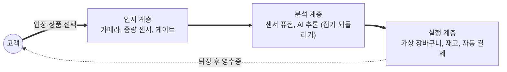

# 엠비언트 커머스 (Ambient Commerce)

---

## I. 의식하지 않아도 구매가 이뤄지는, 엠비언트 커머스의 개요

### 가. 정의

- 주변 환경에 내장된 **센서·카메라·AI가 상황을 인식해 고객의 명시적 조작 없이 상품 선택·결제·재주문을 처리**하는 상거래 방식

### 나. 필요성 및 특징

| 구분 | 내용 |
| --- | --- |
| 마찰 제거 | 계산대 대기, 바코드 스캔, 결제 입력 등 구매 과정 단축 |
| 기술 성숙 | 컴퓨터 비전, IoT 센서, 엣지 AI, [[에이전틱 AI]] 발전 |
| Zero UI | 걷기·집기 등 자연스러운 행동이 곧 입력 |
| 예측 구매 | 소비 패턴을 학습해 소진 전 자동 주문 |

---

## II. 구조 및 구성요소

### 가. 무인 매장 동작 구조

- 카메라와 선반 센서가 고객 행동을 추적하고, AI가 집은 상품과 되돌린 상품을 판별해 가상 장바구니를 만든 뒤 퇴장 시 자동 결제 (예: Amazon Just Walk Out)

### 나. 구성요소

| 구분 | 요소 | 설명 |
| --- | --- | --- |
| 인지 | 컴퓨터 비전 | 다중 카메라로 고객 동선·상품 객체 인식 ([[딥러닝]]) |
| | 센서 퓨전 | 영상과 선반 중량 센서를 결합해 인식 오류 보완 |
| | [[RFID]]·BLE 비콘 | 상품·위치 식별 보조 |
| 처리 | [[EDGE\|엣지]] 컴퓨팅 | 매장 내 서버에서 저지연 추론 |
| 결제 | 무자각 결제 | 앱·생체 인증 계정 기반 자동 결제 ([[핀테크]]) |
| 운영 | 디지털 트윈·재고 | 진열·재고 상태 실시간 반영, 보충 알림 |
| 가정 | AI 에이전트 자동 주문 | 스마트 기기가 소모품 소진을 감지해 재주문 |

---

## III. 이커머스 비교 및 동향

### 가. 이커머스 vs 엠비언트 커머스

| 구분 | 이커머스 | 엠비언트 커머스 |
| --- | --- | --- |
| 사용자 개입 | 검색·클릭·결제 (능동) | 행동 자체가 입력 (수동·자연) |
| 결제 | 명시적 결제 인증 | 자동·무자각 결제 |
| 공간 | 웹·앱 | 오프라인 매장, 스마트 홈, 차량 |
| 핵심 기술 | 추천 [[알고리즘]], 웹 플랫폼 | 컴퓨터 비전, AIoT, 엣지 AI |

### 나. 동향

- **무인 매장 모델 조정**: Amazon이 2024년 일부 대형 식료품 매장에서 Just Walk Out을 스마트 카트로 대체하는 등 운영비·정확도 문제로 적용 범위 재조정
- **프라이버시 보호**: 안면·행동 데이터 상시 수집 우려로 [[비식별화]], 동의 기반 생체 인증, 온디바이스 처리 필요
- **에이전트 커머스**: AI 에이전트가 사용자 대신 탐색·주문·결제하는 방식으로 확장 ([[의도 경제]])

---

### 🔗 연관 토픽

- **소속 도메인**: [[00_경영전략_MOC|📈 경영전략]]
- **세부 분류**: `5. IT 투자 성과 평가 & 비즈니스 연속성 계획 (BCP)`
- **핵심 연관 토픽**:
  - [[의도 경제|의도 경제(Intention Economy)]]
  - [[에이전틱 AI|에이전틱 AI(Agentic AI)]]
  - [[비식별화]]
  - [[핀테크|핀테크 (FinTech)]]
  - [[RFID]]
