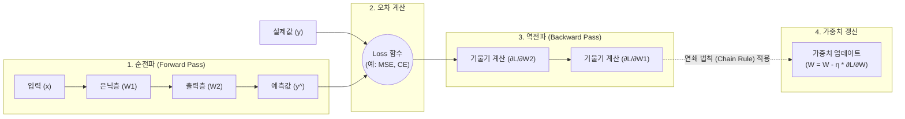

# 역전파 (Backpropagation)

---

## I. 인공신경망 최적화의 핵심 메커니즘, 역전파의 개요

### 가. 역전파(Backpropagation)의 정의
- 인공신경망의 출력층에서 발생한 오차(Loss)를 미분의 연쇄 법칙(Chain Rule)을 활용하여 입력층 방향으로 역방향 전파하면서 각 층의 가중치(Weight)와 편향을 갱신하는 딥러닝 핵심 지도학습 알고리즘이다.

### 나. 역전파의 등장 배경 및 주요 특징

| 구분 | 주요 내용 |
| --- | --- |
| 다층 퍼셉트론 학습 가능 | 단층 퍼셉트론의 XOR 선형 분리 불가 한계를 해결한 다층 신경망(MLP)의 은닉층 가중치 최적화 경로 확립 |
| 연쇄 법칙 (Chain Rule) | 합성함수 미분 원리를 적용하여 수십억 개 파라미터의 국소 미분값 곱셈 연산으로 전체 그래디언트 고속 계산 |
| 경사하강법과 결합 | 손실 함수(Loss Function)의 기울기 역방향으로 가중치를 이동시켜 전역 최적해(Global Minimum)로 점진적 수렴 |
| 활성화 텐서 캐싱 | 순전파(Forward Pass) 시 계산된 은닉 노드 활성화 값들을 역전파 기울기 산출을 위해 메모리에 저장·활용 |

---

## II. 역전파의 아키텍처 및 핵심 구성요소

### 가. 역전파의 동작 메커니즘 및 개념도

* 입력값을 통한 순전파 진행 시 각 노드의 활성화 값(Activation)을 캐싱하여 저장함
* 오차(Loss) 산출 후, 출력층에서 입력층 방향으로 국소 미분값을 곱해 나가는 연쇄 법칙으로 기울기를 도출하여 가중치를 갱신함

### 나. 역전파의 핵심 기술 요소

| 구분 | 요소기술(키워드) | 세부 설명 |
| --- | --- | --- |
| **수학적 원리** | **편미분 (Partial Derivative)** | 전체 오차(Loss) 함수를 특정 가중치 변수에 대해서만 미분하여 오차의 변화량과 기울기를 정량적으로 측정 |
| **수학적 원리** | **연쇄 법칙 (Chain Rule)** | 합성함수의 미분 성질을 이용하여, 층별 국소 미분값들의 단순 곱셈만으로 최종 노드의 그래디언트를 도출 |
| **연산 과정** | **순전파 (Forward Pass)** | 입력에서 출력 방향으로 연산하며 예측값을 산출하고, 역전파 계산에 필요한 노드별 연산 결과값을 캐시(Cache)에 저장 |
| **연산 과정** | **비용 함수 (Cost Function)** | 실제 정답(Label)과 예측값 간의 차이를 수치화. 회귀는 MSE(평균제곱오차), 분류는 CE(교차엔트로피)를 주로 사용 |
| **최적화 기법** | **경사하강법 (Gradient Descent)** | 산출된 기울기 방향의 역방향으로 가중치를 이동시켜 신경망 전체의 손실(Loss)을 최소값(Global Minima)으로 수렴 |
| **하이퍼파라미터** | **학습률 (Learning Rate)** | 가중치를 갱신할 때 이동하는 보폭(Step Size). 과도하면 발산하고, 부족하면 학습 속도 저하 및 지역 최적해(Local Minima)에 빠짐 |
| **학습 안정화** | **가중치 초기화 (Initialization)** | Xavier, He 초기화 등을 적용하여 학습 초기 역전파 시 발생할 수 있는 신호 폭주나 소실을 사전 차단 |
| **문제점 극복** | **비선형 활성화 함수 (ReLU)** | 깊은 계층에서 Sigmoid 함수 사용 시 기울기가 0으로 수렴하는 기울기 소실(Vanishing Gradient) 현상을 방지 |

---

## III. 역전파와 대안 학습 기법 비교 및 최신 기술 동향

### 가. 전통 역전파(Backpropagation) vs Forward-Forward(FF) 알고리즘 비교

| 비교 항목 | 전통적 역전파 (Backpropagation) | Forward-Forward (FF) 알고리즘 |
| --- | --- | --- |
| **제안 배경** | 합성함수 미분의 연쇄 법칙 기반 글로벌 최적화 | 생물학적 비현실성 극복 및 역방향 패스 제거 |
| **연산 방향** | 순전파(Forward) 후 역전파(Backward) 순차 실행 | 두 번의 순전파(Positive / Negative Pass)만 실행 |
| **오차 전달 방식** | 출력층에서 시작하여 이전 층으로 역방향 오차 전파 | 각 층이 자체 목적함수(Goodness)를 통해 국소(Local) 갱신 |
| **메모리(VRAM) 사용** | 활성화 텐서 전체 캐싱 필요 (높은 메모리 점유) | 순전파 중간값 저장 불필요 (메모리 절감) |
| **하드웨어 친화성** | GPU 글로벌 동기화 및 역방향 통신 오버헤드 | 아날로그 칩, 뉴로모픽(Neuromorphic) 저전력 하드웨어 친화적 |

### 나. 역전파의 한계 극복 및 최신 기술 동향
- **활성화 체크포인팅(Activation Checkpointing)**: 초거대 모델 역전파 시 모든 활성화 텐서를 VRAM에 유지하지 않고 일부 노드만 저장한 뒤, 역전파 도중 필요한 값을 재계산(Recomputation)하여 메모리 사용량 최대 80% 절감.
- **분산 학습과 그래디언트 최적화(ZeRO / DDP)**: 수천억 파라미터 분산 학습을 위해 역전파 단계에서 그래디언트와 옵티마이저 상태를 노드 간 분할 저장(ZeRO Stage 1~3)하고 통신-연산을 오버랩하는 파이프라인 고도화.
- **BP-Free(역전파 대체) 생물학적 인공지능 연구**: 역전파의 파이프라인 정체(Stall) 및 양방향 가중치 전송 병목을 탈피하기 위해 피드백 정렬(Feedback Alignment) 및 뉴로모픽 칩 기반 로컬 학습 메커니즘 연구 지속.

---

### 🔗 연관 토픽

- **소속 도메인**: [[00_인공지능_MOC|🤖 인공지능]]
- **세부 분류**: `2. 머신러닝 기초 & 핵심 알고리즘`
- **핵심 연관 토픽**:
  - [[딥러닝]]
  - [[경사하강법|경사하강법 (Gradient Descent Algorithm)]]
  - [[지도학습]]
  - [[랜덤 포레스트|랜덤 포레스트 (Random Forest)]]
  - [[편향]]
