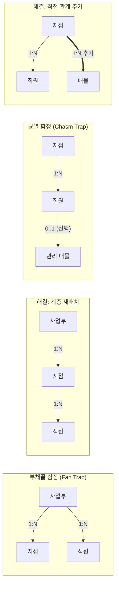

# 연결함정 (Connection Trap)

---

## I. 관계 경로의 오해, 연결함정의 개요

### 가. 정의

- ER 모델에서 관계 배치를 잘못해 **엔티티 인스턴스 간 연결 경로가 모호하거나 끊겨, 필요한 정보를 정확히 얻을 수 없는 모델링 오류** (부채꼴 함정, 균열 함정)

### 나. 특징

| 구분 | 내용 |
| --- | --- |
| 원인 | 업무 규칙 오해, 관계 오배치, 선택적 참여 방치 |
| 증상 | 경로 모호(Fan) 또는 경로 단절(Chasm) |
| 영향 | 잘못된 조회 결과, 집계 중복, 데이터 누락 |
| 해결 | 관계 재배치, 누락된 직접 관계 추가 |

---

## II. 유형 및 해결 방안

### 가. 유형별 구조

- 부채꼴 함정: 한 엔티티에서 1:N 관계가 두 갈래로 뻗어 어떤 직원이 어느 지점 소속인지 알 수 없음
- 균열 함정: 담당 직원이 없는 매물은 지점과 연결 경로가 끊김

### 나. 유형별 비교

| 구분 | 요소 | 설명 |
| --- | --- | --- |
| Fan Trap | 구조 | 하나의 엔티티에서 두 개 이상의 1:N 관계가 부채꼴로 분기 |
| | 문제 | 하위 엔티티 인스턴스 간 연결이 모호, SQL 조인 시 행 중복·집계 과다 |
| | 해결 | 업무 흐름에 맞게 관계를 직렬 계층으로 재배치 |
| Chasm Trap | 구조 | 경로 중간에 선택적(0 참여) 관계 존재 |
| | 문제 | 중간 인스턴스가 없으면 양 끝 엔티티 연결 단절, 조회 누락 |
| | 해결 | 양 끝 엔티티 간 직접 관계 추가 |
| 예방 | 경로 검증 | ERD 완성 후 주요 업무 질의 경로를 시나리오로 점검 |

---

## III. 비교 및 동향

### 가. Fan Trap vs Chasm Trap

| 비교 항목 | Fan Trap | Chasm Trap |
| --- | --- | --- |
| 원인 | 1:N 관계의 병렬 분기 | 선택적 참여 관계 |
| 증상 | 경로 모호 | 경로 단절 |
| 결과 | 잘못된 연결·중복 집계 | 데이터 누락 |
| 해결 | 관계 재구성 | 직접 관계 추가 |

### 나. 동향

- **BI 시맨틱 레이어**: 리포팅 도구가 Fan·Chasm Trap을 감지해 집계를 분리 실행 (예: 컨텍스트, 다중 쿼리)
- **그래프 DB**: 관계를 엣지로 명시해 경로 탐색을 직관적으로 표현, 모델 오류 자체는 설계 검토가 필요

---

### 🔗 연관 토픽

- **소속 도메인**: [[00_데이터베이스_MOC|🗄️ 데이터베이스]]
- **세부 분류**: `1. 데이터 모델링 & 관계형 DB 설계`
- **핵심 연관 토픽**:
  - [[엔티티|엔티티(Entity)]]
  - [[관계성]]
  - [[데이터베이스 모델링]]
  - [[조인|조인(Join)]]
  - [[SQL(Structured Query Language)]]
