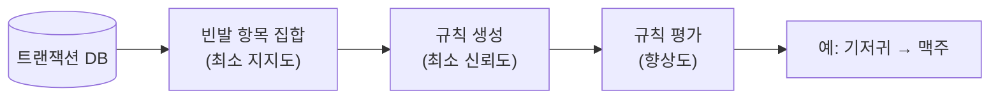

# 연관화 (Association)

---

## I. 함께 나타나는 항목의 규칙화, 연관화의 개요

### 가. 정의

- 데이터 마이닝 과업 중 하나로, 트랜잭션에서 **항목 간 동시 발생 관계를 "If A then B" 규칙으로 찾아내는 [[비지도 학습]] 기법** (상세 기법은 [[연관성 분석]] 참고)

### 나. 특징

| 구분 | 내용 |
| --- | --- |
| 무방향 탐색 | 목표 변수 없이 모든 항목 조합의 패턴 탐색 |
| 정량 평가 | [[지지도]]·신뢰도·향상도로 규칙 강도 평가 |
| 해석 용이 | 규칙 형태라 업무 담당자가 바로 이해 |
| 용어 구분 | 데이터 모델링의 연관화(is-member-of 추상화)와 다른 개념 ([[관계성]]) |

---

## II. 탐색 절차 및 구성요소

### 가. 연관 규칙 탐색 절차

- 최소 지지도로 빈발 집합을 고르고, 최소 신뢰도로 규칙을 만든 뒤 향상도로 우연한 규칙을 걸러냄

### 나. 구성요소

| 구분 | 요소 | 설명 |
| --- | --- | --- |
| 지표 | 지지도 | P(A∩B), 빈발 집합 선별 기준 |
| | 신뢰도 | P(B\|A), 규칙의 강도 |
| | 향상도 | P(B\|A) / P(B), 1 초과 양의 연관, 1 독립, 1 미만 음의 연관 |
| 알고리즘 | [[Apriori 알고리즘\|Apriori]] | 상향식·너비 우선으로 k-항목 후보 생성, 단계마다 DB 스캔 |
| | [[FP(Frequent Pattern) - Growth 알고리즘\|FP-Growth]] | FP-Tree 기반, 후보 생성 없이 DB 2회 스캔 |
| | ECLAT | 수직 포맷 TID 교집합, 깊이 우선 탐색 |
| 확장 | 순차 패턴 | 시간 순서를 고려한 규칙 |
| | 다차원 연관 규칙 | 품목 외 나이·지역 등 속성을 함께 고려 |

---

## III. 비교 및 동향

### 가. 연관화 vs 협업 필터링 (추천 관점)

| 비교 항목 | 연관화 | 협업 필터링 |
| --- | --- | --- |
| 입력 | 거래(장바구니) 데이터 | 사용자–아이템 평점·행동 행렬 |
| 기준 | 항목 간 동시 발생 | 사용자·아이템 간 유사도 |
| 알고리즘 | Apriori, FP-Growth | KNN, 행렬 분해 |
| 개인화 | 집단 규칙 (비개인화) | 개인 맞춤 |
| 콜드 스타트 | 신규 상품은 지지도 부족 | 신규 사용자·아이템 유사도 계산 불가 |

### 나. 동향

- **그래프·임베딩 기반 추천**: GNN으로 항목 간 고차 연관을 학습해 연관 규칙을 보완
- **하이브리드 추천**: 연관 규칙을 협업 필터링·컨텍스트 정보와 결합

---

### 🔗 연관 토픽

- **소속 도메인**: [[00_데이터베이스_MOC|🗄️ 데이터베이스]]
- **세부 분류**: `2. 트랜잭션 & 동시성 제어 (Concurrency)`
- **핵심 연관 토픽**:
  - [[연관성 분석]]
  - [[Apriori 알고리즘]]
  - [[지지도]]
  - [[비지도 학습]]
  - [[집단화]]
