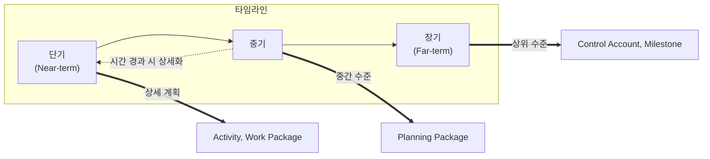

# 연동계획 (Rolling Wave Planning)

---

## I. 가까운 일은 상세히, 먼 일은 개략적으로, 연동계획의 개요

### 가. 정의

- 가까운 기간의 작업은 **활동(Activity) 수준까지 상세히** 계획하고, 먼 미래의 작업은 **상위 수준으로 유지**했다가 정보가 확보되면 점진적으로 구체화하는 반복 계획 기법 (PMBOK 활동 정의 프로세스의 기법)

### 나. 필요성 및 특징

| 구분 | 내용 |
| --- | --- |
| 불확실성 대응 | 초기에 알 수 없는 정보를 억지로 확정하지 않아 재계획·재작업 감소 |
| 점진적 구체화 | Progressive Elaboration, 정보가 늘수록 계획 정확도 향상 |
| 분할 깊이 차등 | 시점에 따라 WBS 분해 수준이 다름 |
| 적응형 철학 | 애자일의 릴리스 계획(장기)·스프린트 계획(단기)과 같은 원리 |

---

## II. 동작 원리와 구성요소

### 가. 개념도

- 시간이 지나면 다음 기간(Wave)의 계획 패키지를 작업 패키지·활동으로 분해. 이를 주기적으로 반복

### 나. 구성요소

| 구분 | 요소 | 설명 |
| --- | --- | --- |
| 원리 | 점진적 구체화 | 가용 정보 증가에 따라 계획을 지속 상세화 |
| 분할 도구 | [[WBS\|WBS]] | 범위를 작업 패키지 단위로 계층 분해 |
| 단기 계획 | Work Package, Activity | 일정·자원·원가 산정이 가능한 수준까지 상세화 |
| 중장기 계획 | Planning Package | 작업 내용은 알지만 세부 활동이 미정인 통제 계정 하위 단위 |
| | Control Account, Milestone | 성과 측정 기준점이 되는 상위 관리 단위 |
| 기준선 | 일정·원가 베이스라인 | 계획 패키지 예산 범위 내 상세화, 범위·예산이 바뀌면 변경 통제 대상 |
| 검토 시점 | 단계 관문 (Phase Gate) | 다음 Wave 상세 계획 전 검토·승인 |

---

## III. 비교 및 동향

### 가. 연동계획 vs 일괄 상세 계획

| 비교 항목 | 연동계획 | 일괄 상세 계획 |
| --- | --- | --- |
| 개념 | 근거리 상세, 원거리 개략 | 초기에 전체를 상세 확정 |
| WBS 분할 | 시점별 깊이 상이 | 전 범위를 동시에 최하위까지 분해 |
| 적용 환경 | R&D, SW 개발 등 불확실성 높은 분야 | 건설·제조 등 요구사항이 명확한 분야 |
| 변경 대응 | 유연함 | 변경 시 대규모 재계획 필요 |
| 생애주기 | 적응형, 하이브리드 | [[워터폴\|폭포수]], 예측형 |

### 나. 동향

- **하이브리드 PM**: 마스터 일정은 예측형으로, 세부 구현은 [[SCRUM|스크럼]] 이터레이션으로 운영하는 방식이 대형 SI에 확산
- **도구 지원**: PMIS가 유사 프로젝트 이력을 바탕으로 다음 Wave의 활동·자원 분해를 추천

---

### 🔗 연관 토픽

- **소속 도메인**: [[00_프로젝트관리_MOC|📋 프로젝트관리]]
- **세부 분류**: `1. PMBOK 표준 & 프로젝트 거버넌스`
- **핵심 연관 토픽**:
  - [[WBS|WBS (Work Breakdown Structure)]]
  - [[프로젝트 일정관리]]
  - [[프로젝트 관리 계획서]]
  - [[SCRUM]]
  - [[Agile]]
