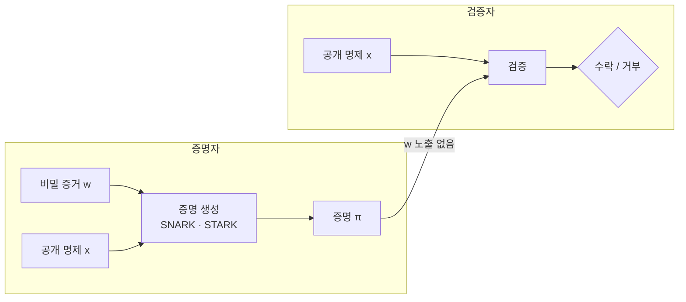

# 영지식증명 (Zero Knowledge Proof, ZKP)

---

## I. 비밀은 숨기고 사실만 증명, 영지식증명의 개요

### 가. 정의

- 증명자가 **어떤 명제가 참이라는 사실(또는 비밀을 알고 있다는 사실) 외에는 아무 정보도 드러내지 않고** 검증자를 납득시키는 암호 프로토콜 (Goldwasser·Micali·Rackoff, 1985)

### 나. 특징

| 구분 | 내용 |
| --- | --- |
| 완전성 | 명제가 참이면 정직한 검증자는 항상 수락 |
| 건전성 | 명제가 거짓이면 속일 확률이 무시할 만큼 작음 |
| 영지식성 | 검증자는 참·거짓 외의 지식을 얻지 못함 |
| 활용 배경 | 최소 공개 신원 증명(DID), 블록체인 프라이버시·확장성 |

---

## II. 동작 구조 및 구성요소

### 가. 비대화형 증명(NIZK) 구조

- 증명자는 비밀 w와 공개 명제 x로 증명 π를 만들고, 검증자는 x와 π만으로 참 여부를 판단

### 나. 구성요소

| 구분 | 요소 | 설명 |
| --- | --- | --- |
| 참여자 | 증명자 / 검증자 | 비밀 보유자와 판정자 |
| 핵심 속성 | 완전성·건전성·영지식성 | 증명 시스템의 3대 요건 |
| 증명 방식 | 대화형 | 챌린지-응답을 반복 (Schnorr 식별, 동굴 예시) |
| | 비대화형 (NIZK) | Fiat-Shamir 변환 등으로 한 번에 증명 전달 |
| 연산 표현 | 산술 회로·다항식 | 프로그램을 R1CS·PLONKish 제약식으로 변환 |
| 신뢰 설정 | Trusted Setup | 일부 SNARK의 공개 파라미터 생성, 비밀 난수(toxic waste) 폐기 필요 |
| 응용 증명 | 범위 증명 (Bulletproofs) | 값이 범위 안에 있음을 증명 (예: 성인 여부) |

---

## III. 비교 및 동향

### 가. zk-SNARK vs zk-STARK

| 비교 항목 | zk-SNARK | zk-STARK |
| --- | --- | --- |
| 의미 | Succinct Non-interactive ARgument of Knowledge | Scalable Transparent ARgument of Knowledge |
| 기반 | 페어링·타원곡선 (Groth16, PLONK) | 해시 함수 (FRI) |
| 신뢰 설정 | Groth16 등은 필요, Halo2 등은 불필요 | 불필요 (투명) |
| 증명 크기 | 수백 바이트 (Groth16 약 200바이트) | 수십~수백 KB |
| 양자 내성 | 타원곡선 기반은 취약 | 해시 기반으로 내성 기대 |
| 사례 | Zcash, zkSync | Starknet |

### 나. 동향

- **ZK 롤업**: 이더리움 레이어2에서 오프체인 실행 결과를 증명으로 검증해 확장성 확보
- **선택적 공개 신원**: 디지털 신원지갑(EU EUDI Wallet 등)에서 나이·자격만 증명하는 방식 논의
- **zkVM·증명 가속**: 범용 프로그램을 증명하는 zkVM과 GPU·전용 하드웨어 증명 가속

---

### 🔗 연관 토픽

- **소속 도메인**: [[00_보안_MOC|🛡️ 보안]]
- **세부 분류**: `2. 현대 암호학 & 키 관리 · 전자서명`
- **핵심 연관 토픽**:
  - [[블록체인 플랫폼|블록체인 (Block Chain) 플랫폼]]
  - [[동형 암호|동형 암호 (Homomorphic Encryption)]]
  - [[PEC(Privacy-Enhancing Computation)]]
  - [[타원곡선 암호|타원곡선 (Elliptic Curve Cryptography)]]
  - [[CBDC]]
