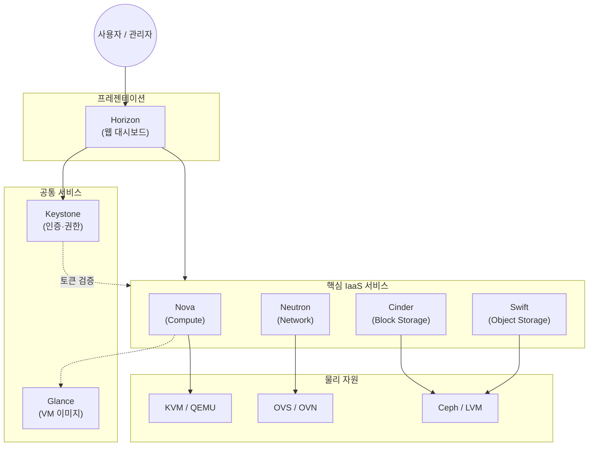

# 오픈스택 프로젝트 (OpenStack Project)

---

## I. 오픈소스 IaaS 플랫폼, 오픈스택의 개요

### 가. 정의

- 컴퓨팅·스토리지·네트워크 자원 풀을 API와 대시보드로 제어하여 **프라이빗·퍼블릭 IaaS 클라우드를 구축하는 오픈소스 플랫폼** (2010년 Rackspace·NASA 시작)

### 나. 특징

| 구분 | 내용 |
| --- | --- |
| 등장 배경 | 상용 클라우드·가상화 제품 종속(Vendor Lock-in) 탈피, 개방형 클라우드 생태계 필요 |
| 모듈형 구조 | 서비스별 독립 프로젝트를 필요에 따라 조합 |
| 표준 API | 모든 서비스가 RESTful API 제공, 자동화 용이 |
| 확장성 | 범용 하드웨어로 대규모 수평 확장, 통신사·연구기관 활용 |
| 릴리스 | 6개월 주기 릴리스 (2023.1 Antelope부터 연도.회차 표기) |

---

## II. 아키텍처 및 핵심 프로젝트

### 가. 아키텍처

- 요청은 Keystone 인증 후 각 서비스의 REST API로 전달되고, 서비스는 하이퍼바이저·SDN·스토리지를 추상화하여 VM과 자원을 [[프로비저닝]]

### 나. 핵심 프로젝트

| 구분 | 요소 | 설명 |
| --- | --- | --- |
| 컴퓨팅 | Nova | VM 생명주기 관리·스케줄링 |
| 네트워크 | Neutron | 가상 네트워크·[[라우터]]·보안그룹 제공, [[SDN(Software Defined Network)\|SDN]] 연동 |
| 스토리지 | Cinder | VM에 연결하는 블록 볼륨 생성·스냅샷 |
| | Swift | 분산 객체 스토리지, 비정형 대용량 데이터 저장 |
| 공통 | Keystone | 인증, 토큰 발급, 서비스 카탈로그 |
| | Glance | VM 이미지([[OS(운영체제)\|OS]] 템플릿) 등록·조회 |
| | Horizon | 웹 기반 관리 콘솔 |
| 확장 | Heat | 템플릿 기반 오케스트레이션 (IaC) |
| | Magnum / Ironic | [[쿠버네티스]] 클러스터 프로비저닝 / 베어메탈 프로비저닝 |

---

## III. 비교 및 동향

### 가. OpenStack vs VMware vSphere

| 비교 항목 | OpenStack | VMware vSphere |
| --- | --- | --- |
| 라이선스 | 오픈소스 (Apache 2.0) | 상용 |
| 구조 | 분산형, 모듈 조합 IaaS | 통합형 가상화 관리 제품군 |
| 하드웨어 | 범용·화이트박스 H/W 폭넓게 지원 | 인증 H/W 중심 |
| 비용 | 라이선스 무료, 구축·운영 인력 비용 큼 | 라이선스 비용 높음, 벤더 기술 지원 |
| 적합 환경 | 통신사(NFV), 퍼블릭·연구 클라우드 | 기업 내부 가상화, 미션 크리티컬 |

### 나. 동향

- **VMware 대체 수요**: Broadcom의 VMware 인수(2023) 후 라이선스 변경으로 OpenStack 기반 프라이빗 클라우드 재검토 증가
- **LOKI 스택**: Linux·OpenStack·Kubernetes·Infrastructure 조합, OpenStack이 쿠버네티스 하부 IaaS(베어메탈·네트워크)로 결합
- **거버넌스**: OpenInfra Foundation이 2025년 Linux Foundation 산하로 합류, GPU·FPGA 가속기 관리(Cyborg) 등 AI 인프라 지원 강화

---

### 🔗 연관 토픽

- **소속 도메인**: [[00_디지털서비스_MOC|🚀 디지털서비스]]
- **세부 분류**: `1. 클라우드 컴퓨팅 & 가상화 인프라`
- **핵심 연관 토픽**:
  - [[클라우드 컴퓨팅|클라우드 컴퓨팅 (Cloud Computing)]]
  - [[가상화]]
  - [[Hypervisor (VMM)]]
  - [[쿠버네티스|쿠버네티스(Kubernates)]]
  - [[SDN(Software Defined Network)|SDN]]
