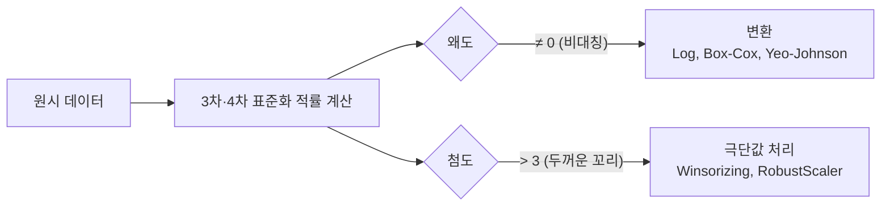

# 왜도 (Skewness) & 첨도 (Kurtosis)

---

## I. 분포의 치우침과 꼬리, 왜도와 첨도의 개요

### 가. 정의

- **왜도**: 분포의 비대칭 정도를 나타내는 3차 표준화 적률, $E[(X-\mu)^3]/\sigma^3$
- **첨도**: 분포 꼬리의 두께(극단값 발생 경향)를 나타내는 4차 표준화 적률, $E[(X-\mu)^4]/\sigma^4$

### 나. 필요성

| 구분 | 내용 |
| --- | --- |
| 정규성 진단 | 회귀·[[ANOVA(Analysis of variance)\|ANOVA]] 등 [[정규분포]] 가정 점검 |
| 위험 탐지 | 금융 Fat-tail 위험, [[이상치]] 빈발 여부 판단 |
| 전처리 기준 | 로그·Box-Cox 변환, 클리핑 적용 여부 결정 |
| 모니터링 | [[MLOps]]에서 입력 분포 변화 감지 지표 |

---

## II. 판별 구조 및 핵심 요소

### 가. 판별·조치 흐름

- 왜도로 치우침, 첨도로 꼬리 두께를 평가하고 각각 변환·극단값 처리로 대응

### 나. 핵심 요소

| 구분 | 요소 | 설명 |
| --- | --- | --- |
| 왜도 | 양의 왜도 (오른쪽 꼬리) | 대체로 평균 > 중앙값 > 최빈값, 예: 소득 분포 |
| | 음의 왜도 (왼쪽 꼬리) | 대체로 최빈값 > 중앙값 > 평균, 예: 쉬운 시험 점수 |
| 첨도 | 급첨 (Leptokurtic) | 첨도 > 3 (초과첨도 > 0), 꼬리가 두꺼워 극단값 빈발 (예: t분포) |
| | 중첨 (Mesokurtic) | 첨도 = 3, 정규분포 |
| | 완첨 (Platykurtic) | 첨도 < 3, 꼬리가 얇음 (예: 균등분포) |
| 검정 | Jarque-Bera | 표본 왜도·첨도가 0·3에서 벗어나는지로 정규성 검정 |
| 변환 | Box-Cox·Yeo-Johnson | 멱변환으로 왜도 완화 (Box-Cox는 양수만, Yeo-Johnson은 음수 허용) |
| | Log·Root | 양의 왜도가 큰 금액·건수 데이터 압축 |
| 극단값 | Winsorizing | 상·하위 백분위 경계값으로 극단값 대체 |

---

## III. 비교 및 동향

### 가. 왜도 vs 첨도

| 비교 항목 | 왜도 | 첨도 |
| --- | --- | --- |
| 정의 | 3차 표준화 적률 | 4차 표준화 적률 |
| 측정 대상 | 비대칭 방향·정도 | 꼬리 두께 (봉우리의 뾰족함이 아님) |
| 정규분포 값 | 0 | 3 (초과첨도 0) |
| 영향 | 평균의 대표성 저하 | 분산·평균 추정 불안정, 극단 위험 과소평가 |
| 대응 | 로그·멱변환 | Winsorizing, 강건 통계량 |

### 나. 동향

- **드리프트 모니터링**: 서빙 데이터의 왜도·첨도를 학습 기준값과 비교해 분포 변화를 조기 감지 ([[모델 드리프트 컨셉 드리프트 & 데이터 드리프트|데이터 드리프트]])
- **LLM 양자화의 이상치 문제**: LLM 활성값은 일부 채널에 극단값이 몰린 두꺼운 꼬리 분포를 보여, SmoothQuant(활성 이상치를 가중치로 스케일 이전)·AWQ(활성 크기 기준 중요 가중치 보호) 등으로 양자화 오차 완화

---

### 🔗 연관 토픽

- **소속 도메인**: [[00_인공지능_MOC|🤖 인공지능]]
- **세부 분류**: `1. 수학 · 통계학 & 데이터 전처리`
- **핵심 연관 토픽**:
  - [[기술 통계|기술 통계(Descriptive statistics)]]
  - [[정규분포|정규분포(Normal Distribution)]]
  - [[이상치]]
  - [[확률분포]]
  - [[MLOps]]
