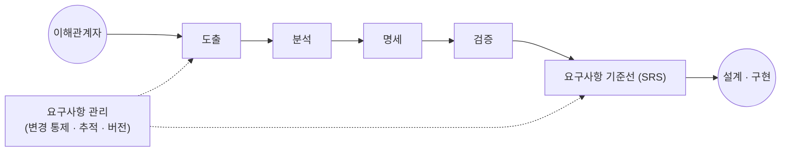

# 요구 공학 (Requirements Engineering)

---

## I. 무엇을 만들지 정하는 공학, 요구 공학의 개요

### 가. 정의

- 이해관계자의 요구를 **도출·분석·명세·검증하고, 개발 전 과정의 변경을 추적·관리**하는 체계적 공학 활동

### 나. 필요성 및 특징

| 구분 | 내용 |
| --- | --- |
| 실패 방지 | 불완전·부정확한 요구가 프로젝트 실패의 주요 원인 (Standish CHAOS 보고서) |
| 기준선 제공 | 개발 범위와 테스트·인수의 기준 확정 |
| 추적성 | 요구-설계-구현-테스트 간 양방향 연결 유지 |
| 지속 관리 | 변경 요청을 영향 분석·승인 절차로 통제 |

---

## II. 프로세스 및 구성요소

### 가. 요구 공학 프로세스

- 도출-분석-명세-검증을 반복해 기준선을 확정하고, 이후 변경은 요구사항 관리 활동이 추적·통제

### 나. 구성요소

| 구분 | 요소 | 설명 |
| --- | --- | --- |
| 도출 | 인터뷰 · 워크숍 · 관찰 | 이해관계자로부터 명시적·암묵적 요구 수집 |
| | 브레인스토밍 · 델파이 · 프로토타이핑 | 아이디어 확산, 전문가 익명 합의, 시제품으로 요구 확인 |
| 분석 | [[요구 사항 분석\|분석 모델링]] | [[데이터 흐름도\|DFD]]·[[UML]]로 구조화, 충돌 해결·우선순위화 |
| 명세 | [[요구사항 명세서]] (SRS) | ISO/IEC/IEEE 29148 (IEEE 830 대체), 자연어·정형 명세 |
| 검증 | 리뷰 · 인스펙션 · 워크스루 | 모호성·완전성·일관성·검증 가능성 확인 |
| | 프로토타입 · 테스트 케이스 작성 | 요구를 시험 가능한 형태로 확인 |
| 관리 | 추적 매트릭스 (RTM) | 요구 ID와 설계·코드·테스트 간 순방향·역방향 추적 |
| | 변경 통제 | 영향 분석 후 CCB 승인, 기준선 갱신 ([[형상 관리]]) |

---

## III. 비교 및 동향

### 가. 전통적 요구 공학 vs 애자일 요구 공학

| 비교 항목 | 전통적 (폭포수) | [[Agile\|애자일]] |
| --- | --- | --- |
| 접근 | 초기 일괄 확정 (Up-front) | 지속적 진화 |
| 산출물 | 상세 SRS | 제품 백로그, 사용자 스토리 |
| 문서화 | 공식·상세 | 경량, 대화와 인수 기준 중심 |
| 변경 통제 | CCB 중심 엄격 통제 | 백로그 재정렬로 스프린트마다 반영 |
| 고객 참여 | 도출 단계와 [[인수 테스트]] | 전 과정 상시 (PO) |

### 나. 동향

- LLM으로 인터뷰 기록에서 요구 초안을 추출하고 모호성·모순을 탐지하는 AI 보조 요구 공학
- Jira 등 요구 관리 도구와 CI/CD를 연동해 커밋 단위 추적성 확보
- 국방·항공·자동차에서 SysML 기반 MBSE로 모델 중심 요구 관리

---

### 🔗 연관 토픽

- **소속 도메인**: [[00_소프트웨어공학_MOC|🏗️ 소프트웨어공학]]
- **세부 분류**: `3. 요구사항 공학 & UML 객체지향 분석/설계`
- **핵심 연관 토픽**:
  - [[요구 사항 분석]]
  - [[요구사항 명세서]]
  - [[유즈케이스 다이어그램]]
  - [[인수 테스트]]
  - [[페르소나|페르소나 (Persona)]]
