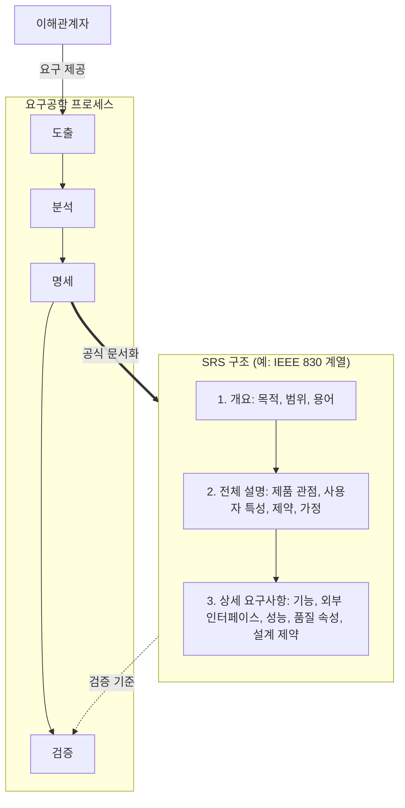

# 요구사항 명세서 (SRS: Software Requirements Specification)

---

## I. 개발의 기준선, 요구사항 명세서의 개요

### 가. 정의

- SW가 갖춰야 할 **기능·비기능 요구사항과 제약사항을 명확하고 검증 가능하게 기술한 공식 문서**로, 발주자와 개발자 합의의 근거 (ISO/IEC/IEEE 29148)

### 나. 필요성

| 구분 | 내용 |
| --- | --- |
| 합의 기준 | 고객·개발자·테스터 간 공통 이해 |
| 기준선 | 일정·원가 산정과 변경 통제의 기준 |
| 검증 기준 | 설계 검토, [[인수 테스트]]의 판단 척도 |
| 추적성 | 요구사항 ~ 설계·구현·테스트 연결 |

---

## II. 작성 흐름과 구성요소

### 가. 개념도

- 도출·분석 결과를 표준 구조로 명세하고, 검증을 거쳐 기준선으로 설정한 뒤 변경 통제

### 나. 구성요소

| 구분 | 요소 | 설명 |
| --- | --- | --- |
| 표준 | ISO/IEC/IEEE 29148 | 요구공학 프로세스·산출물 표준 (2011 제정, 2018 개정), IEEE 830 대체 |
| 내용 | 기능 요구사항 | 입력·처리·출력 등 시스템이 수행할 기능 |
| | 비기능 요구사항 | 성능, [[HA(High Availability)\|가용성]], 보안, 유지보수성 등 품질 속성 |
| | 제약사항·인터페이스 | 기술·법규 제약, 외부 시스템·사용자 인터페이스 |
| 품질 특성 | 정확성·명확성 | 요구를 올바르게, 한 가지 의미로만 해석되게 기술 |
| | 완전성·일관성 | 누락 없음, 요구 간 충돌 없음 |
| | 검증 가능성 | 테스트·측정으로 충족 여부 판정 가능 |
| | 추적성·수정 용이성 | 출처·하위 산출물 연결, 변경 반영 용이 |
| | 순위 | 중요도·안정성에 따른 우선순위 표시 |
| 관리 | RTM | 요구사항과 설계서·코드·테스트 케이스 매핑 |

---

## III. 비교 및 동향

### 가. 전통적 SRS vs 애자일 요구사항

| 비교 항목 | 전통적 SRS | 애자일 ([[Agile]]) |
| --- | --- | --- |
| 형태 | 공식 문서 | 제품 백로그, 사용자 스토리, 인수 조건 |
| 작성 시점 | 초기에 확정 | 반복마다 지속 정제 |
| 상세 수준 | 사전 상세 정의 | 필요 시점에 상세화 (Just-in-Time) |
| 변경 | CCB 통제 | 백로그 우선순위로 반영 |
| 적합 사업 | 안전·미션 크리티컬, 대형 공공·금융 | 변화가 잦은 웹·모바일 서비스 |

### 나. 동향

- **LLM 보조 분석**: 모호한 표현·누락·충돌 탐지, 요구사항에서 테스트 케이스 초안 생성 ([[초거대 언어 모델|LLM]])
- **모델 기반 명세**: SysML 등 MBSE와 정형 명세로 안전 필수 시스템 요구사항 정밀화
- **실행 가능 명세**: BDD(Given-When-Then)로 인수 조건을 자동화 테스트와 연결

---

### 🔗 연관 토픽

- **소속 도메인**: [[00_프로젝트관리_MOC|📋 프로젝트관리]]
- **세부 분류**: `5. 애자일 프로젝트 관리 & 개발 운영 (Agile PM)`
- **핵심 연관 토픽**:
  - [[요구 공학|요구 공학 (Requirements Engineering)]]
  - [[요구사항 수집기법]]
  - [[요구 사항 분석]]
  - [[인수 테스트]]
  - [[범위관리]]
