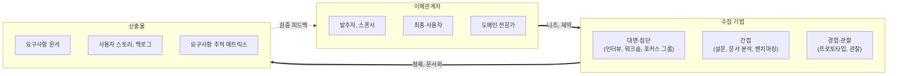

# 요구사항 수집기법 (Requirements Elicitation Techniques)

---

## I. 프로젝트의 출발점, 요구사항 수집기법의 개요

### 가. 정의

- 이해관계자로부터 **비즈니스 니즈·문제·제약사항을 식별·도출**하는 체계적 기법 (PMBOK 6판 요구사항 수집 프로세스의 도구)

### 나. 필요성 및 특징

| 구분 | 내용 |
| --- | --- |
| 재작업 감소 | 불명확한 요구사항은 실패·지연의 주원인, 초기 식별로 후반 변경 비용 감소 |
| 암묵지 도출 | 사용자도 인지하지 못한 요구를 관찰·프로토타입으로 끌어냄 |
| 기법 조합 | 이해관계자 특성·규모·분산 정도에 따라 여러 기법 병행 |
| 완전성 확보 | 기능·비기능·제약사항까지 누락 없이 수집 |

---

## II. 수집 흐름과 주요 기법

### 가. 개념도

- 도출한 요구사항은 요구사항 문서와 추적 매트릭스(RTM)로 관리하고, 피드백으로 반복 정제

### 나. 주요 기법

| 구분 | 요소 | 설명 |
| --- | --- | --- |
| 대면 | 인터뷰 | 1:1 또는 소그룹 질의로 깊이 있는 요구와 숨은 의도 파악 |
| | 포커스 그룹 | 사전 선정한 이해관계자·전문가와 진행자 주도 토론 |
| 집단 창의 | 브레인스토밍 | 비판 없이 아이디어를 자유롭게 발산 |
| | 명목집단기법 | 브레인스토밍 후 투표로 아이디어 우선순위화 |
| 집단 의사결정 | 델파이 | 전문가 대상 익명·반복 설문으로 합의 도출 |
| 촉진 워크숍 | JAD | 사용자·개발자가 합동 워크숍으로 단기간에 요구 확정 |
| | QFD | 고객의 소리(VOC)를 품질 특성으로 전환 (품질의 집) |
| 간접 | 설문조사 | 분산된 다수 응답자에게서 통계 처리 가능한 데이터 수집 |
| | 문서 분석 | 기존 매뉴얼·규정·서식에서 업무 규칙과 제약 도출 |
| 경험·관찰 | 프로토타입 | 화면·모형으로 피드백을 받아 요구 구체화 |
| | 관찰 (Job Shadowing) | 실제 업무를 관찰해 말로 표현하기 어려운 요구 도출 |

---

## III. 비교 및 동향

### 가. 전통적 vs 애자일 수집

| 비교 항목 | 전통적 (폭포수) | 애자일 ([[Agile]]) |
| --- | --- | --- |
| 수집 시점 | 초기 집중 (Up-front) | 전 주기 지속 |
| 주도 | 요구사항 분석가 | 제품 책임자(PO)와 [[SCRUM\|스크럼]] 팀 |
| 주요 기법 | 인터뷰, JAD, 문서 분석 | 사용자 스토리 매핑, [[페르소나]], 백로그 정제 |
| 산출물 | 요구사항 정의서, [[요구사항 명세서\|SRS]] | 에픽, 사용자 스토리 |

### 나. 동향

- **LLM 활용**: 인터뷰 녹취에서 요구사항 후보·유스케이스 초안 추출 ([[초거대 언어 모델|LLM]], [[프롬프트 엔지니어링]])
- **데이터 기반 도출**: 사용 로그, A/B 테스트, 프로세스 마이닝 결과로 행동 기반 요구 식별
- **디자인 씽킹 결합**: 공감·관찰 중심의 [[디자인 씽킹]] 기법을 요구 도출 초기에 적용

---

### 🔗 연관 토픽

- **소속 도메인**: [[00_프로젝트관리_MOC|📋 프로젝트관리]]
- **세부 분류**: `1. PMBOK 표준 & 프로젝트 거버넌스`
- **핵심 연관 토픽**:
  - [[요구 공학]]
  - [[요구사항 명세서|요구사항 명세서 SRS]]
  - [[범위관리]]
  - [[페르소나]]
  - [[SCRUM|스크럼 (SCRUM)]]
