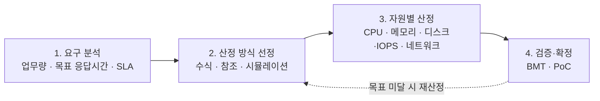

# 용량산정 (Capacity Sizing)

---

## I. 필요한 만큼의 자원, 용량산정의 개요

### 가. 정의

- 목표 성능([[SLA]])과 업무량 증가를 고려해 **CPU·메모리·디스크·네트워크 등 시스템 자원 규모를 수치로 산출하는 과정** (참고: TTA 정보시스템 하드웨어 규모산정 지침)

### 나. 특징

| 구분 | 내용 |
| --- | --- |
| 자원 최적화 | 과다 산정(비용 낭비)과 과소 산정(성능 장애) 방지 |
| 미래 반영 | 피크 부하, 연간 증가율, 여유율 반영 |
| 검증 필요 | 산정값을 BMT·성능 테스트로 확인 |
| 클라우드 | 1회 산정보다 운영 중 Right-sizing 반복 |

---

## II. 산정 절차 및 구성요소

### 가. 산정 절차

- 업무량을 트랜잭션 수로 환산해 자원별 요구량을 구하고, 보정 계수와 여유율을 곱해 최종 규모를 확정

### 나. 구성요소

| 구분 | 요소 | 설명 |
| --- | --- | --- |
| 산정 방식 | 수식 계산법 | 트랜잭션 수·처리 시간 등 수치에 공식을 적용 |
| | 참조법 | 유사 업무·규모의 기존 시스템 사용량 참조 |
| | 시뮬레이션법 | 부하 도구(JMeter, LoadRunner)로 워크로드 재현 후 측정 |
| 성능 지표 | tpmC | TPC-C 기준 분당 트랜잭션 처리량 (OLTP 서버 CPU 산정) |
| | IOPS·처리량 | 스토리지 초당 I/O 횟수, MB/s |
| 보정 계수 | 피크 타임 계수 | 평균 대비 최대 부하 배수 |
| | 동시 사용자 비율 | 전체 사용자 중 동시 접속 비율 |
| | 시스템 여유율 | 예기치 못한 부하·증가에 대비한 여유 |
| 클라우드 | Right-sizing | 사용률 분석으로 인스턴스 타입·크기 조정 |

---

## III. 비교 및 동향

### 가. 온프레미스 vs 클라우드 용량산정

| 비교 항목 | 온프레미스 | 클라우드 |
| --- | --- | --- |
| 시점 | 도입 시 일괄 | 운영 중 지속 |
| 기준 | 향후 3~5년 최대치 | 현재 적정치 + 자동 확장 |
| 확장 | 장비 추가 (Scale-Up 중심) | 인스턴스·[[컨테이너]] 증설 (Scale-Out) |
| 고려사항 | 상면·전력·장비 수명 | 사용량 요금, 데이터 전송 비용 |

### 나. 동향

- **FinOps**: 미사용·저사용 자원을 지속 회수하고 예약·스팟 인스턴스로 비용 최적화
- **예측형 오토스케일링**: 시계열 학습으로 부하 발생 전 선제 증설 (AWS Predictive Scaling 등)
- **AI 인프라 산정**: GPU 메모리·토큰 처리량 기준의 추론 서버 규모 산정 수요 증가

---

### 🔗 연관 토픽

- **소속 도메인**: [[00_데이터베이스_MOC|🗄️ 데이터베이스]]
- **세부 분류**: `3. 장애 회복 기법 & 데이터 무결성`
- **핵심 연관 토픽**:
  - [[성능 테스트]]
  - [[응답시간]]
  - [[SLA]]
  - [[DB 성능 개선 방안]]
  - [[클라우드 네이티브]]
