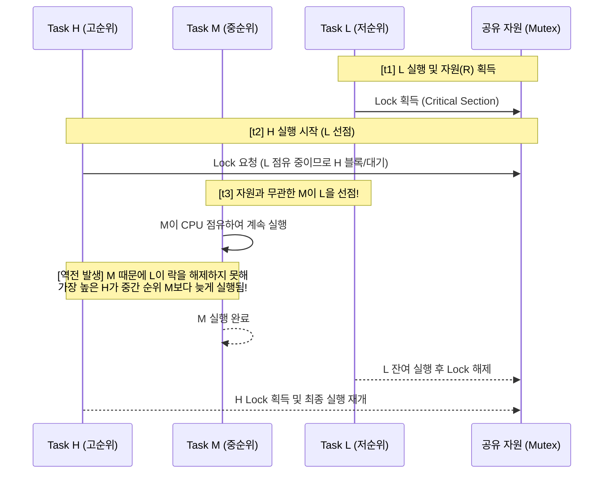

# 우선순위 역전현상 (Priority Inversion)

---

## I. 실시간 시스템의 데드라인 위협 요인, 우선순위 역전의 개요

### 가. 정의

- 다중 프로그래밍 환경에서 **낮은 우선순위 태스크가 점유한 공유 자원을 높은 우선순위 태스크가 대기하는 동안, 자원과 무관한 중간 우선순위 태스크가 CPU를 선점하여 고순위 태스크가 무한정 지연되는 스케줄링 이상 현상**

### 나. 특징 및 필요성

| 구분 | 내용 |
| --- | --- |
| 발생 조건 | 선점형(Preemptive) 스케줄링과 공유 자원 보호를 위한 상호배제(Mutex Lock)가 결합될 때 발생 |
| 데드라인 위반 | 하드 리얼타임(Hard Real-Time) 시스템에서 응답 시간 예측성(Predictability)을 무너뜨려 치명적 고장 유발 |
| 대표 사례 | 1997년 화성 패스파인더(Mars Pathfinder) 탐사선의 잦은 시스템 리셋 장애가 대표적 |
| 기능안전 필수 | 자율주행([[ISO 26262]]), 항공 제어(DO-178C) 등 미션 크리티컬 시스템 인증에서 회피 설계 필수 요구 |

---

## II. 개념도 및 핵심 구성요소

### 가. 발생 메커니즘 개념도

- L이 자원을 잡은 상태에서 M이 L을 선점하면 L의 자원 반환이 지연되고, 결과적으로 H가 M의 완료를 기다리게 되는 모순적인 우선순위 역전이 지속

### 나. 핵심 해결 기법 및 관련 기술

| 구분 | 기법 | 설명 |
| --- | --- | --- |
| 해결 프로토콜 | 우선순위 상속 (PIP) | 고순위 태스크(H)가 자원을 대기할 때, 해당 자원을 점유한 저순위 태스크(L)의 우선순위를 일시적으로 H 수준으로 상승시켜 M의 선점을 차단 |
| | 우선순위 올림 (PCP) | 공유 자원마다 접근 가능한 최고 태스크 순위(Ceiling)를 지정하고, 자원 획득 즉시 태스크 순위를 천장치로 상향하여 교착상태 예방 |
| 범용 OS 메커니즘 | Random Boosting | 윈도우 등 범용 OS에서 장시간 CPU를 받지 못한 스레드의 우선순위를 일시 승격하여 기아(Starvation) 해소 |
| 멀티코어 확장 | MPCP / MSRP | 다중 코어 프로세서 환경에서 스핀락과 인터럽트 차단을 결합하여 코어 간 우선순위 역전 방지 |
| 검증 도구 | WCET 분석 | 최악 실행 시간(Worst-Case Execution Time) 분석을 통해 역전 현상 발생 시에도 마감시간 충족 여부 사전 검증 |

---

## III. 해결 기법 비교 및 동향

### 가. 우선순위 상속(PIP) vs 우선순위 올림(PCP)

| 비교 항목 | 우선순위 상속 (Priority Inheritance, PIP) | 우선순위 올림 (Priority Ceiling, PCP) |
| --- | --- | --- |
| 순위 상승 시점 | 고순위 태스크가 자원을 **요청하여 블록되는 시점** | 저순위 태스크가 공유 자원을 **획득하는 즉시** |
| 상승되는 순위 | 자원을 요청한 고순위 태스크(H)의 우선순위 | 공유 자원에 사전 정의된 **우선순위 상한치(Ceiling)** |
| 교착상태(Deadlock) | 연쇄 대기 발생 시 **교착상태 예방 불가** | 연쇄 락 획득을 차단하여 **교착상태 원천 예방 가능** |
| 블록 횟수 | 최대 $N$개 태스크에 의해 다중 블록 가능 | 임계영역 진입 시 **최대 1회만 블록** 보장 |
| 구현 복잡도 | 비교적 단순 (동적 추적 오버헤드 존재) | 정적 시스템 분석 필요, 구현 복잡도 높음 |
| 지원 환경 | Linux (FUTEX_PI), 일반 RTOS | POSIX (PTHREAD_PRIO_PROTECT), VxWorks |

### 나. 동향

- **차량용 멀티코어 소프트웨어 플랫폼(AUTOSAR) 표준화**: 전장 시스템이 멀티코어 SoC로 전환됨에 따라 코어 간 공유 자원 동기화를 위한 Multiprocessor SRP(Stack Rip Protocol) 및 MPCP 적용 의무화
- **무잠금(Lock-Free) 아키텍처 전환**: 임계영역 락으로 인한 우선순위 역전 및 교착상태 위험을 원천 차단하기 위해 원자적 연산(CAS) 기반 Lock-Free 링 버퍼 및 큐 활용 확산
- **RTOS와 Linux PREEMPT_RT 패치 통합**: 리눅스 커널에 실시간성을 부여하는 PREEMPT_RT 프로젝트가 메인라인에 통합되며 고성능 임베디드 기기에서 커널 수준 우선순위 상속 지원 보편화

---

### 🔗 연관 토픽

- **소속 도메인**: [[00_컴퓨터구조_MOC|💻 컴퓨터구조]]
- **세부 분류**: `5. 핵심 알고리즘 & 계산 복잡도 (Algorithms)`
- **핵심 연관 토픽**:
  - [[교착상태]]
  - [[스핀락]]
  - [[ISO 26262]]
  - [[기아]]
  - [[스케줄링]]
