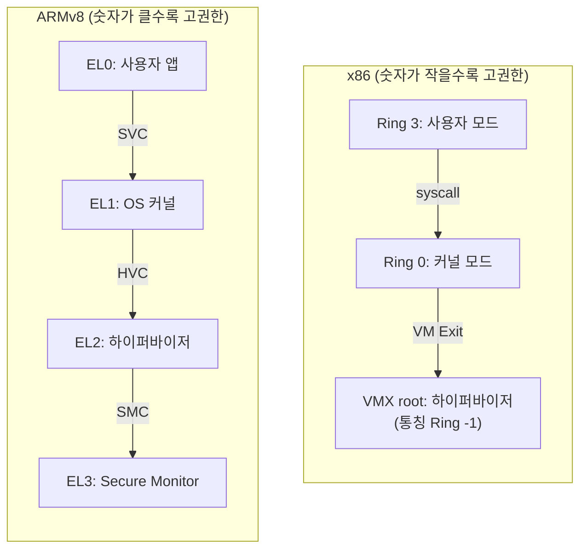

# 운영체제 특권레벨 (OS Privilege Levels)

---

## I. 하드웨어가 나누는 실행 권한, 특권레벨의 개요

### 가. 정의

- 응용 프로그램이 하드웨어 자원과 커널 영역에 함부로 접근하지 못하도록 **[[CPU]]가 명령 실행 권한을 여러 단계로 나누어 강제하는 보호 메커니즘** (x86 Ring, ARM Exception Level)

### 나. 특징

| 구분 | 내용 |
| --- | --- |
| 보호 | 특권 명령(I/O, 인터럽트 제어, 페이지 테이블 변경)은 상위 레벨에서만 실행 |
| 격리 | 사용자 프로그램 오류가 [[커널]]과 다른 [[프로세스]]로 번지지 않음 |
| 제어된 진입 | 하위 레벨은 시스템 콜·예외·인터럽트로만 상위 레벨에 진입 |
| 확장 | 하드웨어 [[가상화]]·보안을 위해 하이퍼바이저·보안 모니터 계층 추가 |

---

## II. 계층 구조 및 구성요소

### 가. x86 Ring과 ARM EL 구조

- 사용자 모드에서 특권 기능이 필요하면 시스템 콜로 커널 모드에 진입(모드 전환)하고 처리 후 복귀

### 나. 구성요소

| 구분 | 요소 | 설명 |
| --- | --- | --- |
| x86 | Ring 0 | 커널, 모든 명령 실행 가능 |
| | Ring 1·2 | 원래 드라이버용이나 현대 OS는 거의 사용 안 함 |
| | Ring 3 | 사용자 애플리케이션 |
| | VMX root (Ring -1) | Intel VT-x·AMD-V 하이퍼바이저 모드 |
| | SMM (Ring -2) | 펌웨어의 시스템 관리 모드, SMI로 진입 |
| ARMv8 | EL0~EL3 | 사용자 앱, OS, 하이퍼바이저, TrustZone 보안 모니터 |
| 진입 수단 | 시스템 콜 (syscall, SVC) | 사용자 → 커널 |
| | [[인터럽트]]·예외 | 하드웨어 이벤트, 페이지 폴트 등으로 상위 레벨 진입 |
| 상태 표시 | CPL (x86 CS 레지스터 하위 2비트) | 현재 실행 중인 특권레벨 |

---

## III. 비교 및 동향

### 가. 사용자 모드 vs 커널 모드

| 비교 항목 | 사용자 모드 | 커널 모드 |
| --- | --- | --- |
| 레벨 | Ring 3 / EL0 | Ring 0 / EL1 |
| 접근 범위 | 자기 프로세스 메모리만 | 전체 메모리, 하드웨어, 인터럽트 |
| 오류 영향 | 해당 프로세스만 종료 | 시스템 전체 장애 (Kernel Panic, BSOD) |
| 자원 요청 | 시스템 콜 경유 | 하드웨어 직접 제어 |
| 실행 예 | 브라우저, 워드프로세서 | 커널, 메모리 관리자, 디바이스 드라이버 |

### 나. 동향

- **[[기밀컴퓨팅|기밀 컴퓨팅]]**: Intel TDX, AMD SEV-SNP, ARM CCA가 하이퍼바이저조차 VM 메모리를 볼 수 없게 하드웨어로 격리
- **마이크로VM**: AWS Firecracker 등 KVM 기반 경량 VM으로 서버리스·[[컨테이너]] 워크로드를 하이퍼바이저 수준에서 격리
- **[[부채널 공격]] 대응**: Meltdown 이후 KPTI로 사용자 모드에서 커널 페이지 매핑을 분리, CPU 하드웨어 수정과 병행

---

### 🔗 연관 토픽

- **소속 도메인**: [[00_운영체제_MOC|⚙️ 운영체제]]
- **세부 분류**: `1. 프로세스 & 스레드 관리`
- **핵심 연관 토픽**:
  - [[CPU Ring Level]]
  - [[커널|커널(Kernel)]]
  - [[인터럽트|인터럽트 (Interrupt)]]
  - [[가상화]]
  - [[기밀컴퓨팅]]
