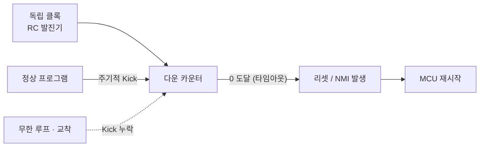

# 워치독 타이머 (Watchdog Timer)

---

## I. 멈춘 시스템을 스스로 되살리는, 워치독 타이머의 개요

### 가. 정의

- 소프트웨어가 **정해진 시간 안에 타이머를 주기적으로 초기화(Kick)하지 않으면 시스템이 멈춘 것으로 보고 리셋·인터럽트를 발생**시키는 하드웨어 감시 타이머

### 나. 특징

| 구분 | 내용 |
| --- | --- |
| 자동 복구 | 사람이 없는 원격·무인 장비의 행(Hang) 상태를 자동 리셋 |
| 독립 동작 | 별도 클록으로 동작해 메인 클록 이상에도 감시 지속 |
| 단순 구조 | 다운 카운터 + 리셋 로직 |
| 한계 | 소프트웨어가 엉뚱한 루프에서 Kick하면 오작동을 감지 못함 (윈도우 WDT로 보완) |

---

## II. 동작 및 구성요소

### 가. 동작 원리

- 정상이면 타임아웃 전에 Kick으로 카운터가 초기값으로 돌아가고, 멈추면 카운터가 0이 되어 리셋

### 나. 구성요소

| 구분 | 요소 | 설명 |
| --- | --- | --- |
| 하드웨어 | 독립 클록 | 메인 클록과 분리된 발진기 |
| | 카운터·프리스케일러 | 타임아웃 주기 설정 (정상 Kick 주기보다 여유 있게) |
| 동작 | Kick (Feed) | 특정 레지스터에 지정 값을 써서 카운터 재설정 |
| | 타임아웃 동작 | 시스템 리셋 또는 NMI(마스크 불가 [[인터럽트]]) |
| 유형 | 내장 WDT | MCU 내부 주변장치 |
| | 외부 WDT IC | 별도 칩으로 MCU 자체·전원 이상까지 감시 |
| | 소프트웨어 WDT | OS [[커널]]·데몬이 태스크별 응답 감시 (예: Linux watchdog) |
| 고도화 | 다단계 WDT | 1차 타임아웃에 로그 저장 인터럽트, 2차에 리셋 |
| | 윈도우 WDT (WWDT) | 정해진 시간 창 안의 Kick만 인정, 너무 이른 Kick도 오류 처리 |

---

## III. 비교 및 동향

### 가. 표준 WDT vs 윈도우 WDT

| 비교 항목 | 표준 WDT | 윈도우 WDT |
| --- | --- | --- |
| Kick 허용 | 타임아웃 전 언제든 | 지정된 창 안에서만 |
| 감지 범위 | 멈춤·지연 | 멈춤·지연 + 너무 빠른 실행(폭주 루프, 클록 이상) |
| 적용 | 일반 임베디드, 가전, 네트워크 장비 | 차량 전장, 의료기기 등 고신뢰 시스템 |

### 나. 동향

- **차량 기능 안전**: [[ISO 26262]] ASIL 요구를 충족하기 위해 전압 감시 기능을 통합한 윈도우 WDT·Q&A 방식 WDT가 ECU에 널리 적용
- **엣지·IIoT 자가 복구**: 원격 [[게이트웨이]]·산업용 [[EDGE|Edge]] 기기의 무인 운영을 위한 1차 복구 수단
- **우주·국방**: 방사선에 의한 비트 반전(SEU)으로 인한 멈춤에 대비해 다중 감시·안전 상태 전환과 결합

---

### 🔗 연관 토픽

- **소속 도메인**: [[00_컴퓨터구조_MOC|💻 컴퓨터구조]]
- **세부 분류**: `3. 고성능 AI 가속기 & 입출력 시스템`
- **핵심 연관 토픽**:
  - [[인터럽트|인터럽트 (Interrupt)]]
  - [[결함허용 컴퓨터|결함허용 컴퓨터(FTS)]]
  - [[ISO 26262]]
  - [[I2C(Inter Integrated Circuit)와 SPI(Serial Peripheral Interface)]]
  - [[HA(High Availability)]]
