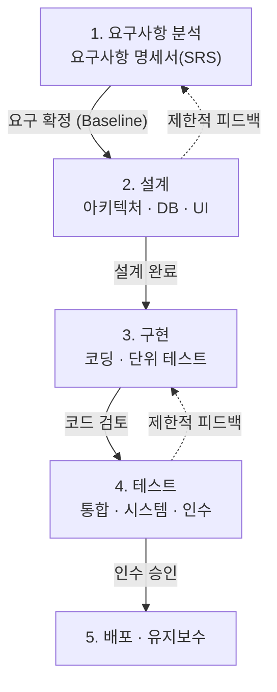

# 워터폴 (Waterfall, 폭포수 모델)

---

## I. 순차적 개발의 표준, 워터폴 모델의 개요

### 가. 정의

- 요구사항 분석 → 설계 → 구현 → 테스트 → 유지보수가 **폭포처럼 한 방향으로, 이전 단계가 끝나야 다음 단계로 진행**되는 선형 [[SDLC]] 모델 (1970년 윈스턴 로이스)

### 나. 특징

| 구분 | 내용 |
| --- | --- |
| 단계 게이트 | 각 단계 완료 승인(Sign-off) 후 다음 단계 진입 |
| 문서 중심 | 단계별 산출물이 다음 단계의 입력 |
| 높은 가시성 | 진척과 통제가 쉬움 |
| 경직성 | 초기 요구 확정이 전제, 도중 변경 수용이 어려움 |
| 비용 곡선 | 후반에 발견된 결함일수록 수정 비용이 급증 |

---

## II. 생명주기 및 단계별 산출물

### 가. 생명주기

### 나. 단계별 산출물 및 관리 요소

| 단계 | 산출물 | 설명 |
| --- | --- | --- |
| 요구사항 분석 | [[요구사항 명세서\|SRS]], 요구사항 추적표 | 기능·비기능 요구를 명세하고 변경 통제 기준 수립 |
| 설계 | 아키텍처 정의서, ERD | 구조·[[데이터베이스]]·인터페이스 설계 |
| 구현 | 소스코드 | 설계서 기반 개발 |
| 테스트 | 테스트 케이스, 결함 보고서 | V-Model 기반 단위~인수 테스트 ([[소프트웨어 테스트]]) |
| 배포·유지보수 | 릴리즈 노트, 운영 매뉴얼 | 운영 이관, 결함 수정, 기능 개선 ([[유지보수]]) |
| 공통 관리 | [[형상 관리]], QA 리뷰, [[WBS]] | 베이스라인·변경 통제, 단계별 진입·종료 기준 검증, 일정 관리 |

---

## III. 애자일과의 비교 및 동향

### 가. 워터폴 vs 애자일

| 비교 항목 | 워터폴 | [[Agile]] |
| --- | --- | --- |
| 철학 | 계획 주도 (Plan-driven) | 가치 주도 (Value-driven) |
| 진행 | 순차적·선형 | 반복적·점진적 (스프린트) |
| 변경 대응 | 낮음 | 높음 |
| 핵심 산출물 | 상세 문서 | 동작하는 소프트웨어 |
| 고객 참여 | 초기·인수 단계 | 전 기간 지속 |
| 팀 구조 | 직무별 분리 | 교차 기능 통합 팀 |
| 적합 사업 | 요구가 명확한 대규모·공공·규제 산업 | 불확실성이 크고 빠른 출시가 필요한 서비스 |

### 나. 동향

- **규제 산업에서 유지**: 의료기기·항공·원자력·금융 원장 등 검증과 문서화가 규제 요건인 분야에서는 여전히 핵심
- **하이브리드**: 초기 아키텍처·예산은 워터폴, 구현은 반복 개발로 진행하는 Water-Scrum-Fall
- **[[테일러링]]**: 사업 규모·위험·규제에 맞게 표준 프로세스를 조정
- 한계를 보완한 모델로 [[Spiral 모델]], [[반복적 개발 모델]], [[증분형 개발 모델]] 등이 등장

---

### 🔗 연관 토픽

- **소속 도메인**: [[00_소프트웨어공학_MOC|🏗️ 소프트웨어공학]]
- **세부 분류**: `1. 소프트웨어 개발 생명주기(SDLC) & 방법론`
- **핵심 연관 토픽**:
  - [[SDLC]]
  - [[Agile]]
  - [[Spiral 모델]]
  - [[테일러링|테일러링 (Tailoring)]]
  - [[소프트웨어 개발 방법론]]
