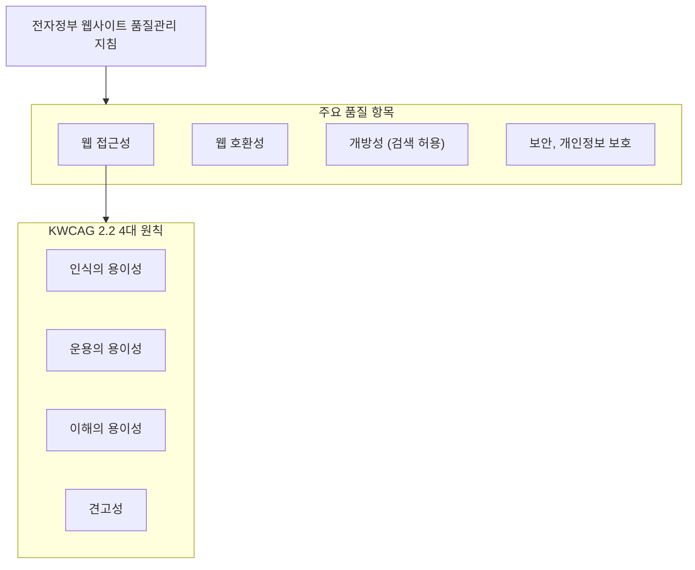

# 웹 접근성(WA) 및 전자정부 웹사이트 품질관리 지침

---

## I. 누구나 동등하게 쓰는 공공 웹, 웹 접근성과 품질관리 지침의 개요

### 가. 정의

- **웹 접근성**: 장애인·고령자 등 누구나 신체적·기술적 여건과 관계없이 웹 정보를 **동등하게 이용**할 수 있도록 보장하는 것 (국가표준 KWCAG, 품질인증 마크 'WA')
- **전자정부 웹사이트 품질관리 지침**: 행정기관 웹사이트의 접근성·호환성·개방성 등 **구축·운영 품질 기준**을 정한 행정안전부 고시

### 나. 법적 근거 및 필요성

| 구분 | 내용 |
| --- | --- |
| 법적 의무 | 지능정보화 기본법(웹 접근성 보장), 장애인차별금지법(정보 접근 차별 금지) |
| 정보 격차 해소 | 고령화, 디지털 취약계층 증가 |
| 이용 환경 다양화 | 다양한 브라우저·모바일 기기에서 동일 서비스 제공 필요 |
| 공공성 | 공공 정보의 검색·재이용 보장 |

---

## II. 구조와 핵심 요소

### 가. 개념도

- 웹 접근성은 KWCAG 2.2(KS X OT0003, 2022)의 4원칙·14지침·33검사항목으로 평가. W3C WCAG 2.1을 반영

### 나. 핵심 요소

| 구분 | 요소 | 설명 |
| --- | --- | --- |
| 접근성 (인식) | 적절한 대체 텍스트 | 이미지 의미를 스크린 리더가 읽도록 텍스트 제공 |
| | 자막·원고 제공 | 멀티미디어에 자막, 대본, 수어 제공 |
| 접근성 (운용) | 키보드 사용 보장 | 마우스 없이 모든 기능 조작, 초점 이동·표시 |
| | 응답시간 조절, 깜빡임 제한 | 시간 제한 연장 가능, 광과민성 발작 방지 |
| 접근성 (이해) | 콘텐츠 선형 구조 | CSS를 제거해도 논리적 순서 유지 |
| | 입력 오류 정정 | 오류 원인 안내와 수정 방법 제공 |
| 접근성 (견고성) | 마크업 오류 방지 | 웹 표준 문법 준수로 보조기술 호환 |
| 웹 호환성 | 크로스 브라우징 | 주요 브라우저·OS에서 동일 동작, 비표준 플러그인 배제 |
| 개방성 | robots.txt 허용 | 검색엔진 수집을 막지 않아 공공 정보 검색 보장 |
| 보안 | [[시큐어코딩]] | 웹 취약점 제거, 개인정보 노출 방지 |

---

## III. 비교 및 동향

### 가. 웹 접근성 vs 웹 호환성

| 비교 항목 | 웹 접근성 | 웹 호환성 |
| --- | --- | --- |
| 관점 | 사용자 (장애·연령) | 이용 환경 (브라우저·OS·기기) |
| 기준 | KWCAG 2.2 | W3C 웹 표준, 지침의 호환성 기준 |
| 점검 예 | 대체 텍스트, 키보드 조작 | 주요 브라우저별 화면·기능 동작 |
| 인증 | WA 품질인증 마크 | 별도 인증 없이 지침 준수 점검 |

### 나. 동향

- **WCAG 2.2**: W3C가 2023년 발표, 초점 가림 방지·최소 타깃 크기·인증 접근성 등 기준 추가
- **모바일 앱·키오스크 확대**: 모바일 앱 접근성 지침(KS X 3253), 무인정보단말기 접근성 의무화 단계 적용
- **자동 점검**: CI/CD 파이프라인에 axe-core 등 접근성 자동 검사 도구 통합, AI 기반 대체 텍스트 생성 보조

---

### 🔗 연관 토픽

- **소속 도메인**: [[00_프로젝트관리_MOC|📋 프로젝트관리]]
- **세부 분류**: `1. PMBOK 표준 & 프로젝트 거버넌스`
- **핵심 연관 토픽**:
  - [[사용성 평가]]
  - [[시큐어코딩]]
  - [[공공데이터|공공데이터 (Open Data)]]
  - [[디지털 역기능]]
  - [[전자정부 성과관리 지침]]
