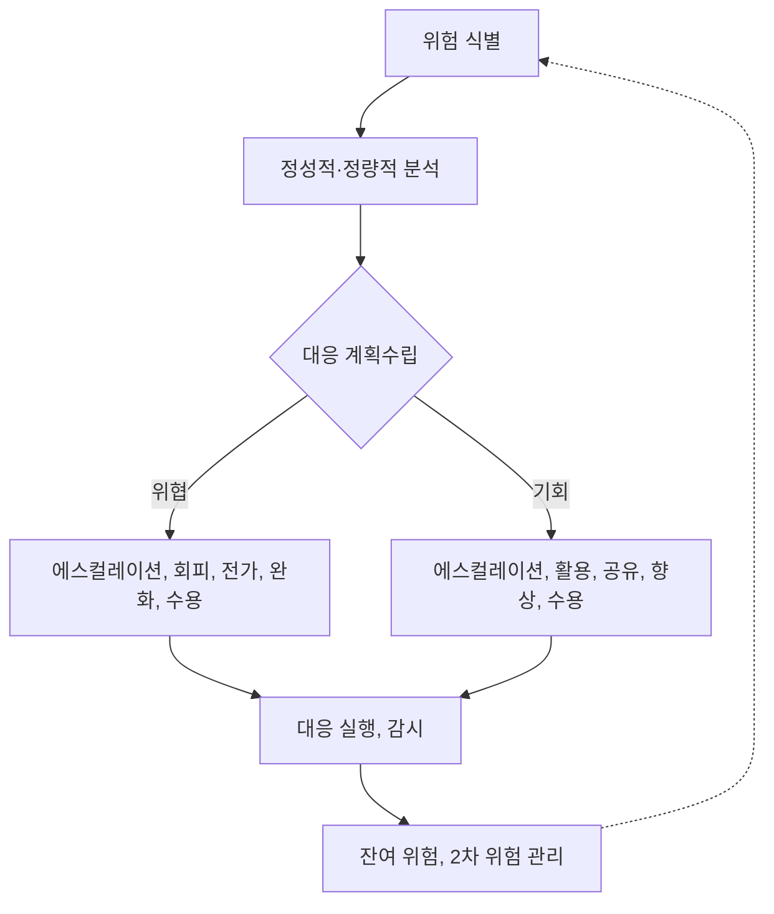

# 위험 대응 (Risk Response)

---

## I. 위협은 줄이고 기회는 키우는, 위험 대응의 개요

### 가. 정의

- 분석된 개별 위험과 프로젝트 전체 위험에 대해 **위협·기회별 대응 전략을 선택·계획·실행**하는 활동 (PMBOK 6판 11.5 위험 대응 계획수립, 11.6 위험 대응 실행)

### 나. 필요성 및 특징

| 구분 | 내용 |
| --- | --- |
| 노출도 관리 | 위험 노출도를 위험 허용 한계(Threshold) 이내로 통제 |
| 책임 지정 | 위험마다 위험 담당자(Risk Owner) 지정 |
| 비용 대비 효과 | 대응 비용이 위험 영향보다 작아야 함 |
| 후속 위험 관리 | 대응 후 잔여 위험·2차 위험을 위험 관리대장에 반영 |

---

## II. 대응 흐름과 전략

### 가. 개념도

- 위험 성격에 맞는 전략을 고르고, 실행 후 잔여 위험은 비상 계획·대체 계획(Fallback)으로, 미식별 사건은 우회책(Workaround)으로 대응

### 나. 대응 전략

| 구분 | 요소 | 설명 |
| --- | --- | --- |
| 위협 | 회피 (Avoid) | 계획 변경·범위 축소로 위협을 제거하거나 영향에서 격리 |
| | 전가 (Transfer) | 영향과 대응 책임을 제3자에게 이전 (보험, 보증, 고정가 계약) |
| | 완화 (Mitigate) | 발생 확률·영향을 줄임 (추가 테스트, 프로토타입, 이중화) |
| 기회 | 활용 (Exploit) | 기회가 확실히 실현되도록 함 (우수 인력 배정) |
| | 공유 (Share) | 기회를 잘 살릴 제3자와 소유권 분담 (합작, 파트너십) |
| | 향상 (Enhance) | 기회의 확률·영향을 높임 |
| 공통 | 수용 (Accept) | 능동적(우발사태 예비비 확보) 또는 수동적(정기 검토만) 수용 |
| | 에스컬레이션 (Escalate) | PM 권한·범위를 벗어난 위험을 프로그램·포트폴리오·조직 수준으로 이관 |
| 대응 계획 | 비상 계획 (Contingency) | 특정 촉발 조건(Trigger) 발생 시 실행 |
| | 대체 계획 (Fallback) | 비상 계획이 효과 없을 때 실행 |

---

## III. 비교 및 동향

### 가. 잔여 위험 vs 2차 위험

| 비교 항목 | 잔여 위험 (Residual) | 2차 위험 (Secondary) |
| --- | --- | --- |
| 발생 원인 | 대응 후에도 남아 있는 위험 | 대응 실행으로 새로 생긴 위험 |
| 관리 기준 | 허용 한계 충족 여부 | 신규 위험으로 식별·분석 |
| 대응 | 주로 수용, 예비비 확보 | 별도 대응 전략 수립 |
| 기록 | 위험 관리대장 갱신 | 위험 관리대장에 신규 등록 |

### 나. 동향

- **지속적 위험 대응**: 애자일 반복마다 위험 재평가, [[DevSecOps]]에서 보안 위험 자동 탐지·대응
- **조직 수준 연계**: 프로젝트 위험을 [[IT 거버넌스]]·전사 위험관리(ERM)와 연계해 에스컬레이션

---

### 🔗 연관 토픽

- **소속 도메인**: [[00_프로젝트관리_MOC|📋 프로젝트관리]]
- **세부 분류**: `4. 품질 보증 · 위험 관리 & 정보시스템 감리`
- **핵심 연관 토픽**:
  - [[프로젝트 위험관리]]
  - [[정량적 위험 분석]]
  - [[정성적 위험 분석]]
  - [[BCP|BCP (Business Continuity Planning)]]
  - [[IT 거버넌스]]
